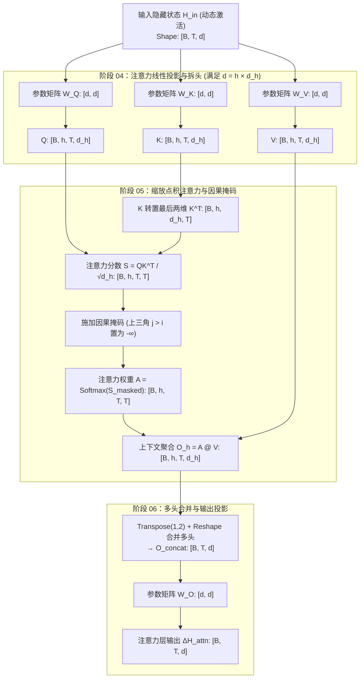

# 第零篇｜大模型推理全流程：从文本到下一个 Token

大语言模型在计算机内部究竟是什么？我们输入的一句文本，又是怎样穿过一层层参数矩阵、最终变成下一个输出词的？

作为本系列的总览篇，我们基于 **Rust 工具链**，以开源模型 `SmolLM2-135M-Instruct`（标准 Llama 架构，1.35 亿参数、272 个权重张量、体积 269 MB）为基准标本，完整追踪一次前向推理的 **11 个计算阶段**；并在文末对标工业界前沿模型 `DeepSeek-V4.1-Flash-1017` 与机械可解释性理论。

- **前置准备**：若你对矩阵维度消去律或 Rust 语法尚不熟悉，建议先阅读 [《前置篇｜线性代数与 Rust 极简入门》](../ep-pre-math-and-rust/draft.md)。
- **配套仓库**：[https://github.com/wittkung/llm](https://github.com/wittkung/llm)

---

## 一、 为什么用 Rust 追踪大模型？

仅需五行 Python 代码即可调用开源模型完成对话，但高度封装的接口也掩盖了底层的张量变形与内存流转。

而在工业界生产环境中，大模型基础设施的核心组件早已转向 Rust：

- **终端与编辑器工具**：OpenAI 官方 CLI `Codex`、AI 编辑器 `Zed`，以及 `Claude Code` 与 `Cursor` 的底层代码检索引擎均由 Rust 编写。
- **Python 生态底层内核**：日常调用的 `tokenizers` 分词器、`safetensors` 权重加载器、`Pydantic` 校验核心与 `uv` 包管理器，底层全部是 Rust 实现。

### 1. 零 GC 开销与编译期内存安全

大模型推理涉及高频分词、几十 GB 权重的零拷贝内存映射（`mmap`）以及高并发流式调度。

Python 受限于解释器开销与全局解释器锁（GIL）；C/C++ 则容易引入内存越界与多线程数据竞争。Rust 通过编译期**所有权**（Ownership）与**借用检查**（Borrow Checker），在不依赖垃圾回收（GC）的前提下，从编译阶段消除了内存与并发安全隐患。

### 2. 基于 LLVM 的原生跨平台编译

Rust 无需像 Python 或 Java 那样在目标机器上配置庞大的解释器或虚拟环境，其跨平台能力建立在三层编译器机制之上：

- **LLVM 中间表示**（LLVM IR）：编译器前端 `rustc` 先将源码转化为硬件无关的 LLVM IR，再由 LLVM 后端直接针对 Apple Silicon（`aarch64`）、x86_64 或 WebAssembly（`wasm32`）生成原生机器码。
- **编译期条件编译**（`#[cfg(...)]`）：可在编译阶段按操作系统自动挂载硬件加速库（如 macOS 自动链接 `Accelerate` 矩阵框架，Linux/Windows 自动切换通用 CPU 或 CUDA 算子）。
- **静态链接单文件分发**：所有依赖默认静态编译为单一原生可执行文件，彻底告别动态库缺失与环境冲突。

---

## 二、 环境准备与模型文件拆解

本实验无需安装 Python 或 Conda，仅需配置 Rust 工具链并下载三个模型文件。

### 1. 安装 Rust 工具链

**macOS / Linux / WSL 终端：**

```bash
curl --proto '=https' --tlsv1.2 -sSf https://sh.rustup.rs | sh
source "$HOME/.cargo/env"
cargo --version
```

- 第 1 行拉取官方安装脚本，出现提示时按回车（Enter）选择默认安装；
- 第 2 行刷新当前终端的环境变量路径；
- 第 3 行验证构建系统与包管理器 `cargo` 是否就绪。

**Windows PowerShell：**

```powershell
winget install Rustlang.Rustup
```

若系统未安装 Visual Studio C++ 链接器，安装器会自动提示 `1) Quick install via the Visual Studio Community installer`，直接按回车自动配置即可。完成后重开 PowerShell 窗口运行 `cargo --version`。

### 2. 三个核心模型文件

Hugging Face（[huggingface.co](https://huggingface.co)）是开源模型权重的标准托管平台。在 `HuggingFaceTB/SmolLM2-135M-Instruct` 仓库中，驱动推理只需下载三个核心文件：`config.json`、`tokenizer.json` 与 `model.safetensors`。

#### （1）config.json：架构超参数

`config.json` 以纯文本记录了决定网络拓扑与张量形状的全部**架构超参数**（Architectural Hyperparameters）：

```json
{
  "architectures": ["LlamaForCausalLM"],
  "model_type": "llama",
  "vocab_size": 49152,
  "hidden_size": 576,
  "num_hidden_layers": 30,
  "num_attention_heads": 9,
  "num_key_value_heads": 3,
  "intermediate_size": 1536,
  "hidden_act": "silu",
  "max_position_embeddings": 8192,
  "rope_theta": 100000,
  "rms_norm_eps": 1e-05,
  "tie_word_embeddings": true,
  "bos_token_id": 1,
  "eos_token_id": 2,
  "torch_dtype": "bfloat16"
}
```

各字段对应的数学符号与所作用的推理阶段如下表所示（阅读后文各阶段时可随时回查）：

| JSON 字段 | 符号与数值 | 作用阶段 | 核心含义 |
|---|---|---|---|
| `vocab_size` | $V = 49,152$ | 阶段 01, 02, 09 | 词表词元总数（Token ID 范围 `0..49151`） |
| `hidden_size` | $d = 576$ | 全流程主干 | 隐藏状态（残差流）的特征向量维度 |
| `num_hidden_layers` | $L = 30$ | 阶段 08 | 串联堆叠的 Transformer 层数 |
| `num_attention_heads` | $h_q = 9$ | 阶段 04 — 06 | 查询（Query）注意力头数，单头维度 $d_h = 576 / 9 = 64$ |
| `num_key_value_heads` | $h_{kv} = 3$ | 阶段 04 — 06 | 键值（Key/Value）头数，构成 3:1 分组查询注意力（GQA） |
| `intermediate_size` | $d_{ff} = 1536$ | 阶段 07 | SwiGLU 前馈网络的中间升维宽度 |
| `rope_theta` | $\theta = 100,000$ | 阶段 03 | 旋转位置编码（RoPE）的几何级数基频 |
| `rms_norm_eps` | $\epsilon = 10^{-5}$ | 阶段 07, 08 | RMSNorm 分母防除零平滑常数 |
| `tie_word_embeddings` | `true` | 阶段 02, 09 | 入口词嵌入矩阵与出口 LM Head 共享同一张权重表 |
| `torch_dtype` | `bfloat16` | 磁盘存储 | 权重采用 16 位脑浮点数（每参数占 2 字节） |

围绕 `"hidden_size": 576`，有两个关键设计逻辑：

- **分布式表示**（Distributed Representation）：离散的整数词号无法直接求导或表达语义距离；将每个词映射为 576 维连续实数向量后，神经网络即可通过线性代数运算度量词法、句法与语境特征。
- **硬件寄存器对齐**：576 在注意力层被均分为 $h_q = 9$ 个头，单头维度 $d_h = 576 \div 9 = 64$。现代 CPU SIMD 与 GPU Tensor Core 在维度为 $32, 64, 128$ 等 **$2$ 的整数次幂**时计算吞吐率最高。

#### （2）tokenizer.json：子词分词器与词表

为什么输入文本要先做**子词分词**（Subword Tokenization）？

若按整句编号，人类句子无穷无尽，词表无法穷举；若按单字符切分，不仅单字符缺乏独立语义，还会使序列长度 $T$ 暴涨，导致复杂度为 $O(T^2)$ 的注意力计算崩溃。

字节对编码（BPE）采取了折中路线：统计语料高频片段，将常用整词、词根词缀与基础字符浓缩为一张 $V = 49,152$ 的有限词表：

```json
{
  "model": {
    "type": "BPE",
    "vocab": {
      "<|endoftext|>": 0,
      "<|im_start|>": 1,
      "<|im_end|>": 2,
      "!": 17,
      "Ċ": 198,
      "user": 4093,
      "Hello": 19556,
      "ĠRust": 36828,
      "ectable": 49151
    },
    "merges": ["Ġ t", "Ġ a", "i n", "h e", "Ġ Ġ", "r e"]
  }
}
```

> **词号与向量的分工**：`tokenizer.json` 仅维护 **`字符串 <-> 整数行号（Token ID）`** 的双向字典（体积仅 2.0 MB），并不存储那 576 个浮点数。真正的浮点数向量存储在 `model.safetensors` 的第一张矩阵 `model.embed_tokens.weight`（形状 `[49152, 576]`）中——整数 Token ID 就是去该矩阵抽取值向量的**行下标**。

#### （3）model.safetensors：静态参数张量

`model.safetensors` 存储了模型全部 **272 个静态参数张量**（共 `134,515,008` 个参数）：

- **BF16 浮点格式**：每个参数采用 2 字节的 **BF16**（Brain Floating Point 16） 存储（1 位符号 + 8 位指数 + 7 位尾数），保留了与 32 位浮点数（FP32）相同的动态范围以防矩阵连乘溢出，同时将文件体积压缩至 $134,515,008 \times 2\text{ Bytes} \approx \mathbf{269.03\text{ MB}}$。
- **参数的来源与生命周期**：所有权重在预训练之初均由标准差为 $1/\sqrt{d} \approx 0.04167$ 的正态分布随机初始化；在预训练阶段通过预测下一词的交叉熵损失与**反向传播**（Backpropagation）迭代更新；而在我们今天运行的**推理阶段**，全部 272 个张量永久冻结、只读不改。

> **为什么不用下载仓库里的其他文件？**
> - `tokenizer_config.json` / `special_tokens_map.json`：特殊控制词元 ID 已内嵌于 `tokenizer.json` 中，本篇直接在代码中明文书写 ChatML 模板字符串以保持白盒透明；
> - `generation_config.json`：记录随机采样的 `temperature` 与 `top_p` 参数；本篇采用 100% 确定性的**贪心解码**（Greedy Decoding）以确保跨平台数值完全可复现；
> - `vocab.json` / `merges.txt`：旧版 Python 分词器的拆分文件，数据已完全包含在 `tokenizer.json` 内。

### 3. 克隆仓库并下载模型

**macOS / Linux / WSL 终端：**

```bash
git clone https://github.com/wittkung/llm.git
cd llm
mkdir -p models/SmolLM2-135M-Instruct

BASE_URL="https://hf-mirror.com/HuggingFaceTB/SmolLM2-135M-Instruct/resolve/main"
curl -L "${BASE_URL}/config.json"       -o models/SmolLM2-135M-Instruct/config.json
curl -L "${BASE_URL}/tokenizer.json"    -o models/SmolLM2-135M-Instruct/tokenizer.json
curl -L "${BASE_URL}/model.safetensors" -o models/SmolLM2-135M-Instruct/model.safetensors
```

**Windows PowerShell：**

```powershell
git clone https://github.com/wittkung/llm.git
cd llm
New-Item -ItemType Directory -Force -Path models\SmolLM2-135M-Instruct | Out-Null

$BASE_URL = "https://hf-mirror.com/HuggingFaceTB/SmolLM2-135M-Instruct/resolve/main"
curl.exe -L "$BASE_URL/config.json"       -o models\SmolLM2-135M-Instruct\config.json
curl.exe -L "$BASE_URL/tokenizer.json"    -o models\SmolLM2-135M-Instruct\tokenizer.json
curl.exe -L "$BASE_URL/model.safetensors" -o models\SmolLM2-135M-Instruct\model.safetensors
```

### 4. 运行 llm-tracer 开箱体检

配套仓库中的 `crates/llm-tracer` 是专为本篇编写的白盒探针包，各源码模块的职责划分如下：

| 源码文件 | 行数 | 对应章节 | 运行命令 | 核心职责 |
|---|---|---|---|---|
| `src/main.rs` & `lib.rs` | 59 / 62 | 全局入口 | `cargo test` | 命令行参数解析与单元测试 |
| `src/prelude.rs` | 150 | [前置篇](../ep-pre-math-and-rust/draft.md) | `cargo run -- --mode prelude` | 6 组线性代数与张量算子演练 |
| `src/inspect.rs` | 139 | 第二节 | `cargo run -- --mode inspect` | 解析配置并体检 272 个权重张量 |
| `src/toy.rs` | 83 | 第六节 | `cargo run -- --mode toy` | 核验 $3 \times 4$ 玩具注意力手算结果 |
| `src/ops.rs` | 104 | 第九节 | （由 `model.rs` 调用） | `trace` 打印器与 5 个核心数学算子 |
| `src/model.rs` | 249 | 第九、十节 | `cargo run -- --mode real` | 11 阶段真机前向推理与 KV Cache |

`src/inspect.rs` 负责反序列化 `config.json`，并将 `model.safetensors` 中的 272 个 `BF16` 张量转换为 CPU 原生支持的 32 位单精度浮点数 `F32`：

```rust
// crates/llm-tracer/src/inspect.rs（核心逻辑）
pub fn load_config_and_weights(
    model_dir: &Path,
    dev: &Device,
) -> Result<(LlamaConfig, HashMap<String, Tensor>)> {
    let cfg_str = std::fs::read_to_string(model_dir.join("config.json"))?;
    let cfg: LlamaConfig = serde_json::from_str(&cfg_str)?;

    let raw = candle_core::safetensors::load(model_dir.join("model.safetensors"), dev)?;
    let mut f32_map = HashMap::with_capacity(raw.len());
    for (k, v) in raw {
        f32_map.insert(k, v.to_dtype(DType::F32)?);
    }
    Ok((cfg, f32_map))
}
```

在终端运行 `--mode inspect`（注意中间的 `--` 用于将右侧参数传递给 `llm-tracer`）：

```bash
cargo run -- --mode inspect
```

终端随即输出完整的模型权重解剖报告：

```text
=== [1/2] Blueprint Parsed from config.json ===
  model_type: "llama" | vocab_size (V): 49152 | hidden_size (d): 576 | layers (L): 30
  attn_heads (h_q): 9 | kv_heads (h_kv): 3 | head_dim (d_h): 64 | intermediate_size (d_ff): 1536
  max_position_embeddings: 8192 | rope_theta: 100000 | rms_norm_eps: 1e-5 | tie_word_embeddings: true
Loading real SafeTensors weights from: ../../models/SmolLM2-135M-Instruct/model.safetensors
Loaded 272 parameter tensors in F32.

=== [2/2] SmolLM2-135M-Instruct SafeTensors Anatomy (1 + 30 * 9 + 1 = 272 Tensors) ===
[Part 1: Shared Embedding] model.embed_tokens.weight            | shape: [49152, 576]   |   28311552 params
[Part 2: Layer 0..29 (30 identical blocks, 9 tensors each = 270 tensors)]
  ├─ model.layers.0.input_layernorm.weight        | shape: [576]          |        576 params
  ├─ model.layers.0.self_attn.q_proj.weight       | shape: [576, 576]     |     331776 params
  ├─ model.layers.0.self_attn.k_proj.weight       | shape: [192, 576]     |     110592 params
  ├─ model.layers.0.self_attn.v_proj.weight       | shape: [192, 576]     |     110592 params
  ├─ model.layers.0.self_attn.o_proj.weight       | shape: [576, 576]     |     331776 params
  ├─ model.layers.0.post_attention_layernorm.weight | shape: [576]          |        576 params
  ├─ model.layers.0.mlp.gate_proj.weight          | shape: [1536, 576]    |     884736 params
  ├─ model.layers.0.mlp.up_proj.weight            | shape: [1536, 576]    |     884736 params
  ├─ model.layers.0.mlp.down_proj.weight          | shape: [576, 1536]    |     884736 params
  └─ Per-layer subtotal: 3540096 params  x  30 layers = 106202880 params
[Part 3: Final RMSNorm   ] model.norm.weight                    | shape: [576]          |        576 params
------------------------------------------------------------------------------------------
Total Tensors: 272 | Total Parameters: 134515008 (~134.52M) | BF16 Disk Footprint: 269.03 MB
```

### 5. 权重结构拆解：1 + 30 × 9 + 1 = 272

272 个张量并非杂乱无章，而是严格按 **`1 + 30 × 9 + 1`** 的三段式结构排布（共 211 张二维矩阵 + 61 条一维归一化向量）：

| 部位 | 张量数 | 核心权重与形状 | 参数量 | 占比 |
|---|---|---|---|---|
| **Part 1：共享词嵌入表** | $1$ | `embed_tokens.weight`: `[49152, 576]` | $28,311,552$ | $21.05\%$ |
| **Part 2：30 层 Transformer** | $30 \times 9 = 270$ | 每层 5 个注意力张量 + 4 个 MLP 张量 | $106,202,880$ | $78.95\%$ |
| **Part 3：最终归一化** | $1$ | `model.norm.weight`: `[576]` | $576$ | $0.0004\%$ |
| **全模型总计** | **$272$** | **211 张二维矩阵 + 61 条一维向量** | **$134,515,008$** | **$100\%$** |

30 层 Transformer（`model.layers.0` 至 `model.layers.29`）的内部结构与形状 100% 相同，每一层固定由 **9 个张量**（约 354 万参数）串联组成：

#### （1）自注意力子层（`self_attn`，占 5 个张量，共 88.5 万参数）

负责跨序列位置检索并聚合上下文信息：

- `input_layernorm.weight`（`[576]`）：注意力计算前的 Pre-RMSNorm 一维缩放向量；
- `q_proj.weight`（`[576, 576]`）：将输入投影为 $h_q = 9$ 个查询头（$9 \times 64 = 576$）；
- `k_proj.weight` 与 `v_proj.weight`（均为 `[192, 576]`）：将输入投影为 $h_{kv} = 3$ 个键值头（$3 \times 64 = 192$）；
- `o_proj.weight`（`[576, 576]`）：将多头注意力输出重新融合回 576 维残差流。

#### （2）前馈网络子层（`mlp`，占 4 个张量，共 265.4 万参数）

负责单位置内部的非线性特征变换与知识提取（占单层参数量的 **75%**，是注意力层的 3 倍）：

- `post_attention_layernorm.weight`（`[576]`）：进入 MLP 前的 Pre-RMSNorm 一维缩放向量；
- `gate_proj.weight` 与 `up_proj.weight`（均为 `[1536, 576]`）：将 576 维向量双路升维至 $d_{ff} = 1536$ 维；
- `down_proj.weight`（`[576, 1536]`）：将门控调制后的 1536 维特征投影回 576 维残差流。

> **核心结论**：在计算机磁盘中，大语言模型既没有 `if-else` 逻辑规则，也没有压缩文本库；它的本体就是一个包含 **272 个命名浮点数数组**（共计 1.345 亿个小数） 的静态数据字典。

---

## 三、 参数矩阵与中间激活

当模型执行前向计算（Forward Pass）时，内存中的所有张量严格分为两类：

1. **参数矩阵**（Parameter Matrices / Weights）：从 `.safetensors` 加载，训练期定型，推理期全程**只读不变**。
2. **中间激活**（Intermediate Activations）：随当前输入文本动态计算生成，推理结束后（除 KV Cache 外）立即释放。

区分两者的唯一标准是**维度签名**。设批大小为 $B$、序列长度为 $T$、隐藏维度为 $d$、头数为 $h$、单头维度为 $d_h$、词表大小为 $V$：

> **维度判定铁律**：所有**参数矩阵**的形状仅由架构常数 $(V, d, h, d_h, d_{ff})$ 决定，绝不包含 $B$ 和 $T$；所有**中间激活**的形状必定包含批大小 $B$ 与序列长度 $T$。

整趟前向计算的 **11 阶段张量流转全景** 如下表所示：

| 阶段 | 形状变化 | 静态参数矩阵 | 动态中间激活 |
|---|---|---|---|
| **01. 输入与分词** | 文本 $\to [B, T]$ | 词表（`tokenizer.json`） | `input_ids`: $[B, T]$ |
| **02. Embedding 查表** | $[B, T] \to [B, T, d]$ | $\mathbf{W}_E: [V, d]$ | $\mathbf{H}^{(0)}: [B, T, d]$ |
| **03. 位置编码**（RoPE） | 保持 $[B, h, T, d_h]$ | 预计算频率表 $[T_{\max}, d_h/2]$ | $\mathbf{Q}_{\text{rope}}, \mathbf{K}_{\text{rope}}: [B, h, T, d_h]$ |
| **04. QKV 投影与拆头** | $[B, T, d] \to [B, h, T, d_h]$ | $\mathbf{W}_Q, \mathbf{W}_K, \mathbf{W}_V$ | $\mathbf{Q}, \mathbf{K}, \mathbf{V}: [B, h, T, d_h]$ |
| **05. 注意力与掩码** | $[B, h, T, d_h] \to [B, h, T, T] \to [B, h, T, d_h]$ | 无（缩放常数与因果掩码） | $\mathbf{S}, \mathbf{A}: [B, h, T, T]$，$\mathbf{O}_h: [B, h, T, d_h]$ |
| **06. 多头合并与投影** | $[B, h, T, d_h] \to [B, T, d]$ | $\mathbf{W}_O: [d, d]$ | $\mathbf{O}_{\text{concat}}, \Delta\mathbf{H}_{\text{attn}}: [B, T, d]$ |
| **07. 归一化、残差与 MLP** | $[B, T, d] \to [B, T, d_{ff}] \to [B, T, d]$ | $\boldsymbol{\gamma}: [d]$，$\mathbf{W}_{\text{gate}}, \mathbf{W}_{\text{up}}, \mathbf{W}_{\text{down}}$ | $\mathbf{G}, \mathbf{U}: [B, T, d_{ff}]$，$\mathbf{H}^{(1)}: [B, T, d]$ |
| **08. 串联多层 Transformer** | $\mathbf{H}^{(0)} \to \dots \to \mathbf{H}^{(L)}: [B, T, d]$ | 第 $0 \dots L-1$ 层权重组 | $\mathbf{H}^{(\ell)}: [B, T, d]$ |
| **09. 输出投影**（LM Head） | $[B, T, d] \to [B, T, V]$ | $\mathbf{W}_{\text{head}}: [V, d]$ | $\text{logits}_{\text{all}}: [B, T, V]$ |
| **10. 选出下一个 Token** | $[B, T, V] \to [B, V] \to [B, 1]$ | 无参数矩阵 | $\text{logits}_{\text{last}}: [B, V]$ |
| **11. 自回归生成循环** | 追加新词，步进循环 | 全模型权重复用 | 新增激活与 **KV Cache** |

---

## 四、 前向计算入口（阶段 01 — 03）

### 01. 输入与分词（Tokenization）

用户输入 `"Hello"` 后，客户端会先按对话模板（ChatML）包裹控制符与换行符：

```text
<|im_start|>user\nHello<|im_end|>\n<|im_start|>assistant\n
```

分词器查 `tokenizer.json` 将该字符串切分为 $T = 10$ 个整数 Token ID：

| 位置下标 $t$ | $0$ | $1$ | $2$ | $3$ | $4$ | $5$ | $6$ | $7$ | $8$ | $9$ |
|---|---|---|---|---|---|---|---|---|---|---|
| **切分词元** | `<\|im_start\|>` | `user` | `\n` (`Ċ`) | `Hello` | `<\|im_end\|>` | `\n` (`Ċ`) | `<\|im_start\|>` | `ass` | `istant` | `\n` (`Ċ`) |
| **Token ID** | `1` | `4093` | `198` | `19556` | `2` | `198` | `1` | `520` | `9531` | `198` |

> **为什么 `"assistant"` 被切成了 `"ass"`（520）+ `"istant"`（9531）？**
> 英文正文中该词前面通常带空格（`"Ġassistant"` 在词表中是独立的 `11191` 号整词），而模板中 `<|im_start|>assistant` 紧挨特殊控制符无空格，分词器便按 BPE 规则将其拆分为两个已知词根。

为便于后续手算演练，我们同时定义一个 $B=1, T=3$ 的极简序列 `["我", "喜欢", "写"]`（对应 ID `[1, 3, 4]`）：

$$
\text{input\_ids} = \begin{bmatrix} 1 & 3 & 4 \end{bmatrix}, \qquad \text{Shape: } [B, T] = [1, 3]
$$

### 02. Embedding 查表

模型以 $[B, T]$ 中的每个整数 ID 为行下标，调用 `index_select` 从词嵌入矩阵 $\mathbf{W}_E \in \mathbb{R}^{V \times d}$ 中抽出对应的 $d$ 维行向量（数学上等价于 $V$ 维独热向量 One-Hot Vector 右乘 $\mathbf{W}_E$）：

$$
\text{input\_ids}: [B, T] \xrightarrow{\text{按行查表 } \mathbf{W}_E: [V, d]} \mathbf{H}^{(0)}: [B, T, d]
$$

查表所得的 $\mathbf{H}^{(0)}$ 即第 0 层初始**隐藏状态**（Hidden States），也称为**残差流**（Residual Stream）——在后续 30 层网络中，主干张量始终保持 $[B, T, d]$ 形状，各层子模块的输出均通过逐元素加法叠加其上。

### 03. 旋转位置编码（RoPE）

矩阵乘法本身对行顺序不敏感（调换输入词序只会调换输出行序）。为注入序列位置 $t \in \{0, \dots, T-1\}$，现代开源模型普遍采用**旋转位置编码**（Rotary Position Embedding, RoPE）：

1. **子空间配对**：在阶段 04 拆出单头维度 $d_h = 64$ 的查询向量 $\mathbf{Q}$ 与键向量 $\mathbf{K}$（形状 $[B, h, T, 64]$）后，将 64 个维度按半区配对为 **32 组二维向量** $[x_i, x_{i+32}]$（$i = 0 \dots 31$），并按几何级数分配基频 $\omega_i = 1 / 100000^{2i/64}$。
2. **正交旋转**：对序列位置 $t$ 的词元，使用二维正交旋转矩阵 $\mathbf{R}(t\omega_i)$ 将第 $i$ 组二维子空间旋转 $t\omega_i$ 弧度。
3. **相对位置点积不变性**：由前置篇证明的正交旋转性质，位置 $m$ 的查询向量与位置 $n$ 的键向量做点积时，旋转矩阵合并为 $\mathbf{R}(m\omega_i)\mathbf{R}(n\omega_i)^\top = \mathbf{R}\big((m-n)\omega_i\big)$，使注意力内积天然仅依赖于两词的**相对距离 $(m - n)$**。

---

## 五、 注意力机制（阶段 04 — 06）

在初始隐藏状态 $\mathbf{H}^{(0)}$ 中，每一行仅包含当前词自身的字面特征。**多头自注意力**（Multi-Head Self-Attention） 的作用是让每个位置根据特征匹配度，动态检索并加权融合前文所有位置的信息。



### 04. QKV 线性投影与拆头

为实现非对称的上下文检索，模型先用三张参数矩阵 $\mathbf{W}_Q, \mathbf{W}_K, \mathbf{W}_V$ 将输入隐藏状态 $\mathbf{H}$ 投影为三份角色：

- **查询**（Query, $\mathbf{Q}$）：当前位置发出的检索特征向量；
- **键**（Key, $\mathbf{K}$）：各位置供检索匹配的特征索引向量；
- **值**（Value, $\mathbf{V}$）：配对成功后实际被提取搬运的内容向量。

$$
\mathbf{Q}_{\text{raw}} = \mathbf{H}\mathbf{W}_Q^\top, \quad \mathbf{K}_{\text{raw}} = \mathbf{H}\mathbf{W}_K^\top, \quad \mathbf{V}_{\text{raw}} = \mathbf{H}\mathbf{W}_V^\top
$$

> **权重转置说明**：Hugging Face `.safetensors` 中的线性层权重統一按 `[输出维度, 输入维度]` 存储，因此代码中计算线性投影时均需右乘转置矩阵 $\mathbf{W}^\top$。

**拆分注意力头（Split Heads）与分组查询注意力（GQA）：**

为了让不同子空间同时捕捉语法、指代等多种语义关系，模型将总宽度 $d$ 拆分为多个单头宽度 $d_h = 64$ 的子空间，并通过 `reshape` 与 `transpose(1, 2)` 将头维度换到序列维度之前：

$$
[B, T, h \cdot d_h] \xrightarrow{\text{Reshape}} [B, T, h, d_h] \xrightarrow{\text{Transpose}(1,2)} [B, h, T, d_h]
$$

在 `SmolLM2-135M` 中，查询头有 $h_q = 9$ 个（$\mathbf{Q}$ 形状为 `[B, 9, T, 64]`），而键值头采用**分组查询注意力**（Grouped-Query Attention, GQA），仅有 $h_{kv} = 3$ 个（$\mathbf{K}, \mathbf{V}$ 形状为 `[B, 3, T, 64]`）。在计算点积前，代码通过 `repeat_kv` 将 3 个键值头各复制 3 份广播为 `[B, 9, T, 64]`，使每 3 个查询头共享 1 组键值头，从而将 KV 缓存显存占用降低三分之二。

### 05. 缩放点积注意力与因果掩码

每个注意力头将 $\mathbf{Q}$ 与转置后的 $\mathbf{K}^\top: [B, h, d_h, T]$ 相乘，消去内侧维度 $d_h$，并除以缩放因子 $\sqrt{d_h}$ 以稳定方差：

$$
\mathbf{S} = \frac{\mathbf{Q}\mathbf{K}^\top}{\sqrt{d_h}}, \qquad \text{Shape: } [B, h, T, d_h] \times [B, h, d_h, T] \longrightarrow [B, h, T, T]
$$

自回归语言模型必须严格遵守**因果律**（Causality）：位置 $i$ 的词元只能看到 $j \le i$ 的历史与当前位置，绝不能偷看 $j > i$ 的未来位置。

模型在分数方阵 $\mathbf{S}$ 上叠加一个上三角全为 $-\infty$、下三角及对角线全为 $0$ 的**因果掩码**（Causal Mask），再按行执行 $\operatorname{softmax}$ 归一化（上三角经 $e^{-\infty} = 0$ 后权重严格归零），最后左乘值矩阵 $\mathbf{V}$：

$$
\mathbf{A} = \operatorname{softmax}\left(\frac{\mathbf{Q}\mathbf{K}^\top}{\sqrt{d_h}} + \text{mask}\right) \in \mathbb{R}^{[B, h, T, T]}, \qquad \mathbf{O}_h = \mathbf{A}\mathbf{V} \in \mathbb{R}^{[B, h, T, d_h]}
$$

### 06. 多头合并与输出投影

将 $h$ 个头的输出 $\mathbf{O}_h: [B, h, T, d_h]$ 经 `transpose(1, 2)`、`.contiguous()` 与 `reshape` 重新拼接为 $\mathbf{O}_{\text{concat}}: [B, T, d]$，再右乘输出投影矩阵 $\mathbf{W}_O^\top \in \mathbb{R}^{d \times d}$ 融合各头信息：

$$
\Delta\mathbf{H}_{\text{attn}} = \mathbf{O}_{\text{concat}} \mathbf{W}_O^\top, \qquad \text{Shape: } [B, T, d]
$$

---

## 六、 玩具维度手算示例

为彻底验证阶段 04 — 06 的矩阵计算，我们设定一组可纸笔手算的极简维度：$B = 1$、序列长度 $T = 3$（输入 `["我", "喜欢", "写"]`）、隐藏维度 $d = 4$、头数 $h = 2$、单头维度 $d_h = 2$。

### 1. 输入隐藏状态与 QKV 投影

设阶段 02 查表所得的输入激活矩阵 $\mathbf{X} \in \mathbb{R}^{3 \times 4}$ 为：

$$
\mathbf{X}_{[3 \times 4]} = \begin{bmatrix}
1 & 0 & 1 & 0 \\
0 & 1 & 1 & 0 \\
1 & 1 & 0 & 1
\end{bmatrix}
\begin{array}{l}
\leftarrow t=0 \text{ ("我")} \\
\leftarrow t=1 \text{ ("喜欢")} \\
\leftarrow t=2 \text{ ("写")}
\end{array}
$$

给定三张 $4 \times 4$ 参数矩阵（前 2 列对应 Head 1，后 2 列对应 Head 2）：

$$
\mathbf{W}_Q = \begin{bmatrix}
1 & 0 & 0 & 1 \\
0 & 1 & 1 & 0 \\
1 & 0 & 1 & 0 \\
0 & 1 & 0 & 1
\end{bmatrix}, \quad
\mathbf{W}_K = \begin{bmatrix}
1 & 0 & 1 & 0 \\
0 & 1 & 0 & 1 \\
0 & 1 & 1 & 0 \\
1 & 0 & 0 & 1
\end{bmatrix}, \quad
\mathbf{W}_V = \begin{bmatrix}
1 & 0 & 2 & 0 \\
0 & 1 & 0 & 2 \\
1 & 1 & 0 & 0 \\
0 & 0 & 1 & 1
\end{bmatrix}
$$

计算矩阵乘法 $\mathbf{X}\mathbf{W}_Q, \mathbf{X}\mathbf{W}_K, \mathbf{X}\mathbf{W}_V$：

$$
\mathbf{Q}_{\text{raw}} = \begin{bmatrix}
2 & 0 & 1 & 1 \\
1 & 1 & 2 & 0 \\
1 & 2 & 1 & 2
\end{bmatrix}, \quad
\mathbf{K}_{\text{raw}} = \begin{bmatrix}
1 & 1 & 2 & 0 \\
0 & 2 & 1 & 1 \\
2 & 1 & 1 & 2
\end{bmatrix}, \quad
\mathbf{V}_{\text{raw}} = \begin{bmatrix}
2 & 1 & 2 & 0 \\
1 & 2 & 0 & 2 \\
1 & 1 & 3 & 3
\end{bmatrix}
$$

将其按列拆分为 **Head 1**（左半 $3 \times 2$）与 **Head 2**（右半 $3 \times 2$）：

$$
\text{Head 1: } \mathbf{Q}^{(1)} = \begin{bmatrix} 2 & 0 \\ 1 & 1 \\ 1 & 2 \end{bmatrix}, \;
\mathbf{K}^{(1)} = \begin{bmatrix} 1 & 1 \\ 0 & 2 \\ 2 & 1 \end{bmatrix}, \;
\mathbf{V}^{(1)} = \begin{bmatrix} 2 & 1 \\ 1 & 2 \\ 1 & 1 \end{bmatrix}
$$

$$
\text{Head 2: } \mathbf{Q}^{(2)} = \begin{bmatrix} 1 & 1 \\ 2 & 0 \\ 1 & 2 \end{bmatrix}, \;
\mathbf{K}^{(2)} = \begin{bmatrix} 2 & 0 \\ 1 & 1 \\ 1 & 2 \end{bmatrix}, \;
\mathbf{V}^{(2)} = \begin{bmatrix} 2 & 0 \\ 0 & 2 \\ 3 & 3 \end{bmatrix}
$$

### 2. 注意力分数、掩码与加权求和

先计算 **Head 1** 的点积 $\mathbf{Q}^{(1)}(\mathbf{K}^{(1)})^\top$，除以 $\sqrt{2} \approx 1.414$ 并施加因果掩码（将 $j > i$ 置为 $-\infty$）：

$$
\mathbf{Q}^{(1)}(\mathbf{K}^{(1)})^\top = \begin{bmatrix}
2 & 0 & 4 \\
2 & 2 & 3 \\
3 & 4 & 4
\end{bmatrix}
\xrightarrow{\div\sqrt{2} + \text{mask}}
\mathbf{S}_{\text{masked}}^{(1)} \approx \begin{bmatrix}
1.414 & -\infty & -\infty \\
1.414 & 1.414 & -\infty \\
2.121 & 2.828 & 2.828
\end{bmatrix}
$$

对 $\mathbf{S}_{\text{masked}}^{(1)}$ 逐行求 $\operatorname{softmax}$：

- **第 0 行**（`"我"`）：仅第 0 列有效，概率必为 `[1.0, 0.0, 0.0]`；
- **第 1 行**（`"喜欢"`）：前两列数值相等，概率平分为 `[0.5, 0.5, 0.0]`；
- **第 2 行**（`"写"`）：三列经指数归一化后约为 `[0.20, 0.40, 0.40]`。

用所得权重方阵 $\mathbf{A}^{(1)}$ 左乘 $\mathbf{V}^{(1)}$：

$$
\mathbf{O}^{(1)} = \mathbf{A}^{(1)}\mathbf{V}^{(1)} =
\begin{bmatrix}
1.0 & 0.0 & 0.0 \\
0.5 & 0.5 & 0.0 \\
0.2 & 0.4 & 0.4
\end{bmatrix}
\begin{bmatrix}
2 & 1 \\
1 & 2 \\
1 & 1
\end{bmatrix}
= \begin{bmatrix}
2.0 & 1.0 \\
1.5 & 1.5 \\
1.2 & 1.4
\end{bmatrix}
$$

同理计算 **Head 2**：

$$
\mathbf{Q}^{(2)}(\mathbf{K}^{(2)})^\top = \begin{bmatrix}
2 & 2 & 3 \\
4 & 2 & 2 \\
2 & 3 & 5
\end{bmatrix}
\xrightarrow{\div\sqrt{2} + \text{mask}}
\begin{bmatrix}
\sqrt{2} & -\infty & -\infty \\
2\sqrt{2} & \sqrt{2} & -\infty \\
\sqrt{2} & \frac{3}{\sqrt{2}} & \frac{5}{\sqrt{2}}
\end{bmatrix}
$$

$$
\mathbf{A}^{(2)} \approx \begin{bmatrix}
1.00 & 0.00 & 0.00 \\
0.80 & 0.20 & 0.00 \\
0.09 & 0.18 & 0.73
\end{bmatrix}, \qquad
\mathbf{O}^{(2)} = \mathbf{A}^{(2)}\mathbf{V}^{(2)} \approx
\begin{bmatrix}
2.00 & 0.00 \\
1.61 & 0.39 \\
2.38 & 2.56
\end{bmatrix}
$$

对比第 1 行（`"喜欢"`）：Head 1 均等融合前两个词（`[0.5, 0.5, 0.0]`），而 Head 2 将 80% 的注意力集中在主语 `"我"` 上（`[0.80, 0.20, 0.00]`），直观体现了多头子空间的语义分工。

### 3. 多头拼接与代码核验

将 $\mathbf{O}^{(1)}$ 与 $\mathbf{O}^{(2)}$ 左右拼接回 $3 \times 4$ 矩阵：

$$
\mathbf{O}_{\text{concat}} = \begin{bmatrix} \mathbf{O}^{(1)} & \mathbf{O}^{(2)} \end{bmatrix} \approx
\begin{bmatrix}
2.00 & 1.00 & 2.00 & 0.00 \\
1.50 & 1.50 & 1.61 & 0.39 \\
1.20 & 1.40 & 2.38 & 2.56
\end{bmatrix}
$$

打开 `crates/llm-tracer/src/toy.rs`，可以看到上述四步手算过程在 Rust 中的直接映射：

```rust
// crates/llm-tracer/src/toy.rs（核心计算片段）
let q = q_raw.reshape((b, t, h, d_h))?.transpose(1, 2)?.contiguous()?;
let k = k_raw.reshape((b, t, h, d_h))?.transpose(1, 2)?.contiguous()?;
let v = v_raw.reshape((b, t, h, d_h))?.transpose(1, 2)?.contiguous()?;

let scale = 1.0f64 / (d_h as f64).sqrt();
let scaled_scores = (&q.matmul(&k.t()?)? * scale)?;
let masked_scores = apply_causal_mask(&scaled_scores, 0)?;
let attn_probs = candle_nn::ops::softmax_last_dim(&masked_scores)?;
let context = attn_probs.matmul(&v)?;
let o_concat = context.transpose(1, 2)?.contiguous()?.reshape((b, t, d))?;
```

运行 `cargo run -- --mode toy`，终端输出与纸笔手算结果完全一致：

```text
=== Episode 0 Toy Hand-Calculation Verification (B=1, T=3, d=4, h=2, d_h=2) ===
--- Head 1 Attention Probs A^(1) [3x3] ---
[[1.0, 0.0, 0.0], [0.5, 0.5, 0.0], [0.19777581, 0.40111208, 0.40111208]]
--- Head 2 Attention Probs A^(2) [3x3] ---
[[1.0, 0.0, 0.0], [0.8044297, 0.19557032, 0.0], [0.087948754, 0.17837015, 0.73368114]]
--- Concatenated Output O_concat [3x4] ---
[[2.0, 1.0, 2.0, 0.0], [1.5, 1.5, 1.6088594, 0.39114064], [1.1977758, 1.4011121, 2.376941, 2.5577836]]
```

---

## 七、 残差流、MLP 与词表打分（阶段 07 — 11）

### 07. 残差连接、RMSNorm 与 SwiGLU MLP

注意力子层算出上下文增量 $\Delta\mathbf{H}_{\text{attn}}$ 后，通过**残差连接**（Residual Connection）直接叠加回输入主干：

$$
\mathbf{H}_{\text{mid}} = \mathbf{H}^{(0)} + \Delta\mathbf{H}_{\text{attn}}, \qquad \text{Shape: } [B, T, d]
$$

随后，$\mathbf{H}_{\text{mid}}$ 先经过 `post_attention_layernorm`（**RMSNorm 均方根归一化**）得到 $\mathbf{X}_{\text{norm}}: [B, T, d]$，再进入 **SwiGLU（Swish-Gated Linear Unit）前馈网络**。

与跨位置交互的注意力层不同，MLP 仅在每个序列位置 $t$ 自身的向量上独立执行三步非线性变换：

1. **双路升维投影**（$576 \to 1536$）：$\mathbf{X}_{\text{norm}}$ 同时右乘 $\mathbf{W}_{\text{up}}^\top$ 得到候选特征 $\mathbf{U} = \mathbf{X}_{\text{norm}}\mathbf{W}_{\text{up}}^\top$，右乘 $\mathbf{W}_{\text{gate}}^\top$ 并经 $\operatorname{SiLU}(x) = x\sigma(x)$ 激活得到门控张量 $\mathbf{G} = \operatorname{SiLU}(\mathbf{X}_{\text{norm}}\mathbf{W}_{\text{gate}}^\top)$，两者形状均为 $[B, T, 1536]$；
2. **Hadamard 逐元素门控**：计算逐元素乘积 $\mathbf{G} \odot \mathbf{U}: [B, T, 1536]$，动态过滤并调制特征分量；
3. **降维线性投影**（$1536 \to 576$）：右乘 $\mathbf{W}_{\text{down}}^\top$ 还原回 $[B, T, 576]$，并再次与残差流相加：

$$
\Delta\mathbf{H}_{\text{mlp}} = \big(\operatorname{SiLU}(\mathbf{X}_{\text{norm}}\mathbf{W}_{\text{gate}}^\top) \odot (\mathbf{X}_{\text{norm}}\mathbf{W}_{\text{up}}^\top)\big)\mathbf{W}_{\text{down}}^\top, \qquad \mathbf{H}^{(1)} = \mathbf{H}_{\text{mid}} + \Delta\mathbf{H}_{\text{mlp}}
$$

### 08. 串联多层 Transformer

由于单层 Transformer 严格保持输入与输出形状均为 $[B, T, d]$，主干网络将 $L = 30$ 层结构相同的模块直接串联：

$$
\mathbf{H}^{(0)} \xrightarrow{\text{Layer } 0} \mathbf{H}^{(1)} \xrightarrow{\text{Layer } 1} \cdots \xrightarrow{\text{Layer } 29} \mathbf{H}^{(30)} \xrightarrow{\text{Final RMSNorm}} \mathbf{H}_{\text{final}}: [B, T, d]
$$

走出第 29 层后，张量经过第 272 个权重 `model.norm.weight` 完成最终均方根归一化，得到 $\mathbf{H}_{\text{final}}: [B, T, d]$。

### 09. 输出投影（LM Head）与权重绑定

为了将 $d = 576$ 维特征向量转化为词表 $V = 49,152$ 个候选词的预测得分，模型将 $\mathbf{H}_{\text{final}}$ 右乘**语言模型输出头**（LM Head）转置矩阵 $\mathbf{W}_{\text{head}}^\top \in \mathbb{R}^{d \times V}$，得到**未归一化对数概率**（Logits）：

$$
\text{logits}_{\text{all}} = \mathbf{H}_{\text{final}} \mathbf{W}_{\text{head}}^\top, \qquad \text{Shape: } [B, T, d] \times [d, V] \longrightarrow [B, T, V]
$$

> **首尾词表权重绑定**（Weight Tying）：
> - **3B 及以下轻量模型**（`tie_word_embeddings: true`）：如 `SmolLM2-135M`、`Qwen2.5-0.5B`、`Llama-3.2-1B`。由于词表矩阵占比极高（本模型单张表即占总参数的 21.05%），出口处的 $\mathbf{W}_{\text{head}}$ 直接复用阶段 02 入口处的词嵌入矩阵 $\mathbf{W}_E$，因此在 `.safetensors` 中不存在独立的 `lm_head.weight` 键；
> - **7B 及以上中大型模型**（`tie_word_embeddings: false`）：参数预算充裕，为避免首尾梯度互相干扰并便于跨卡流水线并行，入口 `embed_tokens.weight` 与出口 `lm_head.weight` 解绑为两张独立矩阵。

### 10. 选出下一个 Token

在 $\text{logits}_{\text{all}}: [B, T, V]$ 中，第 $t$ 行的 $V$ 个分数代表模型在看到前 $t+1$ 个词后对下一个词的预测（训练阶段利用全部 $T$ 行并行计算交叉熵损失）。

而在推理阶段，前 $T-1$ 个词已是已知输入，因此直接切出序列最后一个位置（下标 $T-1$），并通过 $\arg\max$（贪心解码）选出得分最高的 Token ID：

$$
\text{logits}_{\text{last}} = \text{logits}_{\text{all}}[:, T-1, :] \in \mathbb{R}^{[B, V]}, \qquad \text{next\_id} = \arg\max(\text{logits}_{\text{last}})
$$

### 11. 自回归生成循环（Autoregressive Loop）

单次前向计算仅产出一个新 Token。大模型生成长文的过程，就是将刚生成的 Token ID 拼接到输入序列末尾，循环执行下一轮前向计算，直至命中终止符 `<|im_end|>`（EOS Token）。

---

## 八、 教学模型与现代开源架构对比

现代开源架构（Llama / Qwen / SmolLM2）在保持 `[B, T] -> [B, T, d] -> [B, T, V]` 主干契约不变的前提下，相对于早期 GPT-2 教学模型完成了六项标准化演进：

| 演进维度 | 早期教学模型 (GPT-2) | 现代开源架构 (Llama / SmolLM2) | 权重与激活形状影响 |
|---|---|---|---|
| **1. 归一化** | Post-LayerNorm（含 `bias`） | **Pre-RMSNorm**（无 `bias`） | 移除偏置 `[d]`，形状守恒为 `[B, T, d]` |
| **2. 位置编码** | 绝对位置编码 $\mathbf{W}_{\text{pos}}: [T_{\max}, d]$ | **旋转位置编码 (RoPE)** | 移除 $\mathbf{W}_{\text{pos}}$，在 `[B, h, T, d_h]` 上原地旋转 |
| **3. 注意力头** | 标准多头 MHA ($h_q = h_{kv}$) | **分组查询 GQA** ($h_q = g \cdot h_{kv}$) | $\mathbf{W}_K, \mathbf{W}_V$ 缩小为 `[h_kv * d_h, d]` |
| **4. 前馈网络** | 双矩阵 MLP (`up` + GELU + `down`) | **三矩阵 SwiGLU** (`gate` $\odot$ `up` + `down`) | 权重增至 3 张，两路 `[B, T, d_ff]` 相乘汇合 |
| **5. 线性层偏置** | 全部保留 `.bias: [d_out]` | **普遍移除 (`bias=False`)** | 移除一维偏置向量 |
| **6. 首尾词表** | 强制绑定 | **3B 以下绑定，7B 以上解绑** | 3B 以下无 `lm_head.weight` 独立键 |

横向对比四款主流轻量级开源模型的架构尺寸：

| 指标 | `SmolLM2-135M` | `Qwen2.5-0.5B` | `Llama-3.2-1B` | `Gemma-3-1B` |
|---|---|---|---|---|
| **隐藏维度 $d$ / 层数 $L$** | $576$ / $30$ 层 | $896$ / $24$ 层 | $2048$ / $16$ 层 | $1152$ / $26$ 层 |
| **头配置 ($h_q / h_{kv} / d_h$)** | $9 / 3 / 64$ | $14 / 2 / 64$ | $32 / 8 / 64$ | $4 / 1 / 256$ |
| **MLP 宽度 $d_{ff}$** | $1536$ | $4864$ | $8192$ | $6912$ (GeGLU) |
| **词表大小 $V$** | $49,152$（绑定） | $151,936$（绑定） | $128,256$（绑定） | $262,144$（绑定） |
| **张量总数 / 体积** | **272 个** / 269 MB | **290 个** / 988 MB | **146 个** / 2.47 GB | **340 个** / 2.0 GB |

- **`SmolLM2-135M`**：零偏置标准 Llama 架构，CPU 仅需 0.3 秒即可跑完，是最佳白盒追踪基准；
- **`Qwen2.5-0.5B`**：与 `SmolLM2` 结构一致，仅在每层 `q/k/v_proj` 保留了一维 `.bias` 偏置向量（每层 12 个张量）；
- **`Llama-3.2-1B`**：启用 `llama3` 分段波长 RoPE 缩放以支持长上下文；
- **`Gemma-3-1B`**：查询头总宽 $4 \times 256 = 1024 \neq 1152$，包含 QK-Norm 与 5:1 混合滑动窗口注意力（每层 13 个张量）。

---

## 九、 真机前向追踪示例

现在我们打开 `crates/llm-tracer` 的最后两个源码文件：`src/ops.rs` 与 `src/model.rs`。

### 1. 基础算子实现（src/ops.rs）

跑通整座 Llama 架构大模型，底层只需实现 **5 个数学算子函数**（共 104 行）：

```rust
// crates/llm-tracer/src/ops.rs（5 个核心算子）

/// 1. 无偏置线性投影：[B, T, d_in] -> [B*T, d_in] x [d_in, d_out] -> [B, T, d_out]
pub fn linear_no_bias(x: &Tensor, weight: &Tensor) -> Result<Tensor> {
    let (b, t, d_in) = x.dims3()?;
    let (d_out, _) = weight.dims2()?;
    x.reshape((b * t, d_in))?.matmul(&weight.t()?)?.reshape((b, t, d_out))
}

/// 2. RMSNorm 均方根归一化：x / sqrt(mean(x^2) + eps) * weight
pub fn rms_norm(x: &Tensor, weight: &Tensor, eps: f64) -> Result<Tensor> {
    candle_nn::ops::rms_norm(x, weight, eps as f32)
}

/// 3. 预计算 RoPE 余弦与正弦查找表（形状均为 [max_seq_len, d_h / 2]）
pub fn precompute_rope_tables(max_seq_len: usize, d_h: usize, theta: f32, dev: &Device) -> Result<(Tensor, Tensor)> {
    let half = d_h / 2;
    let inv_freq: Vec<f32> = (0..half).map(|i| 1.0 / theta.powf((2 * i) as f32 / d_h as f32)).collect();
    let inv_freq = Tensor::from_vec(inv_freq, (1, half), dev)?;
    let positions: Vec<f32> = (0..max_seq_len).map(|p| p as f32).collect();
    let t = Tensor::from_vec(positions, (max_seq_len, 1), dev)?;
    let freqs = t.matmul(&inv_freq)?;
    Ok((freqs.cos()?, freqs.sin()?))
}

/// 4. GQA 键值头复制扩展：[B, h_kv, T, d_h] -> [B, h_q, T, d_h]
pub fn repeat_kv(x: &Tensor, n_rep: usize) -> Result<Tensor> {
    if n_rep == 1 { return Ok(x.clone()); }
    let (b, h_kv, seq_len, d_h) = x.dims4()?;
    x.unsqueeze(2)?.expand((b, h_kv, n_rep, seq_len, d_h))?.reshape((b, h_kv * n_rep, seq_len, d_h))
}

/// 5. 上三角因果掩码：将 j > i + offset 的未来位置置为 -inf
pub fn apply_causal_mask(scores: &Tensor, offset: usize) -> Result<Tensor> {
    let (b, h, q_len, kv_len) = scores.dims4()?;
    if q_len == 1 { return Ok(scores.clone()); }
    let mut mask_vec = vec![0.0f32; q_len * kv_len];
    for i in 0..q_len {
        for j in (i + offset + 1)..kv_len {
            mask_vec[i * kv_len + j] = f32::NEG_INFINITY;
        }
    }
    let mask = Tensor::from_vec(mask_vec, (1, 1, q_len, kv_len), scores.device())?.broadcast_as((b, h, q_len, kv_len))?;
    scores.broadcast_add(&mask)
}
```

### 2. 11 阶段前向主循环（src/model.rs）

`src/model.rs` 中的 `forward_step` 函数将上述 5 个算子串联为阶段 01 — 10 的完整前向计算：

```rust
// crates/llm-tracer/src/model.rs —— forward_step 核心实现
pub fn forward_step(
    step_label: &str,
    input_ids: &Tensor,
    offset: usize,
    cfg: &LlamaConfig,
    weights: &HashMap<String, Tensor>,
    cos_all: &Tensor,
    sin_all: &Tensor,
    kv_caches: &mut [Option<(Tensor, Tensor)>],
) -> Result<u32> {
    let (b, seq_len) = input_ids.dims2()?;
    let (d, h_q, h_kv, d_h) = (cfg.hidden_size, cfg.num_attention_heads, cfg.num_key_value_heads, cfg.head_dim());
    let n_rep = h_q / h_kv;

    // 阶段 01 & 02：Embedding 按行查表 [B, T] -> [B, T, 576]
    let w_embed = get_tensor(weights, "model.embed_tokens.weight")?;
    let mut hidden = w_embed.index_select(&input_ids.flatten_all()?, 0)?.reshape((b, seq_len, d))?;

    let cos = cos_all.narrow(0, offset, seq_len)?;
    let sin = sin_all.narrow(0, offset, seq_len)?;

    // 阶段 03 — 08：循环穿过 30 层 Transformer
    for (l, kv_slot) in kv_caches.iter_mut().enumerate().take(cfg.num_hidden_layers) {
        let p = format!("model.layers.{l}");

        // 自注意力子层：Pre-RMSNorm -> QKV 投影与拆头 -> RoPE 旋转 -> KV Cache 拼接 -> GQA 注意力 -> W_O 投影 + 残差
        let x_norm = rms_norm(&hidden, get_tensor(weights, &format!("{p}.input_layernorm.weight"))?, cfg.rms_norm_eps)?;
        let q = linear_no_bias(&x_norm, get_tensor(weights, &format!("{p}.self_attn.q_proj.weight"))?)?
            .reshape((b, seq_len, h_q, d_h))?.transpose(1, 2)?.contiguous()?;
        let k = linear_no_bias(&x_norm, get_tensor(weights, &format!("{p}.self_attn.k_proj.weight"))?)?
            .reshape((b, seq_len, h_kv, d_h))?.transpose(1, 2)?.contiguous()?;
        let v = linear_no_bias(&x_norm, get_tensor(weights, &format!("{p}.self_attn.v_proj.weight"))?)?
            .reshape((b, seq_len, h_kv, d_h))?.transpose(1, 2)?.contiguous()?;

        let q_rope = candle_nn::rotary_emb::rope(&q, &cos, &sin)?;
        let k_rope = candle_nn::rotary_emb::rope(&k, &cos, &sin)?;

        let (k_cache, v_cache) = match kv_slot.take() {
            Some((prev_k, prev_v)) => (Tensor::cat(&[&prev_k, &k_rope], 2)?, Tensor::cat(&[&prev_v, &v], 2)?),
            None => (k_rope, v),
        };
        *kv_slot = Some((k_cache.clone(), v_cache.clone()));

        let k_full = repeat_kv(&k_cache, n_rep)?;
        let v_full = repeat_kv(&v_cache, n_rep)?;
        let attn_scores = (q_rope.matmul(&k_full.t()?)? * (1.0 / (d_h as f64).sqrt()))?;
        let attn_probs = candle_nn::ops::softmax_last_dim(&apply_causal_mask(&attn_scores, offset)?)?;
        let o_concat = attn_probs.matmul(&v_full.contiguous()?)?.transpose(1, 2)?.contiguous()?.reshape((b, seq_len, d))?;
        let h_mid = (&hidden + &linear_no_bias(&o_concat, get_tensor(weights, &format!("{p}.self_attn.o_proj.weight"))?)?)?;

        // SwiGLU MLP 子层：Pre-RMSNorm -> SiLU(gate) * up -> down + 残差
        let h_norm = rms_norm(&h_mid, get_tensor(weights, &format!("{p}.post_attention_layernorm.weight"))?, cfg.rms_norm_eps)?;
        let gate = candle_nn::ops::silu(&linear_no_bias(&h_norm, get_tensor(weights, &format!("{p}.mlp.gate_proj.weight"))?)?)?;
        let up = linear_no_bias(&h_norm, get_tensor(weights, &format!("{p}.mlp.up_proj.weight"))?)?;
        let mlp_out = linear_no_bias(&(&gate * &up)?, get_tensor(weights, &format!("{p}.mlp.down_proj.weight"))?)?;
        hidden = (&h_mid + &mlp_out)?;
    }

    // 阶段 08 — 10：最终归一化 -> LM Head 词表投影 -> 取末位 argmax
    let h_final = rms_norm(&hidden, get_tensor(weights, "model.norm.weight")?, cfg.rms_norm_eps)?;
    let logits = linear_no_bias(&h_final, w_embed)?;
    logits.i((0, seq_len - 1))?.argmax(0)?.to_scalar::<u32>()
}
```

### 3. 运行 --mode real 观察 Step 1 日志

在终端执行真机追踪：

```bash
cargo run -- --mode real
```

终端首先打印 **Step 1**（Prefill 预填充阶段，输入 10 个 Prompt Token） 的追踪日志：

```text
[01.Tokenizer ] Raw prompt: "<|im_start|>user\nHello<|im_end|>\n<|im_start|>assistant\n"
[01.Tokenizer ] Tokens (10): ["<|im_start|>", "user", "Ċ", "Hello", "<|im_end|>", "Ċ", "<|im_start|>", "ass", "istant", "Ċ"]
[01.Tokenizer ] Token IDs : [1, 4093, 198, 19556, 2, 198, 1, 520, 9531, 198]

==========================================================================================
=== STEP 1: PREFILL (T = 10 ChatML prompt tokens) (offset = 0) ===
==========================================================================================
[01.Tokens     ] input_ids                            | ACTIVATION | shape: [1, 10]              | [+1.0000, +4093.0000, +198.0000, +19556.0000 ...]
[02.Embedding  ] model.embed_tokens.weight            | WEIGHT     | shape: [49152, 576]         | [-0.1060, +0.0342, +0.0476, -0.0239 ...]
[02.Embedding  ] X_0 (embedded hidden state)          | ACTIVATION | shape: [1, 10, 576]         | [-0.0255, -0.0192, -0.0396, +0.0187 ...]
[03.PreRMSNorm ] model.layers.0.input_layernorm.weight | WEIGHT     | shape: [576]                | [+0.0140, +0.0238, -0.0198, -0.0303 ...]
[03.PreRMSNorm ] X_norm (Layer 0)                     | ACTIVATION | shape: [1, 10, 576]         | [-0.0026, -0.0033, +0.0057, -0.0041 ...]
[04.AttnProj   ] model.layers.0.self_attn.q_proj.weight | WEIGHT     | shape: [576, 576]           | [-0.0752, +0.1621, -0.0991, -0.7305 ...]
[04.AttnProj   ] model.layers.0.self_attn.k_proj.weight | WEIGHT     | shape: [192, 576]           | [-0.1162, +0.2695, -0.4180, -0.2490 ...]
[04.AttnProj   ] model.layers.0.self_attn.v_proj.weight | WEIGHT     | shape: [192, 576]           | [+0.1055, +0.0757, -0.0903, +0.0248 ...]
[04.AttnProj   ] Q_lin                                | ACTIVATION | shape: [1, 10, 576]         | [-0.4388, -0.1722, +0.0118, -1.3227 ...]
[04.AttnProj   ] K_lin                                | ACTIVATION | shape: [1, 10, 192]         | [-3.1820, +0.1983, -0.5812, -1.0393 ...]
[04.AttnProj   ] V_lin                                | ACTIVATION | shape: [1, 10, 192]         | [-0.0210, +0.0031, -0.0384, -0.0375 ...]
[03.RoPE       ] Q_rope (rotated queries)             | ACTIVATION | shape: [1, 9, 10, 64]       | [-0.4388, -0.1722, +0.0118, -1.3227 ...]
[03.RoPE       ] K_rope (rotated keys)                | ACTIVATION | shape: [1, 3, 10, 64]       | [-3.1820, +0.1983, -0.5812, -1.0393 ...]
[05.KVCache    ] Layer 0 K_cache                      | KV_CACHE   | shape: [1, 3, 10, 64]       | [-3.1820, +0.1983, -0.5812, -1.0393 ...]
[05.KVCache    ] Layer 0 V_cache                      | KV_CACHE   | shape: [1, 3, 10, 64]       | [-0.0210, +0.0031, -0.0384, -0.0375 ...]
[05.Attention  ] K_full (after repeat_kv)             | ACTIVATION | shape: [1, 9, 10, 64]       | [-3.1820, +0.1983, -0.5812, -1.0393 ...]
[05.Attention  ] Scores (QK^T / sqrt(d_h))            | ACTIVATION | shape: [1, 9, 10, 10]       | [+1.7113, -inf, -inf, -inf ...]
[05.Attention  ] Probs (Softmax)                      | ACTIVATION | shape: [1, 9, 10, 10]       | [+1.0000, +0.0000, +0.0000, +0.0000 ...]
[05.Attention  ] Context (Probs * V)                  | ACTIVATION | shape: [1, 9, 10, 64]       | [-0.0210, +0.0031, -0.0384, -0.0375 ...]
[06.MergeOut   ] O_concat                             | ACTIVATION | shape: [1, 10, 576]         | [-0.0210, +0.0031, -0.0384, -0.0375 ...]
[06.MergeOut   ] model.layers.0.self_attn.o_proj.weight | WEIGHT     | shape: [576, 576]           | [+0.0835, +0.0801, +0.0552, +0.0189 ...]
[06.MergeOut   ] H_mid (after Attn residual)          | ACTIVATION | shape: [1, 10, 576]         | [+0.1128, +0.2753, -0.2110, -0.0316 ...]
[07.SwiGLU_MLP ] model.layers.0.mlp.gate_proj.weight  | WEIGHT     | shape: [1536, 576]          | [-0.0145, +0.1826, +0.1377, -0.2314 ...]
[07.SwiGLU_MLP ] Gate = SiLU(H_norm * W_gate)         | ACTIVATION | shape: [1, 10, 1536]        | [+0.1604, +1.2164, +0.1433, +0.6469 ...]
[07.SwiGLU_MLP ] Up = H_norm * W_up                   | ACTIVATION | shape: [1, 10, 1536]        | [-0.2131, -0.7661, -0.6609, -0.3793 ...]
[07.SwiGLU_MLP ] model.layers.0.mlp.down_proj.weight  | WEIGHT     | shape: [576, 1536]          | [-0.3965, +0.2930, +0.0286, -0.4023 ...]
[07.SwiGLU_MLP ] X_1 (Layer 0 output)                 | ACTIVATION | shape: [1, 10, 576]         | [+5.3622, -0.2572, -11.1267, -1.1553 ...]
[08.RepeatL30  ] X_30 (after 30 layers + norm)        | ACTIVATION | shape: [1, 10, 576]         | [-0.7521, -0.1531, +0.1131, +0.7997 ...]
[09.LM_Head    ] lm_head.weight (tied W_E)            | WEIGHT     | shape: [49152, 576]         | [-0.1060, +0.0342, +0.0476, -0.0239 ...]
[09.LM_Head    ] Logits [B, T, V]                     | ACTIVATION | shape: [1, 10, 49152]       | [+14.3638, +5.7890, +8.8255, +5.2430 ...]
[10.SelectNext ] last_logits [V]                      | ACTIVATION | shape: [49152]              | [+21.0763, +22.4347, +24.7866, +20.4223 ...]
[10.SelectNext ] Greedy argmax next_token_id = 19556
[10.Decoded    ] Step 1 generated token 19556 -> "Hello"
```

日志清晰印证了前文的三条核心规律：

- **维度铁律**：所有 `WEIGHT` 行均不含批大小 `1` 与序列长 `10`；所有 `ACTIVATION` 行均携带 `1` 与 `10`。
- **因果掩码效应**：`Scores` 第 0 行后三个元素全为 `-inf`，`Probs` 变为 `[+1.0000, +0.0000, ...]`，使得 `Context` 的前 4 个浮点数 `[-0.0210, +0.0031, -0.0384, -0.0375]` 与 `V_lin` 完全相同。
- **首词解码**：30 层输出 `X_30` 乘转置词表后，末位 `last_logits` 在第 `19556` 列取得最高分，反查 `tokenizer.json` 解码出首个回答词 **`"Hello"`**。

---

## 十、 Prefill、Decode 与 KV Cache

在生成 `"Hello"` 之后的第二个词时，如果把全部 11 个 Token 重新从头算一遍，前 10 个历史 Token 的所有投影与注意力都会被白白重复计算。

### 1. 为什么只需缓存 K 和 V？

由于阶段 05 **因果掩码**的存在，前 10 个 Token 根本看不见第 11 个 Token——无论后面追加多少新词，前 10 个位置在各层的隐藏状态及键向量 $\mathbf{K}_{1..10}$、值向量 $\mathbf{V}_{1..10}$ 永远不会改变。

为了计算第 11 个位置的注意力输出，我们只需用**第 11 个位置自身的查询向量 $\mathbf{q}_{11}: [1, 9, 1, 64]$**，与全部 11 个位置的键矩阵 $\mathbf{K}_{1..11}: [1, 3, 11, 64]$ 和值矩阵 $\mathbf{V}_{1..11}: [1, 3, 11, 64]$ 相乘即可。

因此，**KV Cache**（键值缓存） 只需在显存中保存各层历史位置的 $\mathbf{K}_{\text{rope}}$ 与 $\mathbf{V}$ 激活张量，历史位置的 $\mathbf{Q}$ 用完即弃。

### 2. Step 2（Decode 阶段）真机日志

在 `--mode real` 输出的下半部分，模型仅喂入刚生成的单Token `[19556]`（形状 `[1, 1]`，`offset = 10`）：

```text
==========================================================================================
=== STEP 2: AUTOREGRESSIVE DECODE (T_new = 1, KV Cache 10 -> 11) (offset = 10) ===
==========================================================================================
[01.Tokens     ] input_ids                            | ACTIVATION | shape: [1, 1]               | [+19556.0000 ...]
[02.Embedding  ] X_0 (embedded hidden state)          | ACTIVATION | shape: [1, 1, 576]          | [-0.0498, +0.0398, +0.0012, +0.0859 ...]
[03.RoPE       ] Q_rope (rotated queries)             | ACTIVATION | shape: [1, 9, 1, 64]        | [+0.4956, +0.2792, +0.2399, +0.7698 ...]
[03.RoPE       ] K_rope (rotated keys)                | ACTIVATION | shape: [1, 3, 1, 64]        | [+1.8024, +0.0890, +0.5022, +1.0591 ...]
[05.KVCache    ] Layer 0 K_cache                      | KV_CACHE   | shape: [1, 3, 11, 64]       | [-3.1820, +0.1983, -0.5812, -1.0393 ...]
[05.Attention  ] K_full (after repeat_kv)             | ACTIVATION | shape: [1, 9, 11, 64]       | [-3.1820, +0.1983, -0.5812, -1.0393 ...]
[05.Attention  ] Scores (QK^T / sqrt(d_h))            | ACTIVATION | shape: [1, 9, 1, 11]        | [+0.5725, +0.5533, +1.0500, +0.6461 ...]
[05.Attention  ] Probs (Softmax)                      | ACTIVATION | shape: [1, 9, 1, 11]        | [+0.0614, +0.0602, +0.0990, +0.0661 ...]
[06.MergeOut   ] O_concat                             | ACTIVATION | shape: [1, 1, 576]          | [-0.0019, +0.0136, -0.0206, -0.0091 ...]
[08.RepeatL30  ] X_30 (after 30 layers + norm)        | ACTIVATION | shape: [1, 1, 576]          | [-1.2330, +0.7028, +0.8036, +1.5715 ...]
[09.LM_Head    ] Logits [B, T, V]                     | ACTIVATION | shape: [1, 1, 49152]        | [+7.5679, +15.7363, +21.9471, +10.1808 ...]
[10.SelectNext ] Greedy argmax next_token_id = 17
[10.Decoded    ] Step 2 generated token 17 -> "!"
[11.Summary    ] First 2 generated tokens decoded: "Hello!"
```

Step 2 选出最高分 Token ID `17`（`"!"`），与 Step 1 的 `"Hello"` 拼接输出 **`"Hello!"`**。

### 3. Prefill 与 Decode 的形状对比

开启 KV Cache 后，推理过程自然分为两个阶段：

| 追踪节点 | Prefill 阶段（$T=10$） | Decode 阶段（$T_{\text{new}}=1$） |
|---|---|---|
| **输入 `input_ids`** | `[1, 10]` | **`[1, 1]`** |
| **层间隐藏状态 $\mathbf{H}$** | `[1, 10, 576]` | **`[1, 1, 576]`** |
| **新投影 $\mathbf{Q}_{\text{new}}$** | `[1, 9, 10, 64]` | **`[1, 9, 1, 64]`** |
| **新投影 $\mathbf{K}_{\text{new}}, \mathbf{V}_{\text{new}}$** | `[1, 3, 10, 64]` | **`[1, 3, 1, 64]`** |
| **拼接后 $\mathbf{K}_{\text{all}}, \mathbf{V}_{\text{all}}$** | `[1, 3, 10, 64]` | **`[1, 3, 11, 64]`** |
| **注意力分数 $\mathbf{Q}_{\text{new}}\mathbf{K}_{\text{all}}^\top$** | **`[1, 9, 10, 10]`**（二维方阵） | **`[1, 9, 1, 11]`**（单行向量） |
| **MLP 升维 / Logits** | `[1, 10, 1536]` $\to$ `[1, 10, 49152]` | **`[1, 1, 1536]`** $\to$ **`[1, 1, 49152]`** |

- **Prefill**（计算受限 Compute-Bound）：一次性并行处理整句 Prompt，做矩阵乘矩阵运算并填满 KV Cache；
- **Decode**（访存带宽受限 Memory-Bound）：每步仅输入 1 个新词，线性层与 MLP 的激活退化为单行向量 `[1, 1, d]`，主要耗时花在从显存搬运庞大的权重与历史 KV Cache 上。

---

## 十一、 前沿对标：DeepSeek-V4.1-Flash

掌握了 `SmolLM2-135M` 的 11 阶段流转后，我们来看工业界前沿旗舰模型 **`DeepSeek-V4.1-Flash-1017`**（5520 亿总参数、支持 100 万 Token 上下文，词表 $V = 129,280$、隐藏维度 $d = 5120$、层数 $L = 40$）。

它的宏观主干依然是 `[B, T] -> [B, T, 5120] -> [B, T, 129280]`，但在四个核心算力与显存瓶颈处实施了外科手术式演进：

| 演进部位 | `SmolLM2-135M`（今日基准） | `DeepSeek-V4.1-Flash-1017`（前沿标杆） | 解决的核心瓶颈 |
|---|---|---|---|
| **1. MLP 与知识存储** | 稠密 SwiGLU（100% 激活） | **细粒度 MoE（384 选 6）+ 196B Engram 记忆** | 总容量 552B，单步仅百亿级算力 |
| **2. 层堆叠与读写分工** | 30 层均质纯 Decoder | **20+20 层非对称 CED**（Prefill 8B / Decode 16B） | 长文预填充算力直接砍半 |
| **3. 注意力与 KV 缓存** | 标准 GQA（FP16/BF16 缓存） | **MLA 低秩压缩 + CSA2 稀疏 + FP4 量化** | 全局 KV 压至 **890 Bytes/词** |
| **4. 自回归解码步进** | 单步串行吐 1 词 | **DSpark 投机解码 + `1017` RL 思维链精简** | 一次验真多词，减少总输出步数 |

### 1. 阶段 07 演进：MoE 专家路由与 Engram 条件记忆

在稠密模型中，每个 Token 在阶段 07 都要乘完整的 MLP 矩阵。`DeepSeek-V4.1-Flash` 将单层 MLP 拆分为 **1 个共享专家 + 384 个路由专家**，每个词仅通过轻量路由矩阵唤醒得分最高的 **6 个专家**参与计算；同时引入 **1960 亿参数的 Engram 条件记忆模块**，通过稀疏查表直接提取静态事实知识，省去大量矩阵乘法。

### 2. 阶段 08 演进：CED 非对称因果编码-解码器

针对智能体与代码场景“长文输入（Prefill 重）、短补丁输出（Decode 轻）”的特征，模型将 40 层划分为 **20 层因果编码器 + 20 层解码器**。Prefill 阶段每个词仅激活 **8B 参数**快速消化长上下文，并在第 20 层出口直接生成全局 KV Cache；Decode 阶段则激活 **16B 参数**保障代码与推理生成质量。

### 3. 第十节演进：MLA + CSA2 + FP4 极低显存 KV Cache

为支撑 100 万 Token 上下文，模型结合了三项缓存压缩技术：**MLA**（多头潜在注意力） 将键值张量压入低维潜在向量（单独分离 `qk_rope_head_dim = 64` 施加旋转编码）；**CSA2**（第二代压缩稀疏注意力） 按 `Full / Reindex / Reuse` 跨层复用稀疏 Top-K 位置索引；配合 **FP4（E2M1）缓存量化**，将单 Token 的全模型 KV Cache 压缩至 **890 字节**。

### 4. 阶段 11 演进：DSpark 投机解码与 1017 强化学习精简

为打破阶段 11 单步串行吐词的延迟瓶颈，模型引入 **DSpark 半自回归投机解码**，单次预测多个后续 Token 并并行验真；同时 `1017` 版本通过自反馈强化学习（RL）精简了冗余的中间思维链，以更少的解码步数完成工程交付。

---

## 十二、 结语与机械可解释性边界

至此，看到任意一个张量形状，你都可以立即定位它在计算图中的坐标：

- 看到 `[1, 3, 10, 64]`：带有 $B=1, T=10$，属于**动态中间激活**（或 KV Cache），代表 3 个 GQA 键值头、单头 64 维；
- 看到 `[1536, 576]`：不含 $B$ 与 $T$，属于 `.safetensors` 中的**静态参数矩阵**（SwiGLU 的 `gate_proj` 或 `up_proj` 权重）。

但在掌握张量流转之后，我们还需明确一条科学认知边界：**看清每一个张量的维度与数值来路，不等于直接读懂了模型的内部语义。**

在**机械可解释性**（Mechanistic Interpretability）研究中，三项基础定理揭示了为何不能靠肉眼将单个浮点数或注意力分数直接等同于人类概念：

### 1. 残差流的“无特权基（No Privileged Basis）”

如果向量空间的各个坐标轴天然具有特殊地位，使模型倾向于将独立特征对齐到单个坐标轴下标上，这组坐标基就称为**特权基**（Privileged Basis）。

然而，残差流 `[B, T, d]` 是各层组件仅通过线性矩阵乘法读写、通过线性加法叠加的纯线性通信总线（Elhage et al., 2021）。由前置篇证明的**正交基变换不变性** $(\mathbf{x}\mathbf{R})(\mathbf{R}^\top\mathbf{W}) = \mathbf{x}\mathbf{W}$，若将残差流乘任意正交旋转矩阵 $\mathbf{R}$、同时将读写权重乘 $\mathbf{R}^\top$，残差流在单个坐标下标上的数值会全部改变，但全模型输出完全等价。

因此，**残差流不存在特权基**——第 $k$ 个浮点数下标只是人为坐标系下的任意投影，模型是以任意旋转方向上的**低维线性子空间**（Linear Subspace）为单位编码信息的。

### 2. 多义性（Polysemanticity）与叠加态假设（Superposition）

即便在带有逐元素 $\operatorname{SiLU}$ 非线性激活（从而打破正交旋转对称性、拥有特权基）的 MLP 隐藏层 $[B, T, d_{ff}]$ 中，单个神经元也极少只对应单一概念（**单义性 Monosemanticity**），而是普遍表现出**多义性**（Polysemanticity）——同一个神经元会在完全无关的语境下同时强烈激活。

Anthropic（2022）提出的**叠加态假设**（Superposition Hypothesis）指出：现实世界中的稀疏语义特征数量远大于隐藏维度 $d$。模型利用前置篇介绍的 **Johnson-Lindenstrauss 引理**，在 $d$ 维空间中选出多达 $\exp(c \cdot \epsilon^2 d)$ 个**近似正交**（Almost Orthogonal）的单位方向，将成千上万个稀疏特征线性叠加在同一个 $d$ 维空间中。单个坐标下标上的数值，只是众多高维特征方向在该坐标轴上的重叠投影。

### 3. QK 寻址与 OV 搬运分离及注意力汇聚点（Attention Sink）

形状为 `[B, h, T, T]` 的注意力权重 $\alpha_{i,j}$ 高，并不等于位置 $j$ 对位置 $i$ 的输出贡献大。将阶段 04 — 06 展开，单个注意力头对残差流的写入增量可严格分解为两条独立电路：

- **QK 寻址电路**（$\mathbf{W}_Q \mathbf{W}_K^\top$）：决定注意力分数与 Softmax 权重 $\alpha_{i,j}$，仅负责计算**去哪个位置寻址**；
- **OV 搬运电路**（$\mathbf{W}_V \mathbf{W}_O$）：决定从位置 $j$ 提取并写回残差流的实际向量 $\Delta\mathbf{x}_i = \sum_j \alpha_{i,j} (\mathbf{x}_j \mathbf{W}_V \mathbf{W}_O)$，负责决定**搬运什么内容及幅度**。

由于 Softmax 强制每行概率和恒为 $1.0$，当某个注意力头在当前语境下无需触发时，QK 电路常将接近 `1.0` 的极高权重倾倒在句首控制符 `<|im_start|>` 上（称为 **Attention Sink 注意力汇聚点**，Xiao et al., 2023），同时 OV 电路令该词元的映射范数 $\|\mathbf{x}_{\text{sink}} \mathbf{W}_V \mathbf{W}_O\| \approx 0$，从而用高注意力权重实现了一次**空操作**（No-Op）。

### 4. 机械可解释性的四级科学取证工具

正因如此，研究者在考证模型内部机制时，依赖以下四级递进的受控实验工具：

| 取证方法 | 核心操作 | 证据层级 | 适用问题 |
|---|---|---|---|
| **1. 对数几率透镜 (Logit Lens)** | 中间层 $\mathbf{H}^{(\ell)}$ 提前乘 $\mathbf{W}_{\text{head}}^\top$ | 直投观测级 | 观测候选词分布在 30 层间的收敛过程 |
| **2. 线性探针 (Linear Probing)** | 在冻结激活上训练外部线性分类器 | 相关性观测级 | 检验某概念在当前层是否已线性可分 |
| **3. 稀疏自编码器 (SAE)** | 训练宽度 $M \gg d$ 的过完备稀疏字典 | 无监督特征解耦级 | 解开高维叠加态，提取单义特征方向 |
| **4. 激活修补 (Activation Patching)** | 跨样本移植特定激活并观测输出恢复 | **因果验证黄金标准** | 证明该子空间是决定输出的必要因果机制 |

- **对数几率透镜**（Logit Lens）：无需训练外部参数，直接将第 $\ell$ 层残差流投影至词表空间 $[B, T, V]$，观测各层预测倾向的演进；
- **线性探针**（Linear Probing）：检验特定属性是否在线性子空间中可分，但仅能证明统计相关性，不能证明模型自身在下游使用了该方向；
- **稀疏自编码器**（SAE）：通过 $\hat{\mathbf{x}} = \sum_{k=1}^M f_k(\mathbf{x})\mathbf{d}_k$（$M \gg d$）逆向解开高维叠加态，还原出高纯度的单义特征方向 $\mathbf{d}_k$；
- **激活修补**（Activation Patching）：在“干净输入”与“受损输入”之间定点移植特定层或特定子空间的激活，通过反事实干预（Counterfactual Intervention）确立内部电路的因果作用。

---

至此，我们已经看清了硬盘里 272 个静态权重张量的排布，并亲手追踪了一句文本从 `[B, T]` 整数序列涌入、穿过 30 层 Transformer 直至生成下一个 Token 的全部细节。在下一篇《第 1 篇｜深入 Tokenizer》中，我们将回到阶段 01 的起点，亲手实现把文本切分为 `[B, T]` 整数序列的分词器。
