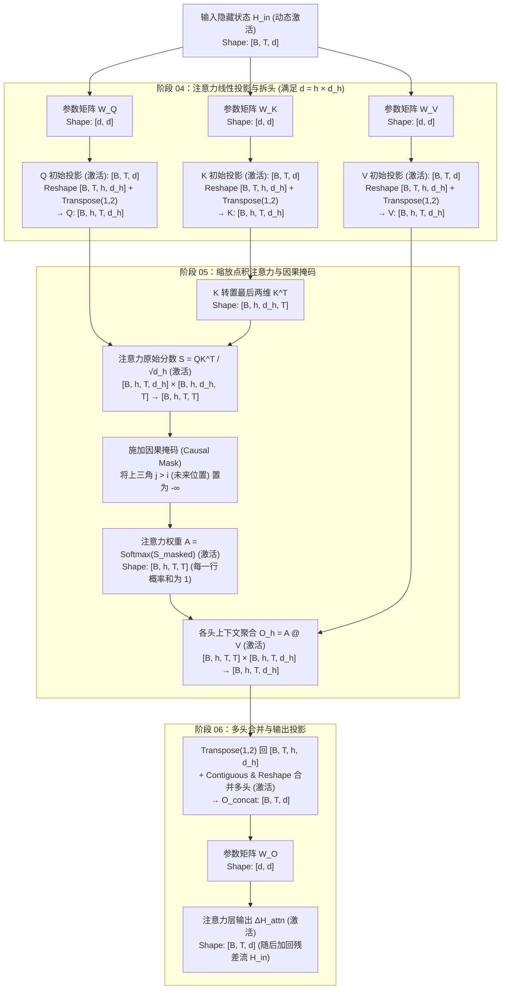

# 第零篇｜一次大语言模型推理的完整旅程：从输入文本到下一个 Token

大语言模型在计算机里究竟是什么？很多人都知道 LLM 是在预测下一个词，里面有成百上千亿甚至上万亿的参数，参数大概是个矩阵，维度非常高。但它究竟是如何工作的？它内部究竟由哪几个部分组成、有几个参数矩阵？我们敲进去的一句输入文本，又是怎样一步步穿过这些矩阵、最终变成下一个输出词的？

今天我们将把这一切讲明白。作为整套系列的**第零篇（总览篇）**，我们基于 **Rust 工具链**，以开源模型 **`SmolLM2-135M-Instruct`**（标准 Llama 仅解码器架构，1.35 亿参数、共 272 个权重张量、单文件 269 MB，普通笔记本 CPU 即可毫秒级运行）为例，走通一次完整前向计算的 11 个阶段；在文章后半部分，我们还将横向对比目前最前沿的工业级大模型——如 **`DeepSeek-V4.1-Flash-1017`**——看看最先进的架构与今天所学的基准模型究竟有什么区别。

别担心，你不需要 Rust 基础，只需要有基本的编程直觉和基础的线性代数知识即可。

本文的配套 GitHub 仓库链接在这：[https://github.com/wittkung/llm](https://github.com/wittkung/llm)，可以克隆或下载代码自己跑跑看！

---

## 一、 撕掉胶水层：为什么我们用 Rust 追踪大模型？

谈论大模型原理的文章十有八九用 Python 写成。只需五行 PyTorch 代码，任何人都能调起一个开源模型完成对话；但也是这五行代码，把初学者挡在了真正的计算过程之外——代码越省事，底层的矩阵变形与数据流动就越像黑盒。

更耐人寻味的是，哪怕一个工程师每天只写 Python，当他真正跑起一次大模型推理或使用前沿 AI 工具时，在底层干重活的早就换成 Rust 了：

- 你在终端里用的 AI 编程助手，比如 OpenAI 官方的 **Codex**、新一代 AI 编辑器 **Zed**，核心全是直接用 Rust 写的；**Claude Code** 能在几毫秒内搜遍整个代码库、**Cursor** 能瞬间完成代码语义检索，背后靠的也是 Rust 编写的检索引擎；
- 就算回到最日常的 Python 环境，当你调用 OpenAI 的 `tiktoken` 或 Hugging Face 的 `tokenizers` 给文本分词、用 `safetensors` 加载模型权重、用 `Pydantic` 校验大模型返回的 JSON、甚至用 `uv` 安装环境时，Python 只是外面一层薄薄的调用壳，底下真正吞吐字节与矩阵的内核全是用 Rust 写的。

Python 对于简洁的调用和快速实验更加方便，但业界的生产端已经大刀阔斧地开始转向 Rust。为什么大家都在往 Rust 迁移？它到底优秀在哪里？

### 1. 裸机极限性能与编译期内存安全

大模型落地时，分词器每秒要切分上百万个词，加载器要把几十 GB 的权重文件直接零拷贝映射（`mmap`）进内存，智能体网关要同时并发调度成百上千条流式连接。

在这些高吞吐底层任务上，Python 受限于解释器开销与全局解释器锁（GIL），往往力不从心；而过去写底层唯一能选的 C/C++，稍微一不留神就会踩中数组越界、内存泄漏或多线程数据竞争的深坑。

Rust 靠独特的编译期所有权（Ownership）与借用检查，**既不需要垃圾回收（避免 GC 暂停），又在编译阶段彻底保证了内存与多线程并发安全**。

### 2. 零运行时负担的原生跨平台编译

以前想让代码跨平台，像 Python 或 Java 必须在目标机器上预先安装庞大的解释器或虚拟机（JVM），换台电脑经常因为缺少动态链接库（`.dll` / `.so` / `.dylib`）或环境版本冲突而报错；而 C/C++ 的跨平台编译又常年受困于各家操作系统头文件与构建系统的兼容问题。

Rust 通过三层编译器工程设计解决了这个问题：

- **基于 LLVM 的编译器架构（一套源码，直出各平台原生机器码）**：
  什么是 **LLVM**？它是当今工业界最核心的开源**编译器后端基础设施（Compiler Infrastructure）**。包括苹果的 Swift、C/C++ 的现代编译器 Clang、乃至英伟达的 CUDA 编译器（NVVM），底层全都建立在 LLVM 之上。
  现代编译器分为**前端（Frontend）**和**后端（Backend）**。为了避免让每门语言重复编写生成几十种 CPU 指令集的代码，LLVM 在中间定义了一套与具体编程语言和具体硬件都无关的通用底层指令集，称为 **LLVM IR（Intermediate Representation，中间表示）**。
  当你编译 Rust 代码时，Rust 编译器前端（`rustc`）先完成类型与内存安全检查，把源码翻译成标准的 **LLVM IR**；随后交由 **LLVM 后端**执行循环向量化、内联等深度优化，并直接针对目标硬件架构——无论是苹果 M 系列的 ARM64 指令集（`aarch64`）、Windows 与 Linux 的 x86_64 指令集，还是可在浏览器中直接运行的 **WebAssembly（`wasm32`）**——生成 100% 原生的机器指令。
- **编译期条件编译（Conditional Compilation, `#[cfg(...)]`）**：
  不同操作系统的虚拟内存映射（`mmap`）、线程调度以及硬件矩阵加速库接口完全不同。Rust 允许在源码和 `Cargo.toml` 中通过 `cfg` 属性，在**编译期**按目标平台自动裁剪并挂载对应的系统原生接口。
  例如在我们今天配套代码的 `Cargo.toml` 中，只需声明一行 `[target.'cfg(target_os = "macos")'.dependencies]`，在 macOS 上编译时就会自动链接苹果原生的 `Accelerate` 矩阵运算框架，而在 Windows 和 Linux 上编译时则自动切换为通用 CPU 或 CUDA 算子——上层业务代码一行都不用改。
- **静态链接与单文件分发**：
  编译完成后，所有第三方依赖库默认被静态链接进同一个只有几 MB 的独立可执行文件中（Windows 下为 `.exe`，macOS/Linux 下为原生 Mach-O/ELF 二进制文件）。它不依赖目标机器上的任何外部环境，彻底告别了 Python 动辄好几个 GB、换台机器就报错的依赖环境地狱。

所以，我们这个系列就用 Rust 来完成——没有黑盒，把所有中间过程都彻底搞懂、搞清楚。

在正式进入模型内部之前，我们先花三分钟把实验环境搭好，把模型真正下载到你自己的电脑硬盘里，边跑代码边往下看。

---

## 二、 动手准备：三分钟配好环境并拆解模型文件

整个实验不需要安装 Python、Conda 或任何庞大的深度学习全家桶，只需要配置好 Rust 工具链，再下载三个核心模型文件即可。

### 1. 第一步：安装 Rust 工具链

如果你电脑上已经装过 Rust，可以直接跳到下一小节。

**macOS / Linux / Windows WSL 用户**打开终端，复制并运行下面这三行官方命令：

```bash
curl --proto '=https' --tlsv1.2 -sSf https://sh.rustup.rs | sh
source "$HOME/.cargo/env"
cargo --version
```

如果你平时很少和终端脚本打交道，不用被这串符号吓到，这三行命令做的事情非常单纯：

1. **第 1 行（下载并运行安装器）**：用 `curl` 通过加密的 HTTPS 协议从 Rust 官网（`sh.rustup.rs`）拉取安装脚本，并通过管道符 `|` 直接交给终端（`sh`）执行。运行后屏幕上会弹出一个英文确认菜单，直接按一下**回车键（Enter）**选择默认安装即可。
2. **第 2 行（刷新当前窗口的环境变量）**：安装器会把工具装在你个人目录下的 `.cargo/bin` 文件夹里。执行 `source "$HOME/.cargo/env"` 是为了告诉当前终端窗口立即加载刚装好的命令路径，这样不用重启终端就能直接使用。
3. **第 3 行（验证构建系统与包管理器 `cargo`）**：`cargo` 是 Rust 官方的**构建系统与包管理器（Build System & Package Manager）**，它把第三方依赖的解析下载（类似 Python 的 `pip/uv`）和调用编译器 `rustc` 编译代码（类似 C++ 的 `CMake`）整合在了同一个工具里。只要终端打印出类似 `cargo 1.85.0 (...)` 的版本号，就说明工具链已经配置完成。

**原生 Windows 用户（PowerShell）**不需要配置 WSL 也能直接运行。你既可以去官网 [`https://rustup.rs`](https://rustup.rs) 下载 [`rustup-init.exe`](https://win.rustup.rs/x86_64) 双击安装，也可以打开 **PowerShell** 运行 Windows 官方包管理器命令：

```powershell
winget install Rustlang.Rustup
```

需要注意：Rust 在 Windows 下编译程序需要调用系统的底层 C++ 链接器。如果你的电脑以前没装过 Visual Studio C++ 工具链，运行 `rustup-init.exe` 时它会提示缺少 C++ 环境，并给出默认选项 `1) Quick install via the Visual Studio Community installer`。你只需**一路按回车（Enter）**，它就会自动调用微软官方安装器把所需的 C++ 组件装好。安装结束后，**关掉当前的 PowerShell 窗口重新打开一个新的**，输入 `cargo --version` 看到版本号即告成功。

### 2. 第二步：认识 Hugging Face 与三个核心模型文件

如果你是第一次接触开源大模型，可能会好奇：**Hugging Face** 到底是什么？

简单来说，如果 GitHub 是全世界程序员托管源代码的大本营，那么 **Hugging Face**（官网 [`huggingface.co`](https://huggingface.co)）就是全球 AI 界的“模型版 GitHub”。普通代码文件只有几 KB，但训练好的大模型权重动辄几百 MB 甚至几百 GB，普通代码仓库根本装不下。于是，包括 DeepSeek、阿里 Qwen、Meta Llama 在内的全球各大实验室，在模型训练完成后都会把权重文件、词表和配置文件按统一标准上传到 Hugging Face 开源分享。

我们今天要用的 **`HuggingFaceTB/SmolLM2-135M-Instruct`**，命名格式就和 GitHub 仓库完全一致：斜杠前面的 `HuggingFaceTB` 是发布团队名称（Hugging Face 官方预训练团队），斜杠后面的 `SmolLM2-135M-Instruct` 则是这套 1.35 亿参数对话模型的仓库名。

当你点开这个模型仓库的文件列表页面时，会看到十来个文件。它们只分两类：**真正驱动推理的核心三件套**（`config.json`、`tokenizer.json`、`model.safetensors`，本次实验只需下载这三个），以及**外围兼容与说明文件**。我们先把它们挨个看懂。

#### （1）`config.json`：模型架构与超参数配置文件（~1 KB）

那份 269 MB 的权重文件是紧凑排列的二进制浮点数，无法用文本编辑器直接阅读；而这份不到 1 KB 的 `config.json` 则以纯文本 JSON 记录了模型的全部**架构超参数（Architectural Hyperparameters）**。无论人类工程师还是推理框架，加载一个模型的第一步永远是先解析 `config.json`：

```json
{
  "architectures": ["LlamaForCausalLM"],
  "model_type": "llama",
  "vocab_size": 49152,                   // 👈 先看第 1 个指标：词表大小 V = 49,152
  "hidden_size": 576,                    // 👈 先看第 2 个指标：隐藏层（词向量）维度 d = 576
  "num_hidden_layers": 30,               // 👈 先看第 3 个指标：Transformer 网络总层数 L = 30
  "num_attention_heads": 9,
  "num_key_value_heads": 3,
  "intermediate_size": 1536,
  "hidden_act": "silu",
  "max_position_embeddings": 8192,
  "rope_theta": 100000,
  "rms_norm_eps": 1e-05,
  "attention_bias": false,
  "mlp_bias": false,
  "tie_word_embeddings": true,
  "bos_token_id": 1,
  "eos_token_id": 2,
  "torch_dtype": "bfloat16",
  "use_cache": true
}
```

第一次打开它，你完全不需要急着看懂里面的每一个字段。我们先看标了箭头的三个核心超参数：词表里有 `49,152` 个词元（`vocab_size`），每个词元在模型内部用 `576` 个浮点数表示（`hidden_size`），一共要依次穿过 `30` 层 Transformer 网络（`num_hidden_layers`）。至于剩下的其他参数，我们会在后文对应的计算阶段逐一揭示；等你读到文章末尾，这二十几行配置将全部水落石出。

围绕着 `"hidden_size": 576`，我们先解决两个最直接的疑问：

**第一，为什么每个词元要用 `576` 个数字来表示，而不是只用 1 个数字？**

分词器给每个词分配的整数编号（Token ID，例如 `19556`）只是一个离散的**查表索引（Index）**，编号本身的大小没有任何数学或语义含义。为了让神经网络能够通过矩阵乘法计算词与词之间的语法、语义和上下文相关性，必须把每个离散的词元映射到高维连续向量空间中——在机器学习里，这叫做**分布式表示（Distributed Representation / Embedding）**。

在 576 维空间里，每一个维度代表一个连续的特征方向。通过 576 个浮点数的线性组合，模型就能同时编码一个词的词性、语义类别与语境特征。模型的参数规模越大，这个隐藏层维度 $d$ 通常越高（例如 1.35 亿参数的本模型为 `576` 维，70 亿参数模型通常为 `4096` 维，而 5520 亿参数的 `DeepSeek-V4.1` 则为 `5120` 维）。

**第二，为什么偏偏是 `576` 这个数，而不是凑整的 `500`？**

这由下一行的 `"num_attention_heads": 9`（**注意力头数 $h_q = 9$**）与底层硬件的寄存器对齐规则共同决定。至于“注意力头”具体是什么，我们在第五节会专门拆解，这里你先不用管它的机制，只需看它的算术拆分关系。

在注意力层中，模型会把长度为 `576` 的向量均匀拆分成 `9` 份（即 9 个注意力头）并行处理，每个头分到的**单头子空间维度（Head Dimension, $d_h$）**恰好是 $576 \div 9 = 64$。而在现代 CPU 的 SIMD 向量指令集与 GPU 的 Tensor Core 硬件单元中，矩阵乘法在维度为 `32`、`64`、`128` 这类 **$2$ 的整数次幂**时才能达到最高的内存对齐效率与指令吞吐率。因此，`576` 正是由 **$9\text{ 个头} \times 64\text{ 维/头}$** 乘出来的，一分不多、一分不少。

那么，每个词里的这 576 个浮点数究竟存在哪里？它们又是怎么定出来的？我们接着看下面两个文件，答案立刻揭晓。

#### （2）`tokenizer.json`：现代一体化分词器与词表（2.0 MB）

刚刚我们在 `config.json` 里看到了 `"vocab_size": 49152`。在打开分词器文件之前，我们先厘清一个最基础的概念：**什么是“切词（分词 / Tokenization）”？为什么要切词？**

平时我们输入给模型的是一整句连续的字符串（例如 `"Hello!"` 或 `"我喜欢写代码"`）。计算机在把它送入神经网络之前，第一步必须先把整句话切分成一个个基本片段（每个片段称为一个 **Token / 词元**），这个过程就叫**切词（分词）**。

为什么要做切词，既不直接按“整句话”编号，也不干脆按“单个字母/字符”编号？

- **为什么不按“整句话”编号？** 因为人类能组合出的句子是无穷无尽的，没有任何词表能把世上所有可能的句子提前收录进去。
- **为什么不按“单个字母或字节”编号？** 如果把英文单词 `"unbelievable"` 硬拆成 12 个独立字母，一方面单个字母 `'u'`、`'n'` 本身几乎不携带独立语义，模型极难从中学习语义规律；另一方面这会让一句话切出来的序列长度 $T$ 暴涨好几倍，而后面注意力层的计算量是随序列长度呈平方级（$O(T^2)$）增长的，算力会被瞬间拖垮。
- **子词分词（Subword Tokenization）的折中解法**：研发人员通过统计海量语料，把最常用的完整单词（如 `"Hello"`、`"user"`）、高频词根词缀（如 `"ing"`、`"able"`）以及基础单字符浓缩成一张包含 `49,152` 个条目的有限**词表（Vocabulary）**，并给每个词元分配一个从 `0` 到 `49,151` 的唯一整数索引（**Token ID**）。无论输入什么句子，分词器都会查这张表将其切分为一串词元序列：常见词直接保留整词（如 `"Hello"` 切为 1 个词元），生僻长词则拆成几个已知词根的组合。这样既能用 `49,152` 个有限词元零遗漏地拼出世上任意文本，又能把一句话切出来的词元个数 $T$ 压到最短。

如果你用文本编辑器打开 `models/SmolLM2-135M-Instruct/tokenizer.json`，就能直接看到这张 `49,152` 词表的真实 JSON 结构（文件遵循 GPT-2 字节级 BPE 规范，用特殊可见字符 `Ċ` 表示换行符 `\n`，用 `Ġ` 表示前导空格 `0x20`）：

```json
{
  "model": {
    "type": "BPE",
    "vocab": {
      "<|endoftext|>": 0,      // 0 ~ 16 号：预留给控制对话边界与代码格式的特殊词元 (Special Tokens)
      "<|im_start|>": 1,       // 1 号：对应 config.json 中的 bos_token_id: 1（单轮消息起始标记）
      "<|im_end|>": 2,         // 2 号：对应 config.json 中的 eos_token_id: 2（单轮消息终止标记）
      "!": 17,                 // 17 号起：ASCII 基础标点符号、数字与单字节字符
      "0": 32,
      "Ċ": 198,                // 198 号：换行符 (\n)
      "Ġis": 314,              // 314 号：带前导空格的高频词 " is"
      "user": 4093,            // 4093 号：子词 "user"
      "Hello": 19556,          // 19556 号：子词 "Hello"
      "ĠRust": 36828,          // 36828 号：带前导空格的子词 " Rust"
      "ectable": 49151         // 49151 号：词表末尾词元（索引范围 0..49151，共 49,152 个）
    },
    "merges": [
      "Ġ t", "Ġ a", "i n", "h e", "Ġ Ġ", "r e", "o n", "e r", "Ġt he", "a t"
      // ... 按优先级排列的 BPE 子词合并规则（例如第 3 条将相邻字符 "i" 与 "n" 合并为子词 "in"）
    ]
  }
}
```

看到这里，你一定会产生一个疑问：**为什么上面说每个词是由 `576` 个浮点数构成的向量，而这里的 `tokenizer.json` 词表里，每个词（比如 `"Hello": 19556`）却只有一个简单的整数？那个向量到底是 $1 \times 576$ 还是 $576 \times 1$？那 576 个数字究竟存在哪里？这两者是什么关系？**

把这三个核心文件连起来看，它们之间的分工与矩阵关系就彻底清楚了：

**第一，`tokenizer.json` 里的单个整数（如 `19556`），本质上只是一个“行号（Row Index）”。**

`tokenizer.json` 里根本不存储那 576 个浮点数。它的职责非常纯粹：只负责维护 **`"文本词元" <-> 整数行号（Token ID）`** 的双向字典（例如把 `"Hello"` 映射为整数 `19556`，把 `"!"` 映射为整数 `17`，总计 `0..49151` 共 `49,152` 个行号）。

**第二，那 `576` 个浮点数，真正存储在第三个文件 `model.safetensors` 的第一张二维矩阵 `model.embed_tokens.weight` 里。**

在 `model.safetensors` 中，存放着全模型的第一张权重矩阵，形状为 **`[49152, 576]`**（即 **49,152 行 $\times$ 576 列**）。它的**行数（49,152 行）**与 `tokenizer.json` 里的词表大小严格一一对应：第 `0` 行属于 `0` 号词元 `<|endoftext|>`，第 `19556` 行就属于 `19556` 号词元 `"Hello"`。

它的**每一行（576 列）**横着连续存放了 576 个浮点数。因此在计算机内存里，单个词元对应的向量是一个 **`1 × 576` 的行向量（Row Vector）**。（注：纯数学教材里习惯把向量竖着写成 $576 \times 1$ 的列向量；但在 PyTorch 与 Rust `candle` 等所有现代张量框架中，物理内存均采用**行优先（Row-Major）**布局，永远把单个词向量横着存成一行。）

当我们把一句话喂入模型时，矩阵形状分三步组装起来：

- **第 ① 步（1 个词 = 1 行）**：如果只看 `"Hello"` 这 1 个词（行号 `19556`），从大表里抽出的第 `19556` 行就是横着的一排 576 个数，形状为 **`[1, 576]`**（1 行、576 列）。
- **第 ② 步（1 句话含多个词 = 多行上下叠成一张二维表）**：实际输入的一句话往往包含多个词。假设一句话被切成了 **3 个词**（比如行号依次为 `1`、`4093`、`19556`），程序就会去 `[49152, 576]` 的大表里把第 `1` 行、第 `4093` 行、第 `19556` 行分别抽出来，按词语先后顺序**第一行、第二行、第三行上下叠在一起**，拼成一张 **3 行 × 576 列** 的二维矩阵，形状记作 **`[3, 576]`**（若一句话切出了 $T$ 个词，叠出来就是 **`[T, 576]`**）：

```text
第 1 个词 (行号 1)     ──► [ -0.0255, -0.0192, -0.0396, ... (共 576 个数) ] ┐
第 2 个词 (行号 4093)  ──► [ +0.0104, -0.0312, +0.0089, ... (共 576 个数) ] ├─ 叠成 3 行 × 576 列的二维矩阵: [3, 576]
第 3 个词 (行号 19556) ──► [ -0.0498, +0.0398, +0.0012, ... (共 576 个数) ] ┘
```

- **第 ③ 步（加上“同时处理几句话”的批大小 $B$ = 三维张量 `[B, T, 576]`）**：在工业级推理服务器上，显卡为了跑满算力，往往会同时把好几个不同用户发来的句子打包在一起并行计算——**一次同时处理的独立句子条数，就叫做“批大小（Batch Size，记作 $B$）”**。如果同时处理 4 条句子（每条 3 个词），就是把 4 张 `3 × 576` 的二维表摞成一摞，形状记作 `[4, 3, 576]`；而在我们本地单人实验时，每次只喂入 **1 条**句子（即 $B = 1$），因此在程序打印出的日志里，这 1 条含 $T$ 个词的句子，形状永远显示为三维的 **`[1, T, 576]`**（分别代表：`1 条句子`、`每条句子 T 个词`、`每个词 576 个浮点数`）。

**第三，`tokenizer.json` 与 `model.safetensors` 是如何一进一出打配合的？**

- **入口处（文字 $\to$ 整数行号 $\to 1 \times 576$ 向量）**：输入 `"Hello"` 时，先查 `tokenizer.json` 拿到整数行号 **`19556`**；紧接着拿 `19556` 当作行下标，去 `model.safetensors` 的 `[49152, 576]` 矩阵里把**第 `19556` 行**那 **$1 \times 576$** 个浮点数整行抽出来，送入 30 层网络做矩阵运算。
- **出口处（$1 \times 576$ 向量 $\to 49,152$ 个候选得分 $\to$ 整数行号 $\to$ 文字）**：当 30 层网络对这串 $1 \times 576$ 向量加工完毕后，在最后一步会把它乘上 `[576, 49152]` 的转置矩阵，算出全部 `49,152` 个候选词各自的得分（Logits）；挑出得分最高的那个下标（比如第 `17` 列得分最高，即 Token ID 为 `17`），最后再去反查 `tokenizer.json`，把整数 `17` 还原成字符 `"!"`。

#### （3）`model.safetensors`：272 个静态参数张量仓库（269 MB）

第三个核心文件 `model.safetensors`，是以 Hugging Face `SafeTensors` 二进制格式存储的模型全部 **272 个静态参数张量（Parameter Tensors）**。文件头部是一段记录每个张量名称、数据类型与形状偏移量的 JSON 索引头，紧接着便是按 64 字节对齐排列的原始浮点数内存块，支持操作系统直接通过 `mmap` 零拷贝映射进内存。

看到“272 个张量”这个数字千万别被吓到——它们绝不是 272 个五花八门的复杂结构，而是按 **`1 + 30 × 9 + 1 = 272`** 的三明治结构整齐排列的：**最前面 1 个入口查表矩阵**，**最后面 1 个出口校准向量**，中间则是 **30 层完全复制粘贴的标准楼层（每层固定只有 9 个张量，$30 \times 9 = 270$）**。也就是说，整座模型真正不同的张量角色只有 $1 + 9 + 1 = 11$ 种，看懂一层楼，就看懂了整座模型。

围绕这个权重文件，我们也先厘清三个最关键的基础问题：

**第一，什么是“张量（Tensor）”？它和向量、矩阵是什么关系？**

在数学里，1 维的一排数叫**向量（Vector）**，2 维的一张表（有行有列）叫**矩阵（Matrix）**。但刚才我们已经看到，把多条句子的二维表摞在一起就变成了 3 维数组 `[B, T, 576]`，后面拆完注意力头甚至会变成 4 维数组 `[B, 9, T, 64]`——超过 2 维后，就不能再叫“矩阵”了。

为了在代码里用同一个数据结构表示**任意维度的数组**，深度学习框架统一借用了**“张量（Tensor）”**这个词：

- **0 维张量** = 标量（单独 1 个数，形状 `[]`）；
- **1 维张量** = 向量（一排数，例如模型里形状为 `[576]` 的归一化缩放权重）；
- **2 维张量** = 矩阵（二维表格，例如形状为 `[49152, 576]` 的词嵌入表和 `[1536, 576]` 的线性层权重）；
- **3 维 / 4 维张量** = 高维数组（例如流过模型主干的 `[B, T, 576]` 隐藏状态与 `[B, 9, T, 64]` 注意力激活）。

简言之：**矩阵只是二维的张量；张量则是向量、矩阵与高维数组的统称。** 这也是为什么权重文件后缀叫 `.safetensors`（安全张量）而不叫 `.safematrices`——在它的 272 个权重里，有 **211 个是二维矩阵**，还有 **61 个是一维向量**（每层 2 个、30 层共 60 个，外加最后 1 个形状为 `[576]` 的归一化向量）。

**第二，这里的浮点数用的是什么标准？一个浮点数占几个字节？（`BF16` vs `FP32` / `FP16`）**

日常写普通代码（如 Rust 的 `f32` 或 C 的 `float`）默认使用 IEEE 754 标准的 **32 位单精度浮点数（FP32）**，每个数占 **4 个字节（32 bits = 1 位符号 + 8 位指数 + 23 位尾数）**。但对动辄上百亿参数的大模型来说，4 字节太占显存；而传统的 16 位半精度浮点数（**FP16**，占 2 字节，1 位符号 + **5 位指数** + 10 位尾数）由于指数位只有 5 位（最大只能表示 $65504$），在矩阵连乘时极易发生数值溢出（`Inf`/`NaN`）。

因此，包括本模型在内的现代主流大模型（见 `config.json` 中的 `"torch_dtype": "bfloat16"`），普遍采用 Google Brain 专为深度学习设计的 **BF16（Brain Floating Point 16，16 位脑浮点数）** 标准：每个浮点数只占 **2 个字节（16 bits）**，但它**完整保留了与 FP32 相同的 8 位指数位（1 位符号 + 8 位指数 + 7 位尾数）**。它用牺牲小数点后末尾几位尾数精度的微小代价，换来了与 32 位浮点数完全一致的抗溢出动态范围，同时让硬盘与显存体积直接减半。

**第三，词表文件 vs 我们接触的第一张矩阵有多大？**

我们可以现场算一笔账：

- **词表文件 `tokenizer.json`（仅 `2.0 MB`）**：因为它只存了 `49,152` 个词元字符串、整数行号与合并规则文本，不存那 576 维浮点数，所以体积只有 **2.0 MB**。
- **第一张矩阵 `model.embed_tokens.weight`（独占 `56.62 MB`）**：它的形状是 `[49152, 576]`，包含的浮点数总数为：

$$
49,152\text{ 行} \times 576\text{ 列} = 28,311,552\text{ 个浮点数（约 2,831 万个参数）}
$$

按每个 `BF16` 浮点数占 **2 个字节**计算，这张表在硬盘上的物理体积为：

$$
28,311,552 \times 2\text{ Bytes} = 56,623,104\text{ Bytes} \approx \mathbf{56.62\text{ MB}}
$$

要知道，整座模型 272 个张量合在一起总共才 `269.03 MB`（`134,515,008` 个参数）——光是我们刚认识的这**第一张矩阵 `model.embed_tokens.weight`**，就吃掉了 **`56.62 MB`**，占去全模型总体积的 **$21.05\%$（超过五分之一）**！（注：如果你以后去下载 70B 或 DeepSeek 等超大模型，会看到 `.safetensors` 被切分为多个 `model-00001-of-00010.safetensors` 分片文件并附带一份 `model.safetensors.index.json` 目录表，那正是因为上百亿个 `BF16` 浮点数算下来达上百 GB，单个文件装不下而做的物理分片。）

**第四，深度拆解第一张矩阵：`model.embed_tokens.weight` 叫什么矩阵？里面的参数是怎么决定的？训练中会修改吗？这些参数到底意味着什么？**

既然这张矩阵占了全模型超过五分之一的分量，又是整个前向计算的第一站，我们把它的来龙去脉一次性讲透：

1. **它叫什么矩阵？为什么起这个名字？**
   在深度学习与自然语言处理中，这张矩阵的标准学术名称叫**词嵌入矩阵（Token Embedding Matrix，数学公式中通常记作 $\mathbf{W}_E \in \mathbb{R}^{V \times d}$）**。
   拆解它在权重文件中的键名 `model.embed_tokens.weight`：`model` 代表主干网络；`embed_tokens` 意为“将词元嵌入（Embed）到高维空间”——即把原本孤立、离散的整数词号（Token ID）映射为连续几何空间（$\mathbb{R}^{576}$）中的一个向量坐标；末尾的 `.weight` 则表明它是神经元连接上的**可学习权重参数**。
   此外，在 `SmolLM2-135M` 中（见 `config.json` 的 `"tie_word_embeddings": true`），这张矩阵还身兼二职：在阶段 02 入口处，它是按行查表的**词嵌入矩阵**；到了阶段 09 出口处，它又转置过来充当把 576 维向量还原为 49,152 个候选词得分的**语言模型输出头矩阵（LM Head）**。

2. **里面的 2,831 万个浮点数参数是怎么决定的？**
   这 `49,152 × 576` 个数字**绝不是**程序员手工填写的，也不是靠某种人为编写的语法规则算出来的，而是**从随机噪声出发，在海量语料预训练中由数据自动雕刻出来的**。
   在模型刚创建、尚未开始训练的第 0 步（**随机初始化阶段**），程序只是读取 `config.json` 中的 `"initializer_range": 0.0416666...`（数值上等于 $1/\sqrt{d} = 1/\sqrt{576} \approx 0.04167$），用均值为 $0$、标准差为 $0.04167$ 的正态分布随机数生成器，填满了整张 `[49152, 576]` 矩阵。在这一刻，`"Hello"` 对应的第 `19556` 行和 `"Rust"` 对应的第 `36828` 行，全都是毫无意义的随机白噪声。

3. **训练过程中会修改吗？是怎么修改的？推理时还会变吗？**
   - **在训练（预训练与微调）过程中：不仅会修改，而且每训练一步都在被反向传播持续修改。**
     训练时，研发团队把数万亿词的文本语料喂给模型，让模型不断做“根据上文预测下一个词”的填空练习。例如输入上文 `"I love writing code in"`，真实标准答案是下一个词 `" Rust"`（行号 `36828`）。模型先从 `model.embed_tokens.weight` 查出上文各词的 576 维向量，穿过 30 层网络算出词表所有词的预测概率。
     起初因为参数是随机的，模型猜中 `" Rust"` 的概率极低，由此算出一个预测误差（**交叉熵损失 Cross-Entropy Loss**）。紧接着，训练框架启动**反向传播（Backpropagation）**：利用微积分链式法则，从第 30 层出口一路倒推回第 0 层入口，精确算出 `model.embed_tokens.weight` 里被查到的那几行、每一个浮点数对这次猜错负有多大责任（即**梯度 Gradient**，$\frac{\partial \mathcal{L}}{\partial \mathbf{W}_E}$）。随后，**优化器（Optimizer，如 AdamW）**顺着减小误差的负梯度方向，直接修改矩阵里这些浮点数的数值。经过成百上千亿次“预测 $\to$ 算误差 $\to$ 反向求导 $\to$ 微调参数”的迭代，这张矩阵才最终收敛定型。
     （注：关于损失函数、反向传播求导与优化器更新的完整数学细节，此处我们仅作简要勾勒以建立全局直觉，后续专门章节会做深入拆解；在本篇中，你只需知道这些参数是由训练过程雕刻出来的即可。）
   - **在训练结束后的推理阶段（即我们今天下载运行的阶段）：永久冻结、只读不改。**
     一旦训练完成并导出为 `model.safetensors`，`model.embed_tokens.weight` 里的 2,831 万个浮点数就作为**静态权重（Static Weights）永久冻结**了。今天我们在本地跑推理时，模型只是从这张表里**只读拷贝**出对应的行作为第 0 层初始激活；后续 30 层网络根据上下文实时修改的，是内存里临时开辟的**中间激活（Activations）**，绝不会回头改动 `model.embed_tokens.weight` 里的任何一位数字。

4. **这些参数到底意味着什么？（高维语义空间的几何坐标）**
   训练完成后，`model.embed_tokens.weight` 的每一行（576 个浮点数）就代表对应词元在 **576 维连续语义空间中的初始特征坐标**。
   为什么梯度下降能让一串浮点数拥有“语义”？因为在训练过程中，凡是经常出现在相似上下文语境里的词（比如 `"Rust"`、`"C++"` 与 `"Python"` 后面常接 `"compiler"` 或 `"code"`），为了都能准确预测出相同的下文，反向传播传回来的梯度会逼着它们各自那 576 个数字向同一个方向靠拢。
   最终，这 576 个浮点数共同编码了该词元的**分布式特征（Distributed Features）**——包括它的词性（名词、动词、介词）、语义范畴（编程语言、动物、情感）、单复数与时态倾向等。虽然单个坐标轴下标（例如第 `19556` 行第 `0` 列的 `-0.0498`）本身并没有固定的人类可读标签，但整条 576 维向量在空间中的**方向与夹角（余弦相似度）**却精确反映了词与词之间的语义远近，为后续 30 层 Transformer 的矩阵运算提供了全部原始素材。

#### （4）仓库里的其他配套文件（为什么有的看似很重要，本次实验却不用下载？）

除了上面三个必下文件，你在 Hugging Face 仓库页面还会看到以下几类外围配套文件。细心的读者一定会问：像特殊词元配置、对话模板和生成采样配置，听起来都很重要，为什么今天不用下载？我们把原因逐一讲清：

- **`tokenizer_config.json` 与 `special_tokens_map.json`（特殊控制词元映射与对话模板配置）**：
  **它们的作用是什么？** 自回归语言模型在数学本质上只会根据上文续写下一个词。为了让模型在多轮对话中准确区分系统指令（`system`）、用户输入（`user`）与模型回复（`assistant`），并知道何时停笔，词表中引入了不参与常规 BPE 切分的**特殊控制词元（Special Tokens，如起始符 `<|im_start|>` 与终止符 `<|im_end|>`）**。`special_tokens_map.json` 用于声明这些特殊词元的角色；而 `tokenizer_config.json` 则包含一段 Jinja2 格式的**对话渲染模板（`chat_template`）**，规定如何把多轮聊天数组自动拼接成 `<|im_start|>user\nHello<|im_end|>\n<|im_start|>assistant\n` 这样的单条字符串。
  **为什么今天不用下载？** 一方面，全部 17 个特殊控制词元的 ID 与防切碎规则（`"special": true`）**已经 100% 内嵌在我们刚下载的 `tokenizer.json` 顶部的 `"added_tokens"` 数组里了**，Rust 分词引擎直接从 `tokenizer.json` 内部读取，根本不需要外挂 `special_tokens_map.json`；另一方面，为了在第 0 篇让你不隔着模板引擎、一眼看穿带控制符的原始输入文本，我们在 Rust 探针代码里直接把那行拼好的 `<|im_start|>...` 字符串明文写了出来。等到之后处理多轮对话输入时，我们再正式接入对话模板。

- **`generation_config.json`（默认解码采样超参数配置）**：
  **它的作用是什么？** 该文件完全不参与模型的前向矩阵乘法，只记录官方推荐的**解码采样策略（Decoding & Sampling Strategy）**默认值。当模型在阶段 09 算出词表 `49,152` 个候选词的得分（Logits）后，如果每次都死板地挑第 1 名，长文生成时容易陷入车轱辘话循环。因此实际聊天部署时会引入随机采样，核心参数包括 **`temperature`（温度系数，在 Softmax 归一化前用得分除以该系数：$T \to 0$ 时趋近于只选第 1 名的确定性解码，$T$ 越大概率分布越平缓、随机性越强）** 与 **`top_p`（Nucleus Sampling 核采样阈值，例如 `0.9` 表示将候选词按概率从高到低排序后，只保留累积概率达到 90% 的头部候选池，然后在池子里随机掷骰子抽词）**。
  **为什么今天不用下载？** 因为一旦按 `generation_config.json` 开启随机掷骰子（`"do_sample": true`），你每跑一次程序，模型挑出的词都可能变一下（这次回 `"Hello"`，下次回 `"Hi"`）。而在第 0 篇中，我们的目标是做**百分之百可复现的白盒追踪**——确保无论你在 macOS、Windows 还是 Linux 上运行，算出的每一个浮点数和生成的每一个词都分毫不差。因此本篇我们在阶段 10 刻意使用完全确定性的**贪心解码（Greedy Decoding，直接挑得分最高的第 1 名）**；之后专门研究如何控制生成随机性时，我们再亲手实现这套采样器。

- **`vocab.json` 与 `merges.txt`（旧版 Python 分词器的独立词表与合并规则表）**：
  早期纯 Python 分词器不支持读取一体化的 `tokenizer.json`，需要将 **BPE（Byte-Pair Encoding，字节对编码）** 的字典映射（`vocab.json`）与子词合并优先级表（`merges.txt`）拆成两个文件存储。这两份文件的数据已 100% 包含在 `tokenizer.json` 中，仅作向后兼容保留。

- **`README.md`、`LICENSE` 与 `onnx/` 目录**：
  `README.md` 是记录训练数据与评测基准的**模型卡（Model Card）**；`LICENSE` 为开源协议声明（本模型采用 `Apache-2.0` 协议）；`onnx/` 目录则存放转换为 **ONNX** 开放中间格式的权重，供浏览器 WebGPU 或移动端引擎调用。

### 3. 第三步：下载核心三件套

在我们的配套仓库根目录下运行下面几行命令，把这三个核心文件拉到本地 `models/SmolLM2-135M-Instruct` 文件夹中（其中 `curl -L` 表示自动跟随云存储跳转链接，`-o` 表示保存到本地指定路径）。

**macOS / Linux / WSL 终端：**

```bash
mkdir -p models/SmolLM2-135M-Instruct

# 国内网络可直接用 hf-mirror.com 满速下载（海外网络将 hf-mirror.com 换回 huggingface.co 即可）
BASE_URL="https://hf-mirror.com/HuggingFaceTB/SmolLM2-135M-Instruct/resolve/main"

curl -L "${BASE_URL}/config.json"       -o models/SmolLM2-135M-Instruct/config.json
curl -L "${BASE_URL}/tokenizer.json"    -o models/SmolLM2-135M-Instruct/tokenizer.json
curl -L "${BASE_URL}/model.safetensors" -o models/SmolLM2-135M-Instruct/model.safetensors
```

**Windows PowerShell**（注意在 PowerShell 中需写 `curl.exe` 以调用系统原生下载工具）：

```powershell
New-Item -ItemType Directory -Force -Path models\SmolLM2-135M-Instruct | Out-Null

$BASE_URL = "https://hf-mirror.com/HuggingFaceTB/SmolLM2-135M-Instruct/resolve/main"

curl.exe -L "$BASE_URL/config.json"       -o models\SmolLM2-135M-Instruct\config.json
curl.exe -L "$BASE_URL/tokenizer.json"    -o models\SmolLM2-135M-Instruct\tokenizer.json
curl.exe -L "$BASE_URL/model.safetensors" -o models\SmolLM2-135M-Instruct\model.safetensors
```

### 4. 第四步：认识我们的白盒探针程序 `llm-tracer`，并给模型做一次“开箱体检”

模型文件下好了，拿什么程序去读取和运行它？

既然我们在开篇立下规矩“拒绝黑盒”，我们就不用任何封装好的第三方推理命令行，而是直接用本篇配套仓库里手写的白盒 Rust 探针程序——**`llm-tracer`**。

在运行它之前，我们先花一分钟看清这个 Rust 项目的目录结构，以及它内部到底写了什么代码：

```text
llm/                                   # 配套仓库根目录
├── Cargo.toml                         # 顶层工作区清单 (Workspace Cargo.toml)
├── models/
│   └── SmolLM2-135M-Instruct/         # 刚刚下载的三个模型文件存放处
│       ├── config.json
│       ├── tokenizer.json
│       └── model.safetensors
└── crates/
    └── llm-tracer/                    # 本篇的白盒探针代码包 (Crate)
        ├── Cargo.toml                 # 探针包的依赖声明文件
        └── src/
            └── main.rs                # 探针的全部 Rust 源代码（仅单文件）
```

如果你是第一次接触 Rust 工程，只需要知道两个核心概念：

1. **`Cargo.toml` 与代码包（Crate）是什么？**
   在 Rust 中，每一个独立编译的项目包称为一个 **Crate**。每个项目包根目录下都必须有一份名为 **`Cargo.toml`** 的工程清单文件（类似 Python 的 `pyproject.toml` 或前端的 `package.json`），里面写明了项目名称和依赖库；而真正的代码则统一放在同级的 `src/main.rs` 里。
   当你敲下 `cargo run` 时，`cargo` 会在当前目录及上层父目录中寻找 `Cargo.toml`（如果在一个既没有 `Cargo.toml`、父目录也没配工作区的文件夹里运行，就会报错 `could not find Cargo.toml`）。我们在仓库根目录和 `crates/llm-tracer` 下都配置好了 `Cargo.toml`，因此你在仓库任意目录下运行 `cargo run` 都能直接找到 `llm-tracer`。

2. **`llm-tracer` 这个程序到底干了什么？**
   打开 `crates/llm-tracer/src/main.rs`，你会发现它只依赖了两个核心基础库：用 `serde_json` 解析 JSON 配置，用 Hugging Face 官方的轻量级 Rust 张量库 `candle-core` 读取 `.safetensors` 并执行矩阵乘法。
   我们为它设计了三个命令行模式（通过 `--mode` 切换）：
   - **`--mode inspect`（开箱体检）**：读取 `config.json` 与 `model.safetensors`，核验全部 272 个张量的名称、形状与参数量；
   - **`--mode toy`（手算核验）**：跑通后文第六节 $B=1, T=3, d=4$ 的玩具模型，验证我们的纸笔手算结果；
   - **`--mode real`（真机推理追踪）**：加载 `SmolLM2-135M-Instruct` 真实权重，跑完 11 个阶段的前向计算并生成回答。

其中，即将运行的 `--mode inspect`（开箱体检）背后的核心 Rust 代码只有短短十几行，逻辑极其透明：

```rust
// 1. 读取 config.json 纯文本，反序列化为 Rust 结构体 LlamaConfig
let cfg_str = std::fs::read_to_string(model_dir.join("config.json"))?;
let cfg: LlamaConfig = serde_json::from_str(&cfg_str)?;

// 2. 加载 model.safetensors，返回一个 "张量名 -> Tensor" 的哈希表（共 272 个张量）
let weights: HashMap<String, Tensor> =
    candle_core::safetensors::load(model_dir.join("model.safetensors"), &Device::Cpu)?;

// 3. 遍历字典，用 t.dims() 查看每个张量的形状，用 t.elem_count() 累加参数总数
let w_embed = &weights["model.embed_tokens.weight"];
println!("shape: {:?} | {} params", w_embed.dims(), w_embed.elem_count());

let total_params: usize = weights.values().map(|t| t.elem_count()).sum();
let bf16_megabytes = (total_params * 2) as f64 / 1_000_000.0; // 每个 BF16 参数占 2 字节
```

看懂了这十几行代码，现在我们在仓库根目录下（或在 `crates/llm-tracer` 目录下）直接运行它：

```bash
cargo run -- --mode inspect
```

（命令中间那个单独的双横线 `--` 是 `cargo` 的语法约定：双横线左边是给构建工具 `cargo run` 看的，双横线右边的 `--mode inspect` 则是传给我们自己写的 `llm-tracer` 程序的参数。程序会自动定位仓库下的 `models/SmolLM2-135M-Instruct` 目录，你也可以显式加上 `--model-dir models/SmolLM2-135M-Instruct`。）

首次运行时，`cargo` 会自动下载并编译所需的依赖库；编译完成后不到一秒钟，终端上就会打印出从 `config.json` 解析出的架构参数，以及 `model.safetensors` 内部 272 个张量的核验报告：

```text
=== [1/2] Blueprint Parsed from config.json ===
  model_type: "llama" | vocab_size (V): 49152 | hidden_size (d): 576 | layers (L): 30
  attn_heads (h_q): 9 | kv_heads (h_kv): 3 | head_dim (d_h): 64 | intermediate_size (d_ff): 1536
  max_position_embeddings: 8192 | rope_theta: 100000 | rms_norm_eps: 1e-5 | tie_word_embeddings: true
Loading real SafeTensors weights from: ../../models/SmolLM2-135M-Instruct/model.safetensors
Loaded 272 parameter tensors in F32.

=== [2/2] SmolLM2-135M-Instruct SafeTensors Anatomy (1 + 30 * 9 + 1 = 272 Tensors) ===
[Part 1: Shared Embedding] model.embed_tokens.weight            | shape: [49152, 576]   |   28311552 params
[Part 2: Layer 0..29 (30 identical blocks, 9 tensors each = 270 tensors)]
  ├─ model.layers.0.input_layernorm.weight        | shape: [576]          |        576 params
  ├─ model.layers.0.self_attn.q_proj.weight       | shape: [576, 576]     |     331776 params
  ├─ model.layers.0.self_attn.k_proj.weight       | shape: [192, 576]     |     110592 params
  ├─ model.layers.0.self_attn.v_proj.weight       | shape: [192, 576]     |     110592 params
  ├─ model.layers.0.self_attn.o_proj.weight       | shape: [576, 576]     |     331776 params
  ├─ model.layers.0.post_attention_layernorm.weight | shape: [576]          |        576 params
  ├─ model.layers.0.mlp.gate_proj.weight          | shape: [1536, 576]    |     884736 params
  ├─ model.layers.0.mlp.up_proj.weight            | shape: [1536, 576]    |     884736 params
  ├─ model.layers.0.mlp.down_proj.weight          | shape: [576, 1536]    |     884736 params
  └─ Per-layer subtotal: 3540096 params  x  30 layers = 106202880 params
[Part 3: Final RMSNorm   ] model.norm.weight                    | shape: [576]          |        576 params
------------------------------------------------------------------------------------------
Total Tensors: 272 | Total Parameters: 134515008 (~134.52M) | BF16 Disk Footprint: 269.03 MB
```

别急着划走，我们逐行拆解屏幕上这份体检报告——它把一座大语言模型的全部家底交代得清清楚楚：

#### 1. 上半部分 `[1/2]`：从 `config.json` 读取的架构常数与内存加载转换

前四行打印的是程序从 `config.json` 读取的核心尺寸常数（词表大小 $V=49152$、隐藏层宽度 $d=576$、层数 $L=30$、查询头数 $h_q=9$、键值头数 $h_{kv}=3$、MLP 宽度 $d_{ff}=1536$），外加程序自动算出的单头宽度 `head_dim (d_h): 64`（由 $d / h_q = 576 / 9 = 64$ 得出）。

紧接着第 6 行打印了 `Loaded 272 parameter tensors in F32`。细心的读者可能会问：**前面不是刚说过硬盘里的 `model.safetensors` 存的是 2 字节的 `BF16` 浮点数吗，怎么加载进内存变成了 `F32`（4 字节标准单精度浮点数）？**

因为普通笔记本电脑的 CPU 原生浮点运算器对 32 位 `F32` 支持最完整、累加精度最高。因此，我们的 `llm-tracer` 在把硬盘上 269 MB 的 `BF16` 权重读入内存时，顺手将这 272 个张量统一转换成了 4 字节的 `F32` 格式（在内存中约占 $538\text{ MB}$），以便后续直接做高精度的 CPU 矩阵乘法。

#### 2. 下半部分 `[2/2]`：别被“272 个张量”吓到——它只是 `1 + 30 × 9 + 1` 的三明治结构

初学者第一次看到 `Total Tensors: 272` 时，很容易心里一紧：难道我要认识 272 个完全不同的矩阵吗？

**完全不需要。** 仔细看下半部分的输出标题：`1 + 30 * 9 + 1 = 272 Tensors`。整座模型在结构上就像一栋标准写字楼，只有**“一头（1 个）、一尾（1 个）、外加中间 30 层一模一样的标准楼层（每层 9 个）”**——真正需要你认识的独立张量角色，加起来只有 **$1 + 9 + 1 = 11$ 个**！

输出的每一行都按 **`张量名称`** $\mid$ **`形状 (shape)`** $\mid$ **`参数量 (params)`** 三列排版（其中 `params` 就是把 `shape` 方括号里的维度数字直接相乘）。我们把这“一头、中间 $30 \times 9$、一尾”逐个拆开来看它们各自干什么：

##### （1）最前面的 `1`（`[Part 1: Shared Embedding]`）：一楼大厅的“词向量翻译表”

- **对应张量**：`model.embed_tokens.weight`（形状 `[49152, 576]`，共 $49,152 \times 576 = 28,311,552$ 个参数，约 **2831 万参数**，占全模型总参数的 **21.05%**）。
- **它是干嘛的**：前面分词器切出来的是整数词号（比如 `"Hello"` 是 `19556`），但后面的神经网络只能对连续的浮点数做矩阵乘法，没法直接拿整数编号做语义推理。所以进门第一步，必须拿词号来这第 1 张大表里按行查表，把每个整数词号翻译成一排 **576 维的浮点数特征向量**。
- **一人兼两职**：因为配置里开启了 `tie_word_embeddings: true`（首尾权重共享），当数据走完 30 层楼到达顶层出口、需要把 576 维向量翻译回 49,152 个候选词的预测得分时，模型还会把这张表倒过来（转置成 $576 \times 49,152$）再用一次。

##### （2）中间的 `30 × 9 = 270`（`[Part 2: Layer 0..29]`）：30 层复制粘贴的“上下文与知识加工车间”

先回答第一个问题：**为什么要乘以 `30`（叠 30 层）？**

刚从一楼查表出来的 576 维向量，还只是每个词“孤立的字面意思”，词与词之间还没有任何交流。模型把这串向量送进一栋 **30 层的标准流水线大楼**（`model.layers.0` 到 `model.layers.29`），一层接一层地往上做精加工：底部的几层先理清相邻词的语法搭配，中间的几层搞懂代词指代与长句结构，高层的几层提炼整段话的深层意图与下一步回答方向。

最让人松一口气的是：**这 30 层楼的房间布局、张量名字后缀、矩阵形状尺寸 100% 复制粘贴！**（只是每层矩阵里训练出的具体浮点数数值不同）。因此体检报告只展开打印了第 `0` 层（`model.layers.0.*`）的 **9 个张量**——看懂这一层的 9 个张量，剩下的 29 层（261 个张量）你就自动全懂了。

再回答第二个问题：**每一层里面的这 `9` 个张量又是干嘛的？**

每一层标准楼层内部，只按顺序干**两件事**，对应两个串联的加工车间（**$5 + 4 = 9$ 个张量**）：

1. **第一车间：左顾右盼找上下文（`self_attn` 自注意力子层，占 5 个张量）**
   一个词孤立地看往往有歧义（比如“苹果”到底是水果还是手机？必须看前后的词）。第一车间的唯一任务，就是**让句子里的每一个词去和前文所有词对账、收集上下文信息**。它由 **5 个张量** 组成：
   - **1 个进门校准向量**：`input_layernorm.weight`（形状 `[576]`，576 个参数）。注意它只有一个维度，是一维向量而非二维矩阵，负责在进入注意力计算前把向量的数值幅度稳住（RMSNorm 归一化）；
   - **3 个提问与检索矩阵**：`self_attn.q_proj.weight`（形状 `[576, 576]`，$331,776$ 个参数）、`k_proj.weight`（形状 `[192, 576]`，$110,592$ 个参数）、`v_proj.weight`（形状 `[192, 576]`，$110,592$ 个参数）。它们分别把每个词的 576 维向量投影成三份角色：**“我要找什么线索（Query）”**、**“我身上有什么标签（Key）”**和**“我能提供什么内容（Value）”**。（为什么 `k_proj` 和 `v_proj` 的行数是 `192` 而不是 `576`？对照上半部分的图纸常数就能秒懂：查询头有 $h_q = 9$ 个，即 $9 \times 64 = 576$；而键值头采用了省显存的分组查询注意力 GQA，只有 $h_{kv} = 3$ 个，即 $3 \times 64 = 192$！图纸参数直接决定了矩阵尺寸）；
   - **1 个汇总输出矩阵**：`self_attn.o_proj.weight`（形状 `[576, 576]`，$331,776$ 个参数），负责把 9 个注意力头收集回来的上下文信息重新融合成 576 维向量。

2. **第二车间：独自消化与提取知识（`mlp` 前馈网络子层，占 4 个张量）**
   在第一车间跟周围的词对完上下文之后，每个词回到自己的座位上**“独自消化思考”**，调用模型在预训练时记住的常识与特征关联。它由 **4 个张量** 组成：
   - **1 个进门校准向量**：`post_attention_layernorm.weight`（形状 `[576]`，576 个参数），在进入第二车间前再做一次数值幅度校准；
   - **3 个升维加工与降维矩阵**：`mlp.gate_proj.weight`（形状 `[1536, 576]`，门控开关矩阵）、`mlp.up_proj.weight`（形状 `[1536, 576]`，升维特征矩阵）与 `mlp.down_proj.weight`（形状 `[576, 1536]`，降维还原矩阵），每个矩阵各含 $1,536 \times 576 = 884,736$ 个参数。它们先把 576 维向量撑大到 **1536 维**（宽了近 3 倍）做门控非线性特征加工，再压缩回 **576 维**，交接给下一层楼。
   - **一个值得注意的账面事实**：在同一层里，第一车间 4 个注意力矩阵加起来共 $884,736$ 个参数（约 88.5 万），而第二车间 3 个 MLP 矩阵加起来高达 $2,654,208$ 个参数（约 265.4 万）——**在每一层 Transformer 中，负责“独自消化知识”的 MLP 独占了约 75% 的参数量，是注意力机制的整整 3 倍。**

把单层这 $5 + 4 = 9$ 个张量的参数加起来，就是 `Per-layer subtotal: 3540096 params`（每层约 **354 万参数**）；再乘以 30 层标准楼层，就是 $3,540,096 \times 30 = 106,202,880$ 个参数（约 **1.062 亿参数**，占全模型的 **78.95%**）。

##### （3）最后面的 `1`（`[Part 3: Final RMSNorm]`）：顶楼天台的“出厂总校准向量”

- **对应张量**：`model.norm.weight`（形状 `[576]`，一维向量，仅含 **576 个参数**）。
- **它是干嘛的**：当 576 维向量一路爬完 30 层楼（中间经历了 30 次注意力车间与 30 次 MLP 车间的累加），数值幅度难免会发生漂移。在把最终向量送去出口转化成词表得分之前，这最后 1 个向量负责做最后一次幅度标准化校准。

#### 3. 一张总表看清 `1 + 30 × 9 + 1 = 272` 与开篇第一个问题的终极答案

把上面三部分拼在一起，整座模型的 **272 个张量** 其实就是下面这张极简清单：

| 部位 | 张量数量算式 | 包含哪些张量 | 它们在推理中干什么 | 参数量合计（占比） |
|---|---|---|---|---|
| **前：`[Part 1]` 入口/出口词表** | **1 个** | `embed_tokens.weight` (`[49152, 576]`) | **进门查表**：把词号变 576 维向量<br>**出门打分**：把向量变回 49152 词得分 | $28,311,552$<br>（**21.05%**） |
| **中：`[Part 2]` 30 层加工主楼**<br>（每层 9 个 $\times$ 30 层） | **$30 \times 9 = 270$ 个** | 每层固定 9 个：<br>• **注意力车间 (5 个)**：`input_layernorm` + `q/k/v/o_proj`<br>• **MLP 车间 (4 个)**：`post_attention_layernorm` + `gate/up/down_proj` | **注意力车间**：词与词交换上下文信息<br>**MLP 车间**：单位置升维到 1536 维提取知识，30 层逐层深化 | $106,202,880$<br>（**78.95%**） |
| **后：`[Part 3]` 出口前总校准** | **1 个** | `model.norm.weight` (`[576]`) | **出门前校准**：对走完 30 层后的 576 维向量做最后一次幅度归一化 | $576$<br>（**0.0004%**） |
| **全模型总计（`Total`）** | **$1 + 270 + 1 = 272$ 个** | **211 张二维矩阵 + 61 条一维向量** | 从输入整数词号一路算到下一个词的概率分布 | **$134,515,008$（~135M）**<br>硬盘占 **269.03 MB** |

看体检报告的最后一行汇总数据：
- **总张量数（`Total Tensors`）**：$1 + 30 \times 9 + 1 = 272$ 个张量；
- **总参数量（`Total Parameters`）**：$28,311,552 + 106,202,880 + 576 = 134,515,008$ 个浮点数（约 **1.345 亿**——这正是模型名称 `SmolLM2-135M` 中 **`135M`** 的精确来源，分毫不差）；
- **磁盘占用（`BF16 Disk Footprint`）**：$134,515,008 \times 2\text{ Bytes} = 269,030,016\text{ Bytes} \approx 269.03\text{ MB}$，加上文件头十几 KB 的 JSON 目录，正好就是我们下载到本地的那个 `model.safetensors` 文件。

现在，看着屏幕上这份体检报告，我们就彻底回答了开篇的第一个问题：**在计算机里，一个大语言模型究竟长什么样？**

许多初学者在拆开模型之前，常以为模型文件里装着某种复杂的“AI 思考代码”、成千上万条 `if-else` 逻辑规则，或者一座存满百科词条的压缩文本库。而这份白盒体检报告把真相摆在了台面上：

**在计算机硬盘里，大语言模型既没有一行可执行逻辑代码，也没有存储任何一句现成的文本；它的本体，完完全全就是一本按“前 1 + 中间 30×9 + 后 1”整齐码放的 272 个命名浮点数数组（211 张二维矩阵 + 61 条一维向量）、共计 $134,515,008$ 个小数的数据字典。**

---

## 三、 坐标系：参数矩阵与中间激活的维度铁律

既然硬盘里的模型本体只是 **272 个静态的浮点数张量**，那当我们向模型输入一句话时，它是怎么“活”过来并开始推理的？

答案是：当模型开始工作（执行前向计算 Forward Pass）时，计算机内存里流淌的所有张量会严格分成两个阵营：

1. **参数矩阵（Parameter Matrices / Weights）**：它们在训练阶段由梯度下降雕塑成形，推理时从 `.safetensors` 文件加载进内存，全程**只读、不更新**。如词嵌入表、注意力投影矩阵、多层感知机（MLP）权重。
2. **中间激活（Intermediate Activations）**：它们在模型等待输入时并不存在，只有当你的具体文本喂入模型后，才顺着计算图一层层动态算出来；一旦本次生成结束（除 KV 缓存外），它们就会被立刻丢弃。如隐藏状态、查询/键/值张量（$\mathbf{Q}/\mathbf{K}/\mathbf{V}$）、注意力权重、未归一化输出分数（Logits）。

怎么在几十个张量里一眼认出谁是参数矩阵、谁是中间激活？只要看它们的维度签名。

设批大小为 $B$（Batch Size，同时处理的独立文本条数），当前输入序列的 Token 长度为 $T$（Sequence Length），模型的隐藏层特征宽度为 $d$（Hidden Size），注意力头数为 $h$（Number of Heads），单个注意力头的宽度为 $d_h$（Head Dimension，满足 $d = h \cdot d_h$），词表总大小为 $V$（Vocabulary Size）。这两类张量在维度签名上有一道极易辨认的分水岭：

**所有参数矩阵的形状只由模型自身的架构常数（$V, d, h, d_h$）决定，绝不包含 $B$ 和 $T$；而所有中间激活的形状，必定处处带着批大小 $B$ 和序列长度 $T$。**

这就像横跨山谷修筑的石砌引水渠：石槽的宽窄在竣工那天就已经凿定，而渠里流过多少水，全看今天山上下了多大的雨。无论你输入的是 3 个词还是 3000 个词，磁盘上映射进来的参数矩阵形状纹丝不动；中间激活则会随着 $T$ 的涨落像手风琴一样伸缩。

带着这条铁律，我们先看一眼这趟旅程的全景路标：

| 阶段 | 主要形状变化 | 参与的参数矩阵（静态只读） | 产生的中间激活（随输入变化） | 这一站要解决什么问题 |
|---|---|---|---|---|
| **01. 输入组织与分词** | 原始文本 $\to [B, T]$ | 词表与合并规则（`tokenizer.json`） | `input_ids`: $[B, T]$ | 聊天消息如何变成模型能读取的整数序列？ |
| **02. Embedding 查表** | $[B, T] \to [B, T, d]$ | 词嵌入矩阵 $\mathbf{W}_E: [V, d]$ | 初始隐藏状态 $\mathbf{H}^{(0)}: [B, T, d]$ | 离散的整数 ID 如何变成连续的稠密向量？ |
| **03. 位置处理** | 维度保持 $[B, T, d]$ 或 $[B, h, T, d_h]$ | 位置编码表或预计算旋转频率表 | 注入位置信息后的状态或 $\mathbf{Q}, \mathbf{K}$ | 矩阵乘法不分先后，模型如何识别词的顺序？ |
| **04. 注意力投影与拆头** | $[B, T, d] \to [B, h, T, d_h]$ | $\mathbf{W}_Q, \mathbf{W}_K, \mathbf{W}_V: [d, d]$ | $\mathbf{Q}, \mathbf{K}, \mathbf{V}: [B, h, T, d_h]$ | 同一份向量如何拆出“找什么”、“有什么”和“内容”？ |
| **05. 注意力分数与掩码** | $\mathbf{Q}\mathbf{K}^\top \to [B, h, T, T]$<br>乘 $\mathbf{V} \to [B, h, T, d_h]$ | 无可训练权重（含缩放常数与掩码） | 分数 $\mathbf{S}: [B,h,T,T]$<br>权重 $\mathbf{A}: [B,h,T,T]$<br>各头输出 $\mathbf{O}_h: [B,h,T,d_h]$ | 每个位置如何聚合前文信息，且绝不偷看未来？ |
| **06. 多头合并与输出投影** | $[B, h, T, d_h] \to [B, T, d]$ | 输出投影矩阵 $\mathbf{W}_O: [d, d]$ | 合并状态 $\mathbf{O}_{\text{concat}}: [B, T, d]$<br>注意力增量 $\Delta\mathbf{H}_{\text{attn}}: [B, T, d]$ | 多个子空间的观察结果如何融合成原宽度并写回主干？ |
| **07. 归一化、残差与 MLP** | $[B, T, d] \to [B, T, d_{ff}] \to [B, T, d]$ | 归一化权重 $\boldsymbol{\gamma}: [d]$<br>MLP 权重 $\mathbf{W}_{\text{up}}, \mathbf{W}_{\text{down}}$ | 升维激活 $[B, T, d_{ff}]$<br>本层输出 $\mathbf{H}^{(1)}: [B, T, d]$ | 既然进出维度都是 $[B, T, d]$，内容发生了什么质变？ |
| **08. 重复 Transformer 层** | $\mathbf{H}^{(0)} \to \dots \to \mathbf{H}^{(L)}: [B, T, d]$ | 第 $0$ 至 $L-1$ 层各自独立的权重组 | 各层刷新后的隐藏状态 $\mathbf{H}^{(\ell)}: [B, T, d]$ | 几十层网络如何依靠统一的形状契约逐层深化表示？ |
| **09. 输出投影（LM Head）** | $[B, T, d] \to [B, T, V]$ | 语言模型头 $\mathbf{W}_{\text{head}}: [d, V]$ | 全序列分数 $\text{logits}_{\text{all}}: [B, T, V]$ | $d$ 维隐藏向量如何翻译回词表里几万个候选词的得分？ |
| **10. 选择下一个 Token** | $[B, T, V] \to [B, V] \to [B, 1]$ | 无参数矩阵 | 末位分数 $\text{logits}_{\text{last}}: [B, V]$<br>概率分布 $\mathbf{p}: [B, V]$ | 算出了 $T$ 个位置的分数，为什么只取最后一行？ |
| **11. 自回归继续生成** | 追加 Token，步进循环 | 全模型权重再次复用 | 新增激活与持久化的 **KV Cache** | 为什么答案只能一个词一个词往外蹦？ |

现在，我们推开第一扇门。

---

## 四、 从字符到向量：前向计算的入口（阶段 01 — 03）

### 01. 输入组织与分词：从字符串到 `[B, T]`

当你在聊天框里敲下一句简单的 `"Hello"`，模型并不会直接收到这五个英文字母。在进入模型之前，客户端程序会先用一套约定的对话模板（Chat Template）把你的话包裹起来——在前后加上标记角色与轮次的控制符。

以我们将要在后文追踪的开源模型 `SmolLM2-135M-Instruct` 为例，哪怕只保留最精简的用户轮次包装，`"Hello"` 也会被展开成这样一串带控制符与换行符（`\n`）的文本：

```text
<|im_start|>user\nHello<|im_end|>\n<|im_start|>assistant\n
```

（若直接调用官方默认模板而不显式关闭系统提示词，模板甚至还会在最前方自动塞入一段 21 个词元的默认 System Prompt：`"<|im_start|>system\nYou are a helpful AI assistant named SmolLM, trained by Hugging Face<|im_end|>\n"`。）

接着，这串文本被交给分词器（Tokenizer）。分词器手里拿着我们在前文打开过的那本 `tokenizer.json` 词典（收录了 $V = 49,152$ 个基本词元 Token，编号从 $0$ 到 $49,151$）。

当我们用真机加载 `SmolLM2-135M-Instruct/tokenizer.json` 切分上面那串纯用户轮文本时，一个极具代表性的真实细节立刻浮现出来——它没有被切成 9 个词，而是被精确切成了 **10 个整数**（即 $T = 10$）：

| 位置下标 $t$ | $0$ | $1$ | $2$ | $3$ | $4$ | $5$ | $6$ | $7$ | $8$ | $9$ |
|---|---|---|---|---|---|---|---|---|---|---|
| **切分出的词元** | `<\|im_start\|>` | `user` | `\n` (`Ċ`) | `Hello` | `<\|im_end\|>` | `\n` (`Ċ`) | `<\|im_start\|>` | `ass` | `istant` | `\n` (`Ċ`) |
| **Token ID** | `1` | `4093` | `198` | `19556` | `2` | `198` | `1` | `520` | `9531` | `198` |

为什么 `"user"` 是一个整词（`4093`），而同样常见的 `"assistant"` 却被劈成了 `"ass"`（`520`）和 `"istant"`（`9531`）两半？

这正是真实 BPE 词表最有趣的地方：在日常英文正文里，`assistant` 几乎总是出现在句中、前面带着一个空格（即 `"Ġassistant"`，在词表里是单独的 `11191` 号整词）；而在 ChatML 模板里，`<|im_start|>assistant` 紧挨着特殊标记、前面**没有空格**。词表里恰好没有收录不带空格的完整 `"assistant"`，于是分词器便按照我们在前文看到的 `merges` 拼词规则，把它拆成了两个已知的词根 `"ass"` + `"istant"`。

为了在接下来的原理解析与手算演练中保持清爽，我们先用一个更短的 $B = 1, T = 3$ 序列作为教学标本：假设输入三个词 `["我", "喜欢", "写"]`，对应的整数 ID 分别是 `1`、`3`、`4`。此时，原本的人类语言消失了，取而代之的是整个前向旅程的第一个动态张量：

$$
\text{input\_ids} = \begin{bmatrix} 1 & 3 & 4 \end{bmatrix}, \qquad \text{Shape: } [B, T] = [1, 3]
$$

至于分词器内部究竟是怎样通过字节对编码（BPE）把 UTF-8 字节流一步步合并成词元的，那是我们在《第 1 篇｜深入 Tokenizer》里要专门拆解的主题。在这里，你只需要记住：模型大门只认形状为 $[B, T]$ 的整数矩阵。

**本阶段对应的 `config.json` 超参数：**

- `"vocab_size": 49152`：规定词表总大小 $V = 49,152$，因此分词器输出的整数 Token ID 严格落在 `0..49151` 闭区间内；
- `"bos_token_id": 1`（Beginning of Sequence）：序列起始控制词元 ID，对应上表第 0 位与第 6 位的 `<|im_start|>`（`1` 号）；
- `"eos_token_id": 2` 与 `"pad_token_id": 2`（End of Sequence / Padding）：序列终止词元与批处理填充词元 ID，对应上表第 4 位的 `<|im_end|>`（`2` 号）。

但这立刻带来了一个麻烦。整数编号 `1`、`3`、`4` 只是词典里的门牌号，没有代数意义——编号 `4`（“写”）并不等于编号 `1`（“我”）加上编号 `3`（“喜欢”），也没法直接放进矩阵乘法里求导和变换。模型怎样才能把一个冷冰冰的门牌号，变成一个能表达丰富特征的对象？

### 02. Embedding 查表：从 `[B, T]` 到 `[B, T, d]`

模型的做法简单而直接：给词典里的每一个 Token 分配一行长长的浮点数向量。

在模型的参数文件里，躺着整个网络的第一张巨型参数矩阵——**词嵌入矩阵（Token Embedding Matrix）** $\mathbf{W}_E$。它的行数等于词表大小 $V$，列数等于模型的隐藏层维度 $d$，形状为 $[V, d]$。

当形状为 $[B, T]$ 的 `input_ids` 到达时，模型不需要做任何复杂的算术，只需把每个整数 ID 当作行号，去 $\mathbf{W}_E$ 里把对应的那一行抽出来（在数学上，这完全等价于把每个整数写成长度为 $V$ 的 One-Hot 独热向量，再右乘矩阵 $\mathbf{W}_E$）：

- 拿走第 `1` 行，得到长度为 $d$ 的向量；
- 拿走第 `3` 行，得到第二个长度为 $d$ 的向量；
- 拿走第 `4` 行，得到第三个长度为 $d$ 的向量。

把这 $T$ 个长度为 $d$ 的向量按原有顺序叠在一起，原来的每一个整数都膨胀成了一条 $d$ 维向量。张量的形状随之完成了第一次跃迁：

$$
\text{input\_ids}: [B, T] \xrightarrow{\text{按行查表 } \mathbf{W}_E: [V, d]} \mathbf{H}^{(0)}: [B, T, d]
$$

这批新鲜出炉的 $\mathbf{H}^{(0)}$ 就是第 0 层 Transformer 的初始**隐藏状态（Hidden States）**，也是流淌在模型主干道——我们称之为**残差流（Residual Stream）**——上的第一股活水。

**本阶段对应的 `config.json` 超参数：**

- `"hidden_size": 576`：定义隐藏层（词嵌入向量）维度 $d = 576$，与 `"vocab_size": 49152` 共同决定了词嵌入矩阵 `model.embed_tokens.weight` 的形状 `[49152, 576]`；
- `"torch_dtype": "bfloat16"`：指定权重张量采用 16 位脑浮点数（BF16，每参数占 2 字节）存储，因此全模型 $134,515,008\text{ 参数} \times 2\text{ 字节} = 269.03\text{ MB}$；
- `"initializer_range": 0.0416666...`：数值上等于 $1 / \sqrt{d} = 1 / \sqrt{576} \approx 0.04167$，代表模型在预训练初始化阶段生成随机权重矩阵时所用的正态分布标准差。

可是，如果我们把目光停在 $\mathbf{H}^{(0)}$ 的形状 $[B, T, d]$ 上，很快就会发现一个致命的盲区。

在接下来的网络层里，模型对这 $T$ 个词向量的加工全靠矩阵乘法。而矩阵乘法是逐行独立作用的：如果你把输入序列里的 `"猫 追 狗"` 调换成 `"狗 追 猫"`，查表得到的无非是把第 0 行和第 2 行对调了一下。如果不引入额外的信息，后面的线性层算出来的结果也只是原封不动地对调第 0 行和第 2 行——模型根本分不清谁在追谁。

### 03. 位置处理：模型如何区别顺序？

为了让对顺序盲目的矩阵运算识别出先后次序，模型必须把每个词所处的下标位置 $t \in \{0, 1, \dots, T-1\}$ 刻进向量里。

不过，位置信息究竟在哪个时刻、以什么方式刻进去，两代 Transformer 做出了截然不同的选择——这也是初学者阅读真实开源模型源码时最容易迷路的地方：

1. **经典教科书方案（绝对位置编码，如初代 Transformer 与 GPT-2）**：直接在阶段 02 查表结束后动手。模型额外准备一张形状为 $[T_{\max}, d]$ 的位置参数矩阵 $\mathbf{W}_{\text{pos}}$（或正余弦公式表），取出前 $T$ 行得到 $[T, d]$，直接与词嵌入激活 $\mathbf{H}^{(0)}: [B, T, d]$ **逐元素相加**。相加之后，形状依然是 $[B, T, d]$，但每个向量内部已经混入了位置底色。
2. **现代开源模型方案（旋转位置编码 RoPE，如 Llama、Qwen、Mistral）**：在阶段 02 查表结束后**什么都不加**，$\mathbf{H}^{(0)}$ 直接保持原样进入 Transformer 层；等到下一阶段（阶段 04）把隐藏状态投影并拆分成注意力查询 $\mathbf{Q}$ 和键 $\mathbf{K}$（形状为 $[B, h, T, d_h]$）之后，再根据每个位置 $t$ 的预设频率，把 $d_h$ 维向量里的分量两两配对，在二维平面上旋转 $t \cdot \theta$ 角。

不管采用哪一种方案，有一条铁律是不变的：**位置处理只改变张量的数值，绝不改变张量的形状。**

**本阶段对应的 `config.json` 超参数：**

- `"max_position_embeddings": 8192`：定义最大上下文窗口长度 $T_{\max} = 8,192$（位置下标 $t \in [0, 8191]$）；
- `"rope_theta": 100000`：定义旋转位置编码（RoPE）的逆频率底数 $\theta_{\text{base}} = 100,000$，各子空间维度的旋转角频率按 $\theta_i = \theta_{\text{base}}^{-2i/d_h}$ 计算；
- `"rope_interleaved": false`：指定二维旋转分量的配对方式——`false` 代表采用 GPT-NeoX / Llama 标准的半区配对（将单头 64 维向量的前半区 `[0..32]` 与后半区 `[32..64]` 配对旋转），而非奇偶相邻下标交错配对；
- `"rope_scaling": null`：表示在 `8,192` 原生窗口内直接使用原始频率公式，不启用线性内插或 YaRN 动态频率缩放。

现在，带着身份与位置信息的初始隐藏状态 $\mathbf{H}^{(0)}: [B, T, d]$ 已经准备就绪，正式撞入第 0 层 Transformer Block 的核心引擎——多头自注意力层（Multi-Head Self-Attention）。

---

## 五、 注意力机制的维度交响曲（阶段 04 — 06）

为什么我们需要注意力机制？

在刚刚查表得到的 $\mathbf{H}^{(0)}: [B, T, d]$ 里，第 $t$ 行的向量只认识它自己对应的那个词。比如在句子 `"苹果发布了新款手机，它很轻"` 中，代表 `"它"` 的那一行向量只知道自己是个代词，却不知道自己指代的是前面的 `"苹果"` 还是 `"手机"`。注意力机制的唯一使命，就是让序列里的每一个位置都能回头审视前面的位置，把相关的上下文信息按权重吸收到自己身上来。

为了看清这一过程在矩阵层面是怎么实现的，我们先用最经典的标准多头注意力（Multi-Head Attention, MHA）走通阶段 04 到 06 的每一次形状变化，随后立刻用纸笔手算一个完整的真实例子。



### 04. 注意力投影与拆头：从 `[B, T, d]` 到 `[B, h, T, d_h]`

如果直接拿输入隐藏状态 $\mathbf{H}$ 和它自己的转置做点积（$\mathbf{H}\mathbf{H}^\top$），每个词和自己长得最像，算出来的注意力就会变成枯燥的“自己看自己”。要实现“代词去找名词”、“动词去找宾语”这样不对称的检索，模型必须先把同一个隐藏状态投影成三种不同的角色：

- **查询（Query, $\mathbf{Q}$）**：当前位置发出的检索请求——“我正在寻找什么样的前文特征？”
- **键（Key, $\mathbf{K}$）**：每个位置挂在门外的特征标签——“我这里有什么特征可供检索？”
- **值（Value, $\mathbf{V}$）**：一旦配对成功，该位置实际交出来的货真价实的内容向量。

承担这次分流任务的是三张参数矩阵：$\mathbf{W}_Q \in \mathbb{R}^{d \times d}$、$\mathbf{W}_K \in \mathbb{R}^{d \times d}$ 和 $\mathbf{W}_V \in \mathbb{R}^{d \times d}$。输入的激活张量 $\mathbf{H} \in \mathbb{R}^{[B, T, d]}$ 分别右乘这三张参数矩阵，得到三个同样是 $[B, T, d]$ 的中间激活：

$$
\mathbf{Q}_{\text{raw}} = \mathbf{H}\mathbf{W}_Q, \quad \mathbf{K}_{\text{raw}} = \mathbf{H}\mathbf{W}_K, \quad \mathbf{V}_{\text{raw}} = \mathbf{H}\mathbf{W}_V \qquad (\text{Shape 均为 } [B, T, d])
$$

这里需要注意一个工程细节（数学公式与 `safetensors` 权重的转置关系）：在数学推导中，我们习惯把权重记作 `[输入维度, 输出维度]`，直接写 $\mathbf{H}\mathbf{W}_Q$；而在 PyTorch 与 Hugging Face 的 `safetensors` 文件里，线性层权重是按 `[输出维度, 输入维度]` 存储的，因此在底层代码里实际执行的是 $\mathbf{H}\mathbf{W}_Q^\top$。当输入输出维度都等于 $d$ 时形状看似相同，但一旦遇到后面 GQA 或 MLP 这种输入输出不等宽的层，看清这一转置方向至关重要。

紧接着是关键的一步：**拆分注意力头（Split Heads）**。

一句话里往往同时存在多种语义关系——既有语法上的主谓搭配，又有指代上的代词回溯，还有语气上的前后呼应。如果把整个 $d$ 维向量捆在一起只算一组注意力权重，不同维度的语义关系就会在单次加权平均中相互淹没。

于是模型把总宽度 $d$ 均匀劈成 $h$ 份（即 $h$ 个注意力头），每个头只分到 $d_h = d / h$ 维的子空间，各自独立计算一套注意力。

注意，**“拆头”这一步没有任何参数矩阵参与**，纯粹是对激活张量做了一次零成本的视图重排（Reshape）与维度交换（Transpose）：

1. 先把最后一维 $d$ 拆成两个维度 $(h, d_h)$，形状从 $[B, T, d]$ 变成 $[B, T, h, d_h]$；
2. 再把代表序列长度的维度 $T$（下标 1）和代表头数的维度 $h$（下标 2）对调（`transpose(1, 2)`），把 $B$ 和 $h$ 都推到前面充当批处理维度：

$$
\mathbf{Q}, \mathbf{K}, \mathbf{V} : [B, T, d] \xrightarrow{\text{Reshape}} [B, T, h, d_h] \xrightarrow{\text{Transpose}(1,2)} [B, h, T, d_h]
$$

（在现代 Llama / Qwen 模型中，此时还会紧接着对形状为 $[B, h, T, d_h]$ 的 $\mathbf{Q}$ 和 $\mathbf{K}$ 施加 RoPE 旋转位置编码，旋转后形状依然是 $[B, h, T, d_h]$。）

### 05. 注意力计算与因果掩码：`[B, h, T, d_h]` $\to$ `[B, h, T, T]` $\to$ `[B, h, T, d_h]`

现在，每个注意力头手里都有了一份形状为 $[T, d_h]$ 的查询表 $\mathbf{Q}$、键表 $\mathbf{K}$ 和值表 $\mathbf{V}$（外层套着 $[B, h]$）。

第 $i$ 个位置的查询向量（长 $d_h$）怎样评估第 $j$ 个位置的键向量（长 $d_h$）跟自己有多匹配？最直接的几何工具就是**向量点积（Dot Product）**。把 $\mathbf{K}$ 的最后两个维度转置成 $\mathbf{K}^\top: [B, h, d_h, T]$，然后让 $\mathbf{Q}$ 与 $\mathbf{K}^\top$ 相乘，中间的维度 $d_h$ 在内积求和中被消掉了，长出了一个极其关键的方阵维度 $T \times T$：

$$
\mathbf{Q}\mathbf{K}^\top : [B, h, T, d_h] \times [B, h, d_h, T] \longrightarrow [B, h, T, T]
$$

为了防止 $d_h$ 较大时点积结果绝对值过大、导致后面的 Softmax 函数进入梯度饱和区，我们将每个分数除以常数 $\sqrt{d_h}$。

但就在这时，我们撞上了 Decoder-only 语言模型最核心的铁律：**因果性（Causality）——过去不能偷看未来。**

在 $[T, T]$ 的分数方阵里，第 $i$ 行、第 $j$ 列的元素代表“第 $i$ 个词向第 $j$ 个词投去的关注度”。当 $j \le i$（对角线及左下角下三角区域）时，第 $i$ 个词是在看自己或自己前面的词，完全合法；但当 $j > i$（右上角上三角区域）时，第 0 个词已经在越界偷看第 1、第 2 个词了！如果不把这个漏洞堵死，模型在训练和预填充阶段就会直接抄袭标准答案。

堵住漏洞的工具叫**因果掩码（Causal Mask）** $\text{mask}$。它是一个形状为 $[T, T]$（可广播至 $[B, h, T, T]$）的固定矩阵：下三角及对角线（$j \le i$）全为 $0$，严格上三角（$j > i$）全为负无穷 $-\infty$。

将它加到缩放后的分数矩阵上，再对每一行做 $\operatorname{softmax}$ 归一化（因为 $e^{-\infty} = 0$，所有未来位置的权重瞬间归零，而剩余合法位置的权重之和恰好等于 $1$）：

$$
\mathbf{A} = \operatorname{softmax}\left(\frac{\mathbf{Q}\mathbf{K}^\top}{\sqrt{d_h}} + \text{mask}\right), \qquad \text{Shape: } [B, h, T, T]
$$

拿到每行和为 $1$ 的注意力权重矩阵 $\mathbf{A}: [B, h, T, T]$ 后，用它左乘值矩阵 $\mathbf{V}: [B, h, T, d_h]$。这一次，中间的第二个 $T$ 与 $\mathbf{V}$ 的行维度 $T$ 在加权求和中消掉，尾部的 $d_h$ 重新浮现出来：

$$
\mathbf{O}_h = \mathbf{A}\mathbf{V} = \operatorname{softmax}\left(\frac{\mathbf{Q}\mathbf{K}^\top}{\sqrt{d_h}} + \text{mask}\right)\mathbf{V}, \qquad \text{Shape: } [B, h, T, d_h]
$$

经过 `[B, h, T, d_h] -> [B, h, T, T] -> [B, h, T, d_h]` 这一圈维度拆合，张量的外在形状回到了 $[B, h, T, d_h]$，但每个位置内部承载的向量已经完成了重组：刚才每个位置只有自身孤立的特征，现在每个位置的向量已经是它与前文所有合法位置 $\mathbf{V}$ 向量的加权融合。

### 06. 多头合并与输出投影：从 `[B, h, T, d_h]` 回到 `[B, T, d]`

现在，$h$ 个注意力头各自算出了自己的结果 $\mathbf{O}_h: [B, h, T, d_h]$。怎样把它们合回主干道所需的 $[B, T, d]$？

只需把阶段 04 的拆头动作倒放一遍：

1. 先把维度 1（$h$）和维度 2（$T$）换回来（`transpose(1, 2)`），形状变为 $[B, T, h, d_h]$；
2. 在内存里整理成连续布局（`.contiguous()`），再把最后两维 $(h, d_h)$ 拍平合并回 $d = h \cdot d_h$，得到拼接后的激活 $\mathbf{O}_{\text{concat}}: [B, T, d]$。

不过，单纯把 $h$ 个头的输出并排拼在一起，头与头之间依然是各自为政的（前 $d_h$ 列只来自第 1 个头，后 $d_h$ 列只来自第 2 个头）。为了让不同注意力头捕捉到的信息相互交换融合，模型在这里放下了本层的第四张参数矩阵——**输出投影矩阵** $\mathbf{W}_O \in \mathbb{R}^{d \times d}$：

$$
\Delta\mathbf{H}_{\text{attn}} = \mathbf{O}_{\text{concat}} \mathbf{W}_O, \qquad \text{Shape: } [B, T, d] \times [d, d] \longrightarrow [B, T, d]
$$

算出的 $\Delta\mathbf{H}_{\text{attn}}: [B, T, d]$ 就是整个多头注意力子层最终交出的答卷。

**本阶段对应的 `config.json` 超参数：**

- `"num_attention_heads": 9`：查询头数 $h_q = 9$，由此导出单头子空间维度 $d_h = d / h_q = 576 / 9 = 64$；
- `"num_key_value_heads": 3`：键值头数 $h_{kv} = 3$。该配置启用了**分组查询注意力（Grouped-Query Attention, GQA）**，即每 $g = h_q / h_{kv} = 3$ 个查询头共享 1 组键值头以压缩 KV Cache 显存占用。这也直接决定了 `.safetensors` 中 `q_proj.weight` 的形状为 `[576, 576]`（$9 \times 64 = 576$），而 `k_proj.weight` 与 `v_proj.weight` 的形状为 **`[192, 576]`**（$3 \times 64 = 192$）；
- `"attention_bias": false` 与 `"attention_dropout": 0.0`：指定 `q/k/v/o_proj` 四个线性层均不包含偏置向量 `.bias`，且注意力概率矩阵的 Dropout 丢弃率为 `0.0`。

---

## 六、 配套示例 1：玩具维度手算（拿纸笔算穿一次注意力）

公式和符号看再多遍，也不如亲手把每一个数字算出来一次踏实。

现在我们把模型缩到最小，设定一套可以用心算验证的极简维度：
- 批大小 $B = 1$（为了纸面排版清爽，下面写二维矩阵时代表 $B=1$ 下的那个唯一切片，同时注明带 $B$ 的完整形状）
- 序列长度 $T = 3$，输入三个词：`["我", "喜欢", "写"]`，Token ID 为 `[1, 3, 4]`
- 词表大小 $V = 6$
- 隐藏维度 $d = 4$，注意力头数 $h = 2$，单头维度 $d_h = 2$（满足 $d = h \cdot d_h = 2 \times 2 = 4$）

### 第一步：拿到输入隐藏状态 $\mathbf{X} \in \mathbb{R}^{[1, 3, 4]}$

假设经过 Embedding 查表（阶段 02）后，这三个 Token 抽出的 4 维向量组成的激活矩阵 $\mathbf{X}$（形状 $[1, 3, 4]$）如下：

$$
\mathbf{X}_{[3 \times 4]} = \begin{bmatrix}
1 & 0 & 1 & 0 \\
0 & 1 & 1 & 0 \\
1 & 1 & 0 & 1
\end{bmatrix}
\begin{array}{l}
\leftarrow t=0 \text{ ("我")} \\
\leftarrow t=1 \text{ ("喜欢")} \\
\leftarrow t=2 \text{ ("写")}
\end{array}
$$

### 第二步：乘上参数矩阵 $\mathbf{W}_Q, \mathbf{W}_K, \mathbf{W}_V$ 并拆分成两个头（阶段 04）

设模型训练好的三张静态参数矩阵 $\mathbf{W}_Q, \mathbf{W}_K, \mathbf{W}_V \in \mathbb{R}^{4 \times 4}$ 为（其中前 2 列对应第 1 个头 Head 1，后 2 列对应第 2 个头 Head 2）：

$$
\mathbf{W}_Q = \begin{bmatrix}
1 & 0 & 0 & 1 \\
0 & 1 & 1 & 0 \\
1 & 0 & 1 & 0 \\
0 & 1 & 0 & 1
\end{bmatrix}, \quad
\mathbf{W}_K = \begin{bmatrix}
1 & 0 & 1 & 0 \\
0 & 1 & 0 & 1 \\
0 & 1 & 1 & 0 \\
1 & 0 & 0 & 1
\end{bmatrix}, \quad
\mathbf{W}_V = \begin{bmatrix}
1 & 0 & 2 & 0 \\
0 & 1 & 0 & 2 \\
1 & 1 & 0 & 0 \\
0 & 0 & 1 & 1
\end{bmatrix}
$$

用 $\mathbf{X}$ 分别右乘这三张矩阵（因为 $\mathbf{X}$ 的元素非 $0$ 即 $1$，矩阵乘法直接简化为把权重矩阵的对应行相加。例如 $\mathbf{X}$ 的第 0 行是 $[1,0,1,0]$，乘出来的结果就是权重矩阵的第 0 行加第 2 行）：

$$
\mathbf{Q}_{\text{raw}} = \mathbf{X}\mathbf{W}_Q = \begin{bmatrix}
2 & 0 & 1 & 1 \\
1 & 1 & 2 & 0 \\
1 & 2 & 1 & 2
\end{bmatrix}, \quad
\mathbf{K}_{\text{raw}} = \mathbf{X}\mathbf{W}_K = \begin{bmatrix}
1 & 1 & 2 & 0 \\
0 & 2 & 1 & 1 \\
2 & 1 & 1 & 2
\end{bmatrix}, \quad
\mathbf{V}_{\text{raw}} = \mathbf{X}\mathbf{W}_V = \begin{bmatrix}
2 & 1 & 2 & 0 \\
1 & 2 & 0 & 2 \\
1 & 1 & 3 & 3
\end{bmatrix}
$$

现在执行拆头（`[1, 3, 4] -> [1, 3, 2, 2] -> transpose(1,2) -> [1, 2, 3, 2]`），反映在纸面上，就是把上面每个 $3 \times 4$ 矩阵从中间竖着一分为二——左半边 $3 \times 2$ 归 **Head 1**，右半边 $3 \times 2$ 归 **Head 2**：

- **Head 1（第 1 个头，形状 $[3, 2]$）**：
  $$
  \mathbf{Q}^{(1)} = \begin{bmatrix} 2 & 0 \\ 1 & 1 \\ 1 & 2 \end{bmatrix}, \quad
  \mathbf{K}^{(1)} = \begin{bmatrix} 1 & 1 \\ 0 & 2 \\ 2 & 1 \end{bmatrix}, \quad
  \mathbf{V}^{(1)} = \begin{bmatrix} 2 & 1 \\ 1 & 2 \\ 1 & 1 \end{bmatrix}
  $$
- **Head 2（第 2 个头，形状 $[3, 2]$）**：
  $$
  \mathbf{Q}^{(2)} = \begin{bmatrix} 1 & 1 \\ 2 & 0 \\ 1 & 2 \end{bmatrix}, \quad
  \mathbf{K}^{(2)} = \begin{bmatrix} 2 & 0 \\ 1 & 1 \\ 1 & 2 \end{bmatrix}, \quad
  \mathbf{V}^{(2)} = \begin{bmatrix} 2 & 0 \\ 0 & 2 \\ 3 & 3 \end{bmatrix}
  $$

### 第三步：手算注意力分数、掩码与加权求和（阶段 05）

我们先盯紧 **Head 1**。把 $\mathbf{K}^{(1)}$ 转置成 $2 \times 3$ 矩阵，与 $\mathbf{Q}^{(1)}$ 相乘（$[3, 2] \times [2, 3] \to [3, 3]$）：

$$
\mathbf{Q}^{(1)}(\mathbf{K}^{(1)})^\top =
\begin{bmatrix} 2 & 0 \\ 1 & 1 \\ 1 & 2 \end{bmatrix}
\begin{bmatrix} 1 & 0 & 2 \\ 1 & 2 & 1 \end{bmatrix}
= \begin{bmatrix}
2 & 0 & 4 \\
2 & 2 & 3 \\
3 & 4 & 4
\end{bmatrix}
$$

除以缩放因子 $\sqrt{d_h} = \sqrt{2} \approx 1.414$，并立刻盖上因果掩码 $\text{mask}$——把所有 $j > i$ 的右上角三个位置 $(0,1), (0,2), (1,2)$ 强行抹成 $-\infty$：

$$
\mathbf{S}_{\text{masked}}^{(1)} = \frac{\mathbf{Q}^{(1)}(\mathbf{K}^{(1)})^\top}{\sqrt{2}} + \text{mask} =
\begin{bmatrix}
\sqrt{2} & -\infty & -\infty \\
\sqrt{2} & \sqrt{2} & -\infty \\
\frac{3}{\sqrt{2}} & 2\sqrt{2} & 2\sqrt{2}
\end{bmatrix}
\approx
\begin{bmatrix}
1.414 & -\infty & -\infty \\
1.414 & 1.414 & -\infty \\
2.121 & 2.828 & 2.828
\end{bmatrix}
$$

现在对每一行分别求 $\operatorname{softmax}$（记住 $e^{-\infty} = 0$）：
- **第 0 行（`"我"`）**：只有第 0 列一个有效数字，其余两个全是 $0$。无论那个数字是多少，归一化后的概率必然是 **`[1.0, 0.0, 0.0]`**！因为第 0 个词前面没有任何历史，它百分之百只能看自己。
- **第 1 行（`"喜欢"`）**：前两列的有效数字一模一样（都是 $\sqrt{2}$），第 2 列是 $-\infty$。两个相等的数做 Softmax，连计算器都不用按，概率必然平分，严格等于 **`[0.5, 0.5, 0.0]`**！
- **第 2 行（`"写"`）**：三个位置都能看，数值为 $[2.121, 2.828, 2.828]$，求指数并除以行和，得到概率约为 **`[0.20, 0.40, 0.40]`**。

于是我们得到了 Head 1 的注意力权重方阵 $\mathbf{A}^{(1)} \in \mathbb{R}^{3 \times 3}$，并用它左乘 $\mathbf{V}^{(1)} \in \mathbb{R}^{3 \times 2}$：

$$
\mathbf{O}^{(1)} = \mathbf{A}^{(1)}\mathbf{V}^{(1)} =
\begin{bmatrix}
1.0 & 0.0 & 0.0 \\
0.5 & 0.5 & 0.0 \\
0.2 & 0.4 & 0.4
\end{bmatrix}
\begin{bmatrix}
2 & 1 \\
1 & 2 \\
1 & 1
\end{bmatrix}
= \begin{bmatrix}
2.0 & 1.0 \\
1.5 & 1.5 \\
1.2 & 1.4
\end{bmatrix}
$$

将同样的步骤施于 **Head 2**，两个子空间的分工便显现出来：

$$
\mathbf{Q}^{(2)}(\mathbf{K}^{(2)})^\top =
\begin{bmatrix} 1 & 1 \\ 2 & 0 \\ 1 & 2 \end{bmatrix}
\begin{bmatrix} 2 & 1 & 1 \\ 0 & 1 & 2 \end{bmatrix}
= \begin{bmatrix}
2 & 2 & 3 \\
4 & 2 & 2 \\
2 & 3 & 5
\end{bmatrix}
\xrightarrow{\div\sqrt{2} + \text{mask}}
\begin{bmatrix}
\sqrt{2} & -\infty & -\infty \\
2\sqrt{2} & \sqrt{2} & -\infty \\
\sqrt{2} & \frac{3}{\sqrt{2}} & \frac{5}{\sqrt{2}}
\end{bmatrix}
$$

请看第 1 行（`"喜欢"`）：在刚才的 Head 1 里，它对 `"我"` 和 `"喜欢"` 投去了完全均等的关注（`[0.5, 0.5, 0]`）；但在 Head 2 里，它对前一个词 `"我"` 的打分是 $2\sqrt{2} \approx 2.828$，而对自己的打分只有 $\sqrt{2} \approx 1.414$！经过 Softmax 后，Head 2 的权重矩阵 $\mathbf{A}^{(2)}$ 变成了：

$$
\mathbf{A}^{(2)} \approx \begin{bmatrix}
1.00 & 0.00 & 0.00 \\
0.80 & 0.20 & 0.00 \\
0.09 & 0.19 & 0.72
\end{bmatrix}, \qquad
\mathbf{O}^{(2)} = \mathbf{A}^{(2)}\mathbf{V}^{(2)} \approx
\begin{bmatrix}
2.00 & 0.00 \\
1.60 & 0.40 \\
2.34 & 2.54
\end{bmatrix}
$$

同一个位置 $t=1$，Head 1 在平均吸收前两个词的特征，而 Head 2 则把 80% 的聚光灯打在了主语 `"我"` 身上。

### 第四步：合并多头并乘上 $\mathbf{W}_O$（阶段 06）

最后，把 Head 1 的输出 $\mathbf{O}^{(1)}: [3, 2]$ 和 Head 2 的输出 $\mathbf{O}^{(2)}: [3, 2]$ 左右拼回一个 $3 \times 4$ 矩阵（即完整形状 $[1, 3, 4]$）：

$$
\mathbf{O}_{\text{concat}} = \begin{bmatrix} \mathbf{O}^{(1)} & \mathbf{O}^{(2)} \end{bmatrix} =
\begin{bmatrix}
2.00 & 1.00 & 2.00 & 0.00 \\
1.50 & 1.50 & 1.60 & 0.40 \\
1.20 & 1.40 & 2.34 & 2.54
\end{bmatrix}
$$

再右乘输出投影矩阵 $\mathbf{W}_O \in \mathbb{R}^{4 \times 4}$，就得到了注意力子层最终写回主干道的增量 $\Delta\mathbf{H}_{\text{attn}} \in \mathbb{R}^{[1, 3, 4]}$。每一格数字都来路清楚，没有任何魔法。

---

## 七、 从残差流到词表打分：走完后半程（阶段 07 — 11）

注意力子层把跨位置收集来的上下文增量 $\Delta\mathbf{H}_{\text{attn}}: [B, T, d]$ 算好之后，这趟旅程进入了后半段。

### 07. 归一化、残差连接与 MLP：维度不变，内容发生了什么变化？

拿到 $\Delta\mathbf{H}_{\text{attn}}$ 后，模型并不会用它直接替换掉原来的输入 $\mathbf{H}^{(0)}$，而是做一个简单的**逐元素加法**——这就是贯穿整个 Transformer 的生命线：**残差连接（Residual Connection）**。

$$
\mathbf{H}_{\text{mid}} = \mathbf{H}^{(0)} + \Delta\mathbf{H}_{\text{attn}}, \qquad \text{Shape: } [B, T, d]
$$

你可以把形状恒为 $[B, T, d]$ 的隐藏状态想象成一条从模型入口直通出口的宽阔传送带（即**残差流**）。注意力层所做的事，是从传送带上读取当前的向量，跨位置比对一番，然后把算出来的修正量 $\Delta\mathbf{H}_{\text{attn}}$ 叠加回传送带上。

紧接着，传送带上的向量要经过第二次加工：**归一化（Normalization）与多层感知机（MLP / Feed-Forward Network）**。

1. **归一化（LayerNorm 或现代模型标配的 RMSNorm）**：多层连续相加相乘很容易让激活数值越滚越大或趋近于零。归一化层对 $[B, T, d]$ 里每一个位置的 $d$ 维向量单独计算均方根，将其拉回标准尺度，再逐元素乘上一条长度为 $d$ 的可学习缩放参数向量 $\boldsymbol{\gamma} \in \mathbb{R}^d$。这一步进出形状严格保持 $[B, T, d]$。
2. **MLP（前馈神经网络）**：如果说刚才的注意力层负责的是**“跨位置搬运信息”**（让位置 $t$ 看到位置 $0 \dots t-1$），那么 MLP 负责的就是**“每个位置关起门来消化信息”**。在 MLP 内部，位置 $0$、位置 $1$ 和位置 $2$ 之间没有任何交互，计算完全在每个位置自己的 $d$ 维向量内部独立展开：
   - **升维投影**：先乘上一张宽阔的参数矩阵 $\mathbf{W}_{\text{up}} \in \mathbb{R}^{d \times d_{ff}}$（在现代 SwiGLU 架构中是 `gate_proj` 与 `up_proj` 两张并联的 $[d, d_{ff}]$ 矩阵），把特征宽度从 $d$ 扩展到更宽的中间维度 $d_{ff}$（通常为 $d$ 的 $2.67$ 到 $4$ 倍），激活形状暂时膨胀为 $[B, T, d_{ff}]$；
   - **非线性激活与门控**：经过非线性激活函数（如 SiLU / GELU）过滤掉无用特征、放大关键特征组合；
   - **降维投影**：再乘上参数矩阵 $\mathbf{W}_{\text{down}} \in \mathbb{R}^{d_{ff} \times d}$，把宽度从 $d_{ff}$ 重新压缩回 $d$，得到 MLP 的增量 $\Delta\mathbf{H}_{\text{mlp}}: [B, T, d]$。

最后，再做一次残差相加，第 0 层 Transformer Block 宣告结束：

$$
\mathbf{H}^{(1)} = \mathbf{H}_{\text{mid}} + \Delta\mathbf{H}_{\text{mlp}}, \qquad \text{Shape: } [B, T, d]
$$

看到这里，一个自然的疑问是：为什么进这一层前是 $[B, T, d]$，先后走完注意力与 MLP 两套矩阵运算，出来依然是 $[B, T, d]$？

答案正在于：**维度是容器的规格，而数值是容器里装的表示。** 进去时的 $\mathbf{H}^{(0)}$ 只装着孤立的字面特征；经过一次“注意力跨位置聚合”加一次“MLP 位置内非线性提纯”，出来的 $\mathbf{H}^{(1)}$ 虽然容器尺寸没变，但每个位置向量里已经融合了第一层上下文语境。

**本阶段对应的 `config.json` 超参数：**

- `"rms_norm_eps": 1e-05`：RMSNorm 均方根归一化公式 $\operatorname{RMSNorm}(\mathbf{x}) = \frac{\mathbf{x}}{\sqrt{\frac{1}{d}\sum_{i=1}^d x_i^2 + \epsilon}} \odot \boldsymbol{\gamma}$ 分母中的数值稳定常数 $\epsilon = 10^{-5}$，用于防止均方根趋近于 $0$ 时发生浮点除零溢出；
- `"intermediate_size": 1536`：MLP 前馈网络的中间升维宽度 $d_{ff} = 1536$，直接决定了每层 `gate_proj.weight` 与 `up_proj.weight` 的形状为 `[1536, 576]`、`down_proj.weight` 的形状为 `[576, 1536]`；
- `"hidden_act": "silu"` 与 `"mlp_bias": false`：指定 SwiGLU 门控分支采用 $\operatorname{SiLU}(x) = x \cdot \sigma(x)$ 激活函数，且 MLP 的三个线性层均不带 `.bias` 偏置向量。

### 08. 重复 Transformer 层：`[B, T, d]` $\to$ `[B, T, d]` 的接力

正因为单个 Transformer 层严格遵守“吃进 $[B, T, d]$、吐出 $[B, T, d]$”的接口契约，整个主干网络才能把 $L$ 层结构相同的 Transformer Block 直接串联起来：

$$
\mathbf{H}^{(0)} \xrightarrow{\text{Layer } 0} \mathbf{H}^{(1)} \xrightarrow{\text{Layer } 1} \mathbf{H}^{(2)} \longrightarrow \cdots \longrightarrow \mathbf{H}^{(L-1)} \xrightarrow{\text{Layer } L-1} \mathbf{H}^{(L)} \quad (\text{全程保持 } [B, T, d])
$$

这就像古代驿道上一卷尺寸固定的通关文牒，从第一座驿站传到第三十座驿站，羊皮纸的长宽分毫未变，但每一站驿丞都在上面加盖了自己的朱印与批注。

第 0 层、第 1 层直到第 $L-1$ 层，每一层都拥有自己独立的一套参数矩阵（$\mathbf{W}_Q^{(\ell)}, \mathbf{W}_K^{(\ell)}, \mathbf{W}_V^{(\ell)}, \mathbf{W}_O^{(\ell)}$ 以及各自的 MLP 权重）。浅层往往在建立局部的词法与短语搭配，中层在编织跨句子的指代与逻辑结构，深层则在把信息逐步收敛到“接下来该说什么词”的预测方向上。

当激活张量走出最后一层（第 $L-1$ 层）并经过最后一道全局归一化（Final Norm）后，我们拿到了最终隐藏状态 $\mathbf{H}_{\text{final}}: [B, T, d]$。

**本阶段对应的 `config.json` 超参数：**

- `"num_hidden_layers": 30`：决定堆叠层数 $L = 30$（对应权重文件中的 `model.layers.0` 至 `model.layers.29`）；
- `"architectures": ["LlamaForCausalLM"]` 与 `"model_type": "llama"`：向推理引擎声明模型架构类型，使其按标准 Llama 解码器结构组装计算图（附带的 `"pretraining_tp": 1` 表示预训练时的张量并行度为 1，权重未做跨卡切分）。

### 09. 输出投影（LM Head）：从 `[B, T, d]` 到 `[B, T, V]`

现在，传送带走到了尽头。我们手里有每个位置的 $d$ 维特征向量，但屏幕上的用户不需要 $d$ 个浮点数，用户需要的是词表里那 $V$ 个候选词中的一个。

怎么把 $d$ 维向量翻译回 $V$ 个候选词的打分？

还记得阶段 02 进门时的词嵌入矩阵 $\mathbf{W}_E \in \mathbb{R}^{V \times d}$ 吗？进门时，我们用 Token ID 去查 $d$ 维向量；出门时，我们刚好把这个过程反过来——放下一张在 `.safetensors` 中形状同为 $[V, d]$、在数学运算中转置为 $[d, V]$ 的**语言模型头参数矩阵（LM Head）** $\mathbf{W}_{\text{head}}^\top$。

这里藏着一个与模型体积息息相关的工程分水岭——**词表权重绑定（Weight Tying，配置项为 `tie_word_embeddings`）**：

- **在 3B 及以下的轻量级模型中（`tie_word_embeddings: true`）**：如 `SmolLM2-135M`、`Qwen2.5-0.5B`、`Llama-3.2-1B`、`Gemma-3-1B`。由于现代词表极其庞大（例如 `Qwen2.5-0.5B` 的词表 $V = 151,936$，仅一张 $[151936, 896]$ 的词嵌入表就占去全模型总参数的 $27.56\%$；若首尾各自独立存一张表，光这一进一出就要吞噬 $55.1\%$ 的参数预算），这些小模型无一例外将首尾词表绑定。如果你打开它们的 `model.safetensors`，会发现里面**根本不存在 `lm_head.weight` 这个键**——出口处的 $\mathbf{W}_{\text{head}}$ 在物理内存里直接复用了入口处 `model.embed_tokens.weight` 的同一个张量指针。
- **在 7B 及以上的中大型模型中（`tie_word_embeddings: false`）**：如 `Qwen2.5-7B/32B`、`Llama-3.1-8B/405B`。此时参数预算充裕，为了避免同一个矩阵在反向传播时同时承受第 0 层特征提取与末端分类器两股方向迥异的梯度拉扯、并消除跨节点流水线并行（Pipeline Parallelism）的首尾同步开销，`embed_tokens.weight` 与 `lm_head.weight` 才正式分家，成为两张各自独立的 $[V, d]$ 矩阵。

让最终隐藏状态 $\mathbf{H}_{\text{final}}: [B, T, d]$ 右乘 $\mathbf{W}_{\text{head}}^\top: [d, V]$，内积消去了隐藏维度 $d$，词表维度 $V$ 豁然展开：

$$
\text{logits}_{\text{all}} = \mathbf{H}_{\text{final}} \mathbf{W}_{\text{head}}^\top, \qquad \text{Shape: } [B, T, d] \times [d, V] \longrightarrow [B, T, V]
$$

这个形状为 $[B, T, V]$ 的动态激活张量叫做 **Logits（未归一化对数概率）**。在它的每一个位置 $t$ 上，都整齐地排列着 $V$ 个实数——第 $k$ 个实数越大，代表模型认为词表里第 $k$ 号 Token 接在这个位置后面的可能性越高。

### 10. 选择下一个 Token：为什么只取最后一行 `[B, V]`？

看着形状为 $[B, T, V]$ 的 $\text{logits}_{\text{all}}$，一个问题随之浮现：我们明明只想要预测整句话后面的**那一个**新词，为什么模型一口气算出了全部 $T$ 个位置的 $V$ 维打分？前 $T-1$ 行的打分是干什么用的？

这正是因果掩码留下的结构印记：

- 在位置 $t = 0$（只看到了 `"我"`），模型算出的第 0 行 $[1, V]$ 分数，是在预测 `"我"` 后面该接什么词；
- 在位置 $t = 1$（看到了 `"我 喜欢"`），模型算出的第 1 行 $[1, V]$ 分数，是在预测 `"我 喜欢"` 后面该接什么词；
- 只有到了最后一个位置 $t = T - 1$（看全了整句输入 `"我 喜欢 写"`），模型算出的最后一行 $[1, V]$ 分数，才是在预测整句话后面的**下一个词**。

在训练阶段，前 $T-1$ 行的打分至关重要——因为训练语料里本来就有第 1 个词 `"喜欢"` 和第 2 个词 `"写"`，模型可以同时拿全部 $T$ 行的预测跟标准答案对比算交叉熵损失，用一次前向传播同时完成 $T$ 个预测任务的训练。但在**推理生成阶段**，前 $T-1$ 个词本来就是用户已经敲进去的已知文本，不需要模型再去重猜一遍。

因此在推理的第 10 站，前 $T-1$ 行被直接舍弃，只切出序列维度的最后一行（下标 $T-1$）：

$$
\text{logits}_{\text{last}} = \text{logits}_{\text{all}}[:, T-1, :], \qquad \text{Shape: } [B, T, V] \xrightarrow{\text{取末位切片}} [B, V]
$$

拿到这长度为 $V$ 的打分向量后，经过温度缩放（Temperature）与 Softmax 转换成概率分布 $\mathbf{p} \in \mathbb{R}^{[B, V]}$。如果我们采用最简单的贪心解码（Greedy Decoding，即直接取 $\arg\max$ 挑出分数最高的那一列），就会立刻得到一个整数编号——比如第 `5` 号 Token（`"代码"`）。

至此，一次完整的前向计算全部走完。文本 `"我 喜欢 写"` 穿过了所有层参数矩阵，得到了下一个词 `"代码"`（Token ID `5`）。

### 11. 自回归继续生成：为什么答案不是一次全部生成出来的？

既然算一次前向传播只能拿到 1 个新 Token，那大模型写出一篇五百字的文章是怎么做到的？

答案是：**把刚刚生成的那个新 Token 拼回输入序列的末尾，再跑一遍前向计算。**

1. 第 1 轮：输入 `[1, 3, 4]`（`"我 喜欢 写"`，长 $3$） $\xrightarrow{\text{前向计算}}$ 吐出 `5`（`"代码"`）；
2. 第 2 轮：把 `5` 拼上去，输入变成 `[1, 3, 4, 5]`（`"我 喜欢 写 代码"`，长 $4$） $\xrightarrow{\text{前向计算}}$ 吐出下一个 Token；
3. 如此循环往复，直到模型在某一步挑中了代表结束的特殊词元 `<|im_end|>`（EOS Token），循环终止。

这种“拿自己上一步的输出当作下一步的输入”的循环方式，就叫做**自回归生成（Autoregressive Generation）**。大模型的千言万语，全是一次又一次前向计算接力跑出来的。

---

## 八、 从教学玩具到真实工业模型：六处结构偏移与模型对比

刚才我们用标准多头注意力（MHA）走通了主线。但如果你现在打开 Hugging Face 上主流开源模型——如 `SmolLM2`、`Llama-3.2`、`Qwen2.5` 或 `Gemma-3`——的权重文件与源码，会发现现代工业界在不改动 `[B, T] -> [B, T, d] -> [B, T, V]` 这一宏观张量契约的前提下，对内部算子做了六处结构性重塑。

**我们不能把教学模型的所有形状和操作顺序直接套到所有真实模型上。** 在把 Rust 探针插进真实模型之前，我们先通过下表看清这六处结构偏移（它们的深层数学推导与硬件 Roofline 瓶颈将在《第 2 篇｜深入 Transformer》中展开，本篇只锁定它们对张量形状与参数列表的影响）：

| 结构演进维度 | 经典教学模型 (GPT-2 风格) | 现代主流开源架构 (Llama-3 / Qwen2.5 / SmolLM2) | 对权重与中间激活形状的实际影响 |
|---|---|---|---|
| **1. 归一化位置与算法** | Post-LayerNorm：在残差加法之后归一化，减均值除标准差，含 `weight: [d]` 与 `bias: [d]` | **Pre-RMSNorm**：移入残差支路入口，仅做均方根缩放，仅含 `weight: [d]`，无 `bias` | 移除偏置 `[d]`；输入输出形状严格守恒为 `[B, T, d]`，残差主干变成无阻拦直通车 |
| **2. 位置信息注入** | 绝对位置编码：在阶段 02 查表后直接相加可学习矩阵 $\mathbf{W}_{\text{pos}}: [T_{\max}, d]$ | **旋转位置编码 (RoPE)**：移除 $\mathbf{W}_{\text{pos}}$，在每层阶段 04 拆头后对 $\mathbf{Q}, \mathbf{K}$ 施加复数旋转 | 可训练位置参数归零；在 `[B, h, T, d_h]` 上原地旋转（$\mathbf{V}$ 不旋转），形状不变 |
| **3. 注意力头结构** | 标准多头注意力 (MHA)：查询头数等于键值头数 ($h_q = h_{kv} = h$) | **分组查询注意力 (GQA)**：$h_q = g \cdot h_{kv}$，每 $g$ 个查询头共享 1 组键值头 | $\mathbf{W}_K, \mathbf{W}_V$ 在 `.safetensors` 中从 `[d, d]` 缩小为 **`[h_kv * d_h, d]`**；算 $\mathbf{Q}\mathbf{K}^\top$ 前通过 `repeat_kv` 广播对齐到 `[B, h_q, T, d_h]` |
| **4. 前馈网络 (MLP)** | 双矩阵 MLP：`up` ($d \to 4d$) + GELU + `down` ($4d \to d$) | **三矩阵 SwiGLU**：并联 `gate_proj` 与 `up_proj` ($d \to d_{ff}$)，$\operatorname{SiLU}(\text{gate}) \odot \text{up}$ 后接 `down_proj` | 权重从 2 张变为 3 张；激活分叉为两条 `[B, T, d_ff]` 支路，逐元素相乘汇合后再降维回 `[B, T, d]` |
| **5. 线性层偏置 (Bias)** | 全部保留：所有线性层均带一维偏置向量 `.bias: [d_out]` | **普遍移除 (`bias=False`)**：`SmolLM2` 与 `Llama-3.2` 全模型零偏置；`Qwen2.5` 仅在 `q/k/v_proj` 保留 `.bias` | 移除（或局部保留）一维向量 `[d_out]`，不改变任何三维激活张量的形状 |
| **6. 词表与输出头共享** | 强制绑定：`embed_tokens` 与 `lm_head` 共享同一矩阵 | **按规模分化**：3B 以下小模型绑定（文件中无 `lm_head.weight` 键）；7B 以上大模型解绑为两张独立 `[V, d]` 矩阵 | 无论底层是否共享同一块 `[V, d]` 物理内存，入口 `[B,T]->[B,T,d]` 与出口 `[B,T,d]->[B,T,V]` 的形状契约完全一致 |

进一步对比当前最主流的四个轻量级开源检查点，可以更清楚地看到各家在具体维度与工程怪癖（Quirks）上的分化：

| 核心指标 / 配置项 | `SmolLM2-135M-Instruct`（本篇主讲基准） | `Qwen2.5-0.5B-Instruct`（核心对比） | `Llama-3.2-1B-Instruct`（长文本对比） | `Gemma-3-1B-IT`（异构防坑对照） |
|---|---|---|---|---|
| **隐藏维度 $d$ / 层数 $L$** | $d = 576, L = 30$ | $d = 896, L = 24$ | $d = 2048, L = 16$ | $d = 1152, L = 26$ |
| **头配置 ($h_q$ / $h_{kv}$ / $d_h$)** | $9\text{Q} / 3\text{KV}, d_h = 64$ ($g=3$) | $14\text{Q} / 2\text{KV}, d_h = 64$ ($g=7$) | $32\text{Q} / 8\text{KV}, d_h = 64$ ($g=4$) | $4\text{Q} / 1\text{KV}, d_h = 256$（**注意：$4\times 256 = 1024 \neq 1152$，非方阵投影**） |
| **MLP 中间维度 $d_{ff}$** | $1536$ ($\approx 2.67 d$) | $4864$ ($\approx 5.43 d$) | $8192$ ($4.00 d$) | $6912$ ($6.00 d$, GeGLU) |
| **词表大小 $V$ 与绑定** | $49,152$（绑定，无 `lm_head` 键） | $151,936$（绑定，无 `lm_head` 键） | $128,256$（绑定，无 `lm_head` 键） | $262,144$（绑定，无 `lm_head` 键） |
| **全模型张量总数与体积** | **272 个张量**（单文件 269 MB） | **290 个张量**（单文件 988 MB） | **146 个张量**（单文件 2.47 GB） | **340 个张量**（单文件 ~2.0 GB） |
| **特殊架构差异** | **100% 纯正零偏置 LLaMA**，无任何非标怪癖 | `q/k/v_proj` 带有 `.bias` 向量（每层 12 个张量） | 启用 `llama3` 分段波长 RoPE 缩放 | Embedding 需乘 $\sqrt{1152}$；`(1+w)` 偏移 RMSNorm；含 QK-Norm（每层 13 个张量）与 5:1 混合滑动窗口 |

正因为 `SmolLM2-135M-Instruct` 百分之百采用最干净的标准 `LlamaForCausalLM` 架构（全模型零偏置、272 个张量整整齐齐、269 MB 权重在普通笔记本 CPU 上不到 0.3 秒即可跑完），我们选它作为 Rust 白盒追踪的主讲靶机；同时读者只需在 QKV 投影后加一行偏置加法，就能直接无缝切换到 `Qwen2.5-0.5B`。

---

## 九、 配套示例 2：用 Rust 追踪真实开源模型的完整前向过程

现在，我们用 Rust（基于 `candle-core` 与 `candle-nn`）把探针插进 `SmolLM2-135M-Instruct`，验证真实模型的前向过程。

在动手写这几十行 Rust 代码前，有三个底层张量语义细节需要交代清楚——这正是 Rust 比 Python 更适合做白盒教学的原因：在 PyTorch 中被隐式掩盖的内存步长与形状重排，在 `candle` 中全部是显式的：

1. **三维激活与二维权重的零拷贝矩阵乘法**：
   在 `.safetensors` 文件中，线性层权重 $\mathbf{W}$ 的存储形状是 `[d_out, d_in]`。在 `candle-core` 中，`Tensor::matmul` 被严格定义为**同秩批次矩阵乘法**：如果直接拿三维激活 `x: [B, T, d_in]` 去乘二维转置权重 `w.t()?: [d_in, d_out]`，运行期会立刻因为维度秩不匹配（Rank 3 vs Rank 2）抛出 `ShapeMismatchBinaryOp`；而如果调用 `x.broadcast_matmul(&w.t()?)`，`candle` 内部又会把转置后的权重在物理内存里真正复制一份。
   因此，工业界与 `candle_nn::Linear` 的标准做法是**二维重塑快路径（Reshape-to-2D Fast Path）**：先把 `x` 零拷贝展平为二维 `[B * T, d_in]`，直接与 `w.t()?`（利用底层 BLAS 的转置步长标志位，零内存拷贝）相乘得到 `[B * T, d_out]`，再零拷贝重塑回 `[B, T, d_out]`。
2. **拆头转置后的内存连续性（`.contiguous()`）**：
   将 `[B, T, h * d_h]` 重塑为 `[B, T, h, d_h]` 并调用 `.transpose(1, 2)?` 变成 `[B, h, T, d_h]` 后，张量只是交换了逻辑视图中的步长（Stride），物理内存变成了非连续状态。
   因此，$\mathbf{Q}$ 和 $\mathbf{K}$ 在送入 `rotary_emb::rope` 算子前必须显式调用 `.contiguous()?`；而不经过 RoPE 的 $\mathbf{V}$ 则在 `repeat_kv` 的 `.reshape()` 内部自动完成连续化。反过来，在阶段 05 计算 `q_rope.matmul(&k_rep.t()?)` 时，仅交换最后两个维度的 `k_rep.t()?` **不需要**调用 `.contiguous()?`，因为底层 GEMM 原生支持最后两维的转置步长。
3. **RoPE 的半区配对约定与 `[T, d_h / 2]` 频率表**：
   无论是 `SmolLM2`、`Llama-3.2` 还是 `Qwen2.5`，它们在 Hugging Face `.safetensors` 格式下的权重全部遵循 **GPT-NeoX 非交错半区配对（`rotate_half`）**——即单头维度 $d_h = 64$ 的前半区 `[0..32]` 与后半区 `[32..64]` 配对旋转。在 `candle` 中对应调用 `candle_nn::rotary_emb::rope`（传入形状为 `[T, 32]` 的 `cos` 和 `sin` 表），与 Python 官方参考实现的单层误差小于 $10^{-5}$。

### 1. 核心白盒追踪代码（Rust + `candle-core`）

```rust
use candle_core::{DType, Result, Tensor};

#[derive(Clone, Copy)]
pub enum Role {
    Weight,     // 静态参数矩阵：形状只含 (V, d, h, d_h, d_ff)，绝不含 B 与 T
    Activation, // 动态中间激活：形状必含批大小 B 与序列长度 T
}

pub fn trace(stage: &str, name: &str, role: Role, t: &Tensor) -> Result<()> {
    let role_tag = match role {
        Role::Weight => "WEIGHT    ",
        Role::Activation => "ACTIVATION",
    };
    let flat = t.flatten_all()?.to_dtype(DType::F32)?.to_vec1::<f32>()?;
    let head: Vec<String> = flat.iter().take(3).map(|v| format!("{:+.4}", v)).collect();
    println!(
        "[{:<12}] {:<24} | {} | shape: {:<18} | [{} ...]",
        stage,
        name,
        role_tag,
        format!("{:?}", t.dims()),
        head.join(", ")
    );
    Ok(())
}

/// 二维重塑快路径：三维激活 [B, T, d_in] 与 safetensors 权重 [d_out, d_in] 的零拷贝线性投影
pub fn linear_no_bias(x: &Tensor, weight: &Tensor) -> Result<Tensor> {
    let (b, t, d_in) = x.dims3()?;
    let (d_out, _) = weight.dims2()?;
    x.reshape((b * t, d_in))?
        .matmul(&weight.t()?)?
        .reshape((b, t, d_out))
}

/// GQA 键值扩展：将 [B, h_kv, T, d_h] 按组连续复制 n_rep 次扩展为 [B, h_q, T, d_h]
pub fn repeat_kv(x: &Tensor, n_rep: usize) -> Result<Tensor> {
    if n_rep == 1 {
        return Ok(x.clone());
    }
    let (b, h_kv, seq_len, d_h) = x.dims4()?;
    x.unsqueeze(2)?
        .expand((b, h_kv, n_rep, seq_len, d_h))?
        .reshape((b, h_kv * n_rep, seq_len, d_h))
}
```

在这三个原语之上，第 0 层 Transformer Block 的完整前向计算在 Rust 里只有不到 60 行：

```rust
pub fn forward_layer0_traced(
    h_in: &Tensor,          // 输入隐藏状态: [B, T, 576]
    w_norm1: &Tensor,       // model.layers.0.input_layernorm.weight: [576]
    w_q: &Tensor,           // model.layers.0.self_attn.q_proj.weight: [576, 576]
    w_k: &Tensor,           // model.layers.0.self_attn.k_proj.weight: [192, 576]
    w_v: &Tensor,           // model.layers.0.self_attn.v_proj.weight: [192, 576]
    w_o: &Tensor,           // model.layers.0.self_attn.o_proj.weight: [576, 576]
    w_norm2: &Tensor,       // model.layers.0.post_attention_layernorm.weight: [576]
    w_gate: &Tensor,        // model.layers.0.mlp.gate_proj.weight: [1536, 576]
    w_up: &Tensor,          // model.layers.0.mlp.up_proj.weight: [1536, 576]
    w_down: &Tensor,        // model.layers.0.mlp.down_proj.weight: [576, 1536]
    cos: &Tensor,           // RoPE 余弦表: [T, 32] (即 d_h / 2)
    sin: &Tensor,           // RoPE 正弦表: [T, 32]
    eps: f32,
) -> Result<Tensor> {
    let (b, t, d) = h_in.dims3()?;
    let (h_q, h_kv, d_h) = (9, 3, 64);

    // 阶段 04：Pre-RMSNorm 与 Q/K/V 线性投影及拆头
    let h_norm1 = candle_nn::ops::rms_norm(h_in, w_norm1, eps)?;
    trace("04.PreNorm", "h_norm1", Role::Activation, &h_norm1)?;

    let q = linear_no_bias(&h_norm1, w_q)?
        .reshape((b, t, h_q, d_h))?
        .transpose(1, 2)?
        .contiguous()?; // [B, 9, T, 64]
    let k = linear_no_bias(&h_norm1, w_k)?
        .reshape((b, t, h_kv, d_h))?
        .transpose(1, 2)?
        .contiguous()?; // [B, 3, T, 64]
    let v = linear_no_bias(&h_norm1, w_v)?
        .reshape((b, t, h_kv, d_h))?
        .transpose(1, 2)?
        .contiguous()?; // [B, 3, T, 64]

    trace("04.AttnProj", "W_Q (static)", Role::Weight, w_q)?;
    trace("04.AttnProj", "W_K (static, GQA)", Role::Weight, w_k)?;
    trace("04.AttnProj", "Q_split", Role::Activation, &q)?;
    trace("04.AttnProj", "K_split (GQA 3 heads)", Role::Activation, &k)?;

    // 阶段 03/04：施加半区配对 RoPE 旋转位置编码（形状不变）
    let q_rope = candle_nn::rotary_emb::rope(&q, cos, sin)?;
    let k_rope = candle_nn::rotary_emb::rope(&k, cos, sin)?;
    trace("04.RoPE", "Q_after_rope", Role::Activation, &q_rope)?;

    // 阶段 05：GQA 广播 KV 头 + 缩放点积 + 因果掩码 + Softmax
    let k_rep = repeat_kv(&k_rope, h_q / h_kv)?; // [B, 3, T, 64] -> [B, 9, T, 64]
    let v_rep = repeat_kv(&v, h_q / h_kv)?;      // [B, 3, T, 64] -> [B, 9, T, 64]

    let scale = 1.0f64 / (d_h as f64).sqrt();
    let scores = (q_rope.matmul(&k_rep.t()?)? * scale)?; // [B, 9, T, T]
    trace("05.AttnScore", "scores (QK^T/sqrt(d_h))", Role::Activation, &scores)?;

    let masked_scores = apply_causal_mask(&scores)?;
    let attn_probs = candle_nn::ops::softmax_last_dim(&masked_scores)?; // [B, 9, T, T]
    trace("05.AttnProbs", "attn_probs (Softmax)", Role::Activation, &attn_probs)?;

    let context = attn_probs.matmul(&v_rep)?; // [B, 9, T, 64]
    trace("05.AttnOut", "context (A @ V)", Role::Activation, &context)?;

    // 阶段 06：多头合并与 W_O 输出投影 + 残差相加
    let o_concat = context.transpose(1, 2)?.contiguous()?.reshape((b, t, d))?;
    let delta_attn = linear_no_bias(&o_concat, w_o)?;
    let h_mid = (h_in + &delta_attn)?;
    trace("06.MergeOut", "h_mid (after Attn Res)", Role::Activation, &h_mid)?;

    // 阶段 07：Pre-RMSNorm + SwiGLU MLP + 残差相加
    let h_norm2 = candle_nn::ops::rms_norm(&h_mid, w_norm2, eps)?;
    let gate = candle_nn::ops::silu(&linear_no_bias(&h_norm2, w_gate)?)?; // [B, T, 1536]
    let up = linear_no_bias(&h_norm2, w_up)?;                             // [B, T, 1536]
    let mlp_hidden = (&gate * &up)?;                                      // [B, T, 1536]
    trace("07.MLP", "W_gate (static)", Role::Weight, w_gate)?;
    trace("07.MLP", "mlp_hidden (SwiGLU)", Role::Activation, &mlp_hidden)?;

    let delta_mlp = linear_no_bias(&mlp_hidden, w_down)?;                 // [B, T, 576]
    let h_out = (&h_mid + &delta_mlp)?;                                   // [B, T, 576]
    trace("07.MLPOut", "h_out (Layer 0 final)", Role::Activation, &h_out)?;

    Ok(h_out)
}
```

### 2. 真实运行记录：一眼看穿全局张量流向与真机吐字

现在，我们在仓库根目录下（或在 `crates/llm-tracer` 目录下）运行 `--mode real`，把刚刚下载的 `SmolLM2-135M-Instruct` 真实权重与阶段 01 拆解过的那句对话序列 `<|im_start|>user\nHello<|im_end|>\n<|im_start|>assistant\n`（共 $B = 1, T = 10$ 个 Token：`[1, 4093, 198, 19556, 2, 198, 1, 520, 9531, 198]`）喂给探针：

```bash
cargo run -- --mode real
```

终端上会完整打印出 **Step 1（Prefill 预填充，处理 10 个输入词并吐出第 1 个回答词）** 与 **Step 2（Decode 自回归解码，喂入刚生成的第 1 个回答词并吐出第 2 个词）** 的真实追踪日志：

```text
[01.Tokenizer ] Raw prompt: "<|im_start|>user\nHello<|im_end|>\n<|im_start|>assistant\n"
[01.Tokenizer ] Tokens (10): ["<|im_start|>", "user", "Ċ", "Hello", "<|im_end|>", "Ċ", "<|im_start|>", "ass", "istant", "Ċ"]
[01.Tokenizer ] Token IDs : [1, 4093, 198, 19556, 2, 198, 1, 520, 9531, 198]

==========================================================================================
=== STEP 1: PREFILL (T = 10 ChatML prompt tokens) (offset = 0) ===
==========================================================================================
[01.Tokens     ] input_ids                            | ACTIVATION | shape: [1, 10]              | [+1.0000, +4093.0000, +198.0000, +19556.0000 ...]
[02.Embedding  ] model.embed_tokens.weight            | WEIGHT     | shape: [49152, 576]         | [-0.1060, +0.0342, +0.0476, -0.0239 ...]
[02.Embedding  ] X_0 (embedded hidden state)          | ACTIVATION | shape: [1, 10, 576]         | [-0.0255, -0.0192, -0.0396, +0.0187 ...]
[03.PreRMSNorm ] model.layers.0.input_layernorm.weight | WEIGHT     | shape: [576]                | [+0.0140, +0.0238, -0.0198, -0.0303 ...]
[03.PreRMSNorm ] X_norm (Layer 0)                     | ACTIVATION | shape: [1, 10, 576]         | [-0.0026, -0.0033, +0.0057, -0.0041 ...]
[04.AttnProj   ] model.layers.0.self_attn.q_proj.weight | WEIGHT     | shape: [576, 576]           | [-0.0752, +0.1621, -0.0991, -0.7305 ...]
[04.AttnProj   ] model.layers.0.self_attn.k_proj.weight | WEIGHT     | shape: [192, 576]           | [-0.1162, +0.2695, -0.4180, -0.2490 ...]
[04.AttnProj   ] model.layers.0.self_attn.v_proj.weight | WEIGHT     | shape: [192, 576]           | [+0.1055, +0.0757, -0.0903, +0.0248 ...]
[04.AttnProj   ] Q_lin                                | ACTIVATION | shape: [1, 10, 576]         | [-0.4388, -0.1722, +0.0118, -1.3227 ...]
[04.AttnProj   ] K_lin                                | ACTIVATION | shape: [1, 10, 192]         | [-3.1820, +0.1983, -0.5812, -1.0393 ...]
[04.AttnProj   ] V_lin                                | ACTIVATION | shape: [1, 10, 192]         | [-0.0210, +0.0031, -0.0384, -0.0375 ...]
[03.RoPE       ] Q_rope (rotated queries)             | ACTIVATION | shape: [1, 9, 10, 64]       | [-0.4388, -0.1722, +0.0118, -1.3227 ...]
[03.RoPE       ] K_rope (rotated keys)                | ACTIVATION | shape: [1, 3, 10, 64]       | [-3.1820, +0.1983, -0.5812, -1.0393 ...]
[05.KVCache    ] Layer 0 K_cache                      | KV_CACHE   | shape: [1, 3, 10, 64]       | [-3.1820, +0.1983, -0.5812, -1.0393 ...]
[05.KVCache    ] Layer 0 V_cache                      | KV_CACHE   | shape: [1, 3, 10, 64]       | [-0.0210, +0.0031, -0.0384, -0.0375 ...]
[05.Attention  ] K_full (after repeat_kv)             | ACTIVATION | shape: [1, 9, 10, 64]       | [-3.1820, +0.1983, -0.5812, -1.0393 ...]
[05.Attention  ] Scores (QK^T / sqrt(d_h))            | ACTIVATION | shape: [1, 9, 10, 10]       | [+1.7113, -inf, -inf, -inf ...]
[05.Attention  ] Probs (Softmax)                      | ACTIVATION | shape: [1, 9, 10, 10]       | [+1.0000, +0.0000, +0.0000, +0.0000 ...]
[05.Attention  ] Context (Probs * V)                  | ACTIVATION | shape: [1, 9, 10, 64]       | [-0.0210, +0.0031, -0.0384, -0.0375 ...]
[06.MergeOut   ] O_concat                             | ACTIVATION | shape: [1, 10, 576]         | [-0.0210, +0.0031, -0.0384, -0.0375 ...]
[06.MergeOut   ] model.layers.0.self_attn.o_proj.weight | WEIGHT     | shape: [576, 576]           | [+0.0835, +0.0801, +0.0552, +0.0189 ...]
[06.MergeOut   ] H_mid (after Attn residual)          | ACTIVATION | shape: [1, 10, 576]         | [+0.1128, +0.2753, -0.2110, -0.0316 ...]
[07.SwiGLU_MLP ] model.layers.0.mlp.gate_proj.weight  | WEIGHT     | shape: [1536, 576]          | [-0.0145, +0.1826, +0.1377, -0.2314 ...]
[07.SwiGLU_MLP ] Gate = SiLU(H_norm * W_gate)         | ACTIVATION | shape: [1, 10, 1536]        | [+0.1604, +1.2164, +0.1433, +0.6469 ...]
[07.SwiGLU_MLP ] Up = H_norm * W_up                   | ACTIVATION | shape: [1, 10, 1536]        | [-0.2131, -0.7661, -0.6609, -0.3793 ...]
[07.SwiGLU_MLP ] model.layers.0.mlp.down_proj.weight  | WEIGHT     | shape: [576, 1536]          | [-0.3965, +0.2930, +0.0286, -0.4023 ...]
[07.SwiGLU_MLP ] X_1 (Layer 0 output)                 | ACTIVATION | shape: [1, 10, 576]         | [+5.3622, -0.2572, -11.1267, -1.1553 ...]
[08.RepeatL30  ] X_30 (after 30 layers + norm)        | ACTIVATION | shape: [1, 10, 576]         | [-0.7521, -0.1531, +0.1131, +0.7997 ...]
[09.LM_Head    ] lm_head.weight (tied W_E)            | WEIGHT     | shape: [49152, 576]         | [-0.1060, +0.0342, +0.0476, -0.0239 ...]
[09.LM_Head    ] Logits [B, T, V]                     | ACTIVATION | shape: [1, 10, 49152]       | [+14.3638, +5.7890, +8.8255, +5.2430 ...]
[10.SelectNext ] last_logits [V]                      | ACTIVATION | shape: [49152]              | [+21.0763, +22.4347, +24.7866, +20.4223 ...]
[10.SelectNext ] Greedy argmax next_token_id = 19556
[10.Decoded    ] Step 1 generated token 19556 -> "Hello"
```

上面这张真机运行记录把整条链路里的每一类张量都落到了实处：

1. **静态权重与动态激活泾渭分明**：凡是标着 `WEIGHT` 的行，形状里只有 `49152`、`576`、`192`、`1536`，完全看不到批大小 `1` 和序列长度 `10` 的踪影；而且 `[09.LM_Head]` 的权重前四个元素 `[-0.1060, +0.0342, +0.0476, -0.0239]` 与 `[02.Embedding]` 完全相同，因为它们指向物理内存里的同一个张量。
2. **动态激活处处带着 $B=1, T=10$**：凡是标着 `ACTIVATION` 的行，无一例外以 `[1, 10, ...]`（或拆头后的 `[1, 9, 10, 64]`、GQA 键值头的 `[1, 3, 10, 64]`）开头。
3. **手算规律在真机上严丝合缝重现**：在 `[05.Attention] Scores` 那一行，第 0 行的后三个元素全是 `-inf`（因果掩码屏蔽未来）；紧接着在 `Probs (Softmax)` 那一行，前四个数字是 `[+1.0000, +0.0000, +0.0000, +0.0000 ...]`——因此 `Context (Probs * V)` 的前四个数字 `[-0.0210, +0.0031, -0.0384, -0.0375]` 与 `V_lin` 的前四个数字分毫不差！这和我们在第六节用纸笔手算出的“位置 0 只能 100% 照抄 $\mathbf{v}_0$”完全一致。
4. **真机开口说出第一个词**：穿过全部 30 层网络后，模型在阶段 10 从 `49,152` 个候选词得分中挑出最高分 `19556` 号，反查我们在前文打开过的 `tokenizer.json` 字典，刚好就是向用户回礼的英文单词 **`"Hello"`**！

---

## 十、 Prefill 与 Decode：KV Cache 到底缓存了什么？

如果故事到这里就结束，当我们进入阶段 11 的自回归循环去生成 `"Hello"` 后面的标点符号时，就会遭遇一场算力灾难。

试想：第 1 轮我们输入了 10 个 Token，算完 30 层得到了第 11 个 Token（`19556`, `"Hello"`）；到了第 2 轮，如果我们把全部 11 个 Token（`[1, 11]`）重新从头喂进模型，那么前 10 个 Token 的 Embedding、前 10 个 Token 在每一层的 $\mathbf{Q}, \mathbf{K}, \mathbf{V}$ 投影、以及前 10 个 Token 之间的注意力，全都得一模一样地重算一遍！生成到第 1000 个词时，每吐出一个新字都要把前面 999 个词重算一遍。

等等——前 10 个 Token 的计算结果，在第 11 个 Token 加进来之后，真的会变吗？

回想一下阶段 05 的**因果掩码**。因为上三角全被抹成了 $-\infty$，前 10 个 Token 在计算注意力时**根本看不见第 11 个 Token**！也就是说，无论后面追加了多少个新词，前 10 个位置在每一层算出来的隐藏状态、以及它们对应的键向量 $\mathbf{K}_{1..10}$ 和值向量 $\mathbf{V}_{1..10}$，**连小数点后最后一位都不会发生任何改变**。

既然前 10 个位置的隐藏状态已经用过了（我们只需要预测第 11 个位置后面的词，只需要算最后一行 `last_logits`），那在第 11 个位置的计算过程中，到底有哪些阶段需要用到前 10 个位置的数据？

翻看整张流程图，答案只有一个地方：**阶段 05 的注意力计算**！

为了算出第 11 个位置（下标 $t=10$）的注意力输出，我们只需要第 11 个位置自己的查询向量 $\mathbf{q}_{11}: [1, 9, 1, 64]$，去和**全部 11 个位置（前 10 个历史位置 + 当前第 11 个位置）**的键向量 $\mathbf{K}_{1..11}: [1, 3, 11, 64]$ 做点积，再对全部 11 个位置的值向量 $\mathbf{V}_{1..11}: [1, 3, 11, 64]$ 做加权求和。

这就是 **KV Cache（键值缓存）** 的全部秘密：

- **它缓存了什么？** 它缓存的既不是模型的静态权重，也不是整个隐藏状态，而是每一层 Transformer Attention 中已经算过的历史位置的 **$\mathbf{K}$ 激活张量和 $\mathbf{V}$ 激活张量**（对 $\mathbf{K}$ 而言是施加 RoPE 旋转之后的张量，且直接按未广播的 $h_{kv} = 3$ 个键值头存储以节省显存）。
- **为什么不缓存 $\mathbf{Q}$？** 因为历史位置的 $\mathbf{Q}_{1..10}$ 只用来预测历史位置自己的下一个词，那些词早就生成完了，后续步骤永远不会再回头去查旧的 $\mathbf{Q}$。

紧接着刚才的 Step 1，你看探针输出的 **Step 2（Decode 自回归解码）** 真机日志，就能亲眼看到序列维度从 `10` 瞬间塌缩为 `1`、而 KV Cache 从 `10` 增长到 `11` 的全过程：

```text
==========================================================================================
=== STEP 2: AUTOREGRESSIVE DECODE (T_new = 1, KV Cache 10 -> 11) (offset = 10) ===
==========================================================================================
[01.Tokens     ] input_ids                            | ACTIVATION | shape: [1, 1]               | [+19556.0000 ...]
[02.Embedding  ] X_0 (embedded hidden state)          | ACTIVATION | shape: [1, 1, 576]          | [-0.0498, +0.0398, +0.0012, +0.0859 ...]
[03.RoPE       ] Q_rope (rotated queries)             | ACTIVATION | shape: [1, 9, 1, 64]        | [+0.4956, +0.2792, +0.2399, +0.7698 ...]
[03.RoPE       ] K_rope (rotated keys)                | ACTIVATION | shape: [1, 3, 1, 64]        | [+1.8024, +0.0890, +0.5022, +1.0591 ...]
[05.KVCache    ] Layer 0 K_cache                      | KV_CACHE   | shape: [1, 3, 11, 64]       | [-3.1820, +0.1983, -0.5812, -1.0393 ...]
[05.Attention  ] K_full (after repeat_kv)             | ACTIVATION | shape: [1, 9, 11, 64]       | [-3.1820, +0.1983, -0.5812, -1.0393 ...]
[05.Attention  ] Scores (QK^T / sqrt(d_h))            | ACTIVATION | shape: [1, 9, 1, 11]        | [+0.5725, +0.5533, +1.0500, +0.6461 ...]
[05.Attention  ] Probs (Softmax)                      | ACTIVATION | shape: [1, 9, 1, 11]        | [+0.0614, +0.0602, +0.0990, +0.0661 ...]
[06.MergeOut   ] O_concat                             | ACTIVATION | shape: [1, 1, 576]          | [-0.0019, +0.0136, -0.0206, -0.0091 ...]
[08.RepeatL30  ] X_30 (after 30 layers + norm)        | ACTIVATION | shape: [1, 1, 576]          | [-1.2330, +0.7028, +0.8036, +1.5715 ...]
[09.LM_Head    ] Logits [B, T, V]                     | ACTIVATION | shape: [1, 1, 49152]        | [+7.5679, +15.7363, +21.9471, +10.1808 ...]
[10.SelectNext ] Greedy argmax next_token_id = 17
[10.Decoded    ] Step 2 generated token 17 -> "!"
[11.Summary    ] First 2 generated tokens decoded: "Hello!"
```

你看 Step 2 的最后三行：模型只喂入了 `[1, 1]`（即刚生成的 `19556` `"Hello"`），与 KV Cache 里的 10 个历史词元拼成 `[1, 3, 11, 64]` 后，算出了下一个最高分词号 **`17`**——回头看一眼我们在开篇贴出的那段 `tokenizer.json` 真实切片，第 `17` 号词元恰恰就是感叹号 **`"!"`**！两步合起来，模型干净利落地吐出了 **`"Hello!"`**。

一旦开启 KV Cache，大模型的推理过程就自然劈成了两个性格截然不同的阶段：

| 追踪节点 | 第一阶段：Prefill（预填充，一次性处理整句输入 $T=10$） | 第二阶段：Decode（自回归解码，每步只喂入最新生成的 $1$ 个词） |
|---|---|---|
| **本次喂入模型的 `input_ids`** | `[1, 10]`（整句 Prompt 的 10 个 Token） | **`[1, 1]`**（仅刚刚生成的第 11 个 Token `19556`） |
| **层间流淌的隐藏状态 $\mathbf{H}$** | `[1, 10, 576]` | **`[1, 1, 576]`**（宽度仍是 576，但序列长度缩成了 1！） |
| **本次新投影出的 $\mathbf{Q}_{\text{new}}$** | `[1, 9, 10, 64]` | **`[1, 9, 1, 64]`**（只有当前这 1 个词的查询向量） |
| **本次新投影出的 $\mathbf{K}_{\text{new}}, \mathbf{V}_{\text{new}}$** | `[1, 3, 10, 64]`（算完后直接存入该层的 KV Cache） | **`[1, 3, 1, 64]`**（算完后追加拼接到 KV Cache 尾部） |
| **KV Cache 拼接后的完整 $\mathbf{K}_{\text{all}}, \mathbf{V}_{\text{all}}$** | `[1, 3, 10, 64]`（GQA 广播后为 `[1, 9, 10, 64]`） | **`[1, 3, 11, 64]`**（历史 10 个 + 新增 1 个，GQA 广播后为 `[1, 9, 11, 64]`） |
| **注意力分数 $\mathbf{Q}_{\text{new}}\mathbf{K}_{\text{all}}^\top$ 形状** | **`[1, 9, 10, 10]`**（$10 \times 10$ 方阵，需盖上三角因果掩码） | **`[1, 9, 1, 11]`**（$1 \times 11$ 单行向量！因为第 11 个词本来就能看全部 1..11，连掩码都省了） |
| **注意力聚合输出 $\mathbf{A}\mathbf{V}_{\text{all}}$ 形状** | `[1, 9, 10, 64]` $\xrightarrow{\text{合并}}$ `[1, 10, 576]` | **`[1, 9, 1, 64]`** $\xrightarrow{\text{合并}}$ **`[1, 1, 576]`** |
| **MLP 与 LM Head 输出形状** | MLP: `[1, 10, 1536]` $\to$ Logits: `[1, 10, 49152]` | MLP: **`[1, 1, 1536]`** $\to$ Logits: **`[1, 1, 49152]`** |

从 `[1, 9, 10, 10]` 的二维方阵变成 `[1, 9, 1, 11]` 的单行向量——在 Decode 阶段，哪怕历史上下文已经累积到了 `4096` 个词，每一步流过线性层和 MLP 的激活张量永远只有薄薄的一行 `[1, 1, d]`。至于这种从“方阵乘矩阵（Prefill，计算受限 Compute-Bound）”到“向量乘矩阵（Decode，显存带宽受限 Memory-Bound）”的变化如何在硬件层面决定推理性能，留待后续的性能扩展篇再做深入剖析。

**本阶段对应的 `config.json` 超参数（阶段 09 — 11 收官）：**

- `"tie_word_embeddings": true`：使阶段 09 的输出投影头 `lm_head` 与阶段 02 的词嵌入矩阵 `embed_tokens` 共享同一块物理内存；
- `"use_cache": true`：控制自回归解码时默认启用 **KV Cache**；
- `"transformers.js_config"` 与 `"transformers_version"`：记录导出时的 `transformers` 库版本及 WebGPU 端 KV 缓存的 `float16` 精度配置。至此，`config.json` 中的全部超参数均已与具体算子一一对应。

---

## 十一、 站在今天看最前沿：`DeepSeek-V4.1-Flash-1017` 与我们今天学的模型有什么区别？

到这里，我们已经把 `SmolLM2-135M-Instruct` 这台 1.35 亿参数的稠密模型从头到尾拆解完毕。但你可能立刻会问：**今天工业界最前沿的旗舰级模型——例如 DeepSeek 在 2026 年 10 月 17 日发布的 `DeepSeek-V4.1-Flash-1017`（5520 亿总参数、支持 100 万 Token 上下文）——和我们今天学的这台小模型相比，究竟改了什么？我们刚建立的张量坐标系，在它身上还管用吗？**

先说结论：**宏观的张量主干契约丝毫未变，但它在我们刚才走过的四个最痛的算力与显存瓶颈处，动了四刀精准的外科手术。**

如果你打开 Hugging Face 上 `DeepSeek-V4.1-Flash-1017` 的官方 `config.json`（`model_type: deepseek_v41_text`），会看到一组极其眼熟的基础维度：词表大小 $V = 129,280$，隐藏层宽度 $d = 5120$，总层数 $L = 40$。

当一句文本进入模型时，它依然在阶段 02 查表变成 `[B, T, 5120]` 的初始残差流，穿过 40 层网络后，依然在阶段 09 乘上输出矩阵变成 `[B, T, 129280]` 的词表分数。你今天掌握的“静态权重不含 $B/T$、动态激活必含 $B/T$”的铁律，在 5520 亿参数的模型上依然百分之百成立。

那它凭什么能装下 5520 亿参数、一口气读完 100 万个 Token（`max_position_embeddings = 1,048,576`），却还能冠以“Flash”之名实现极高吞吐与低廉成本？我们把它的架构配置与今天学的 `SmolLM2-135M` 放在同一张桌子上对比，四处演进一目了然：

| 演进部位（对应本文阶段） | 今日基准：`SmolLM2-135M-Instruct` | 前沿标杆：`DeepSeek-V4.1-Flash-1017` | 这刀手术解决了什么物理瓶颈？ |
|---|---|---|---|
| **1. MLP 与参数激活方式**<br>（对应阶段 02 & 07） | **稠密 (Dense) SwiGLU**：每层仅 1 组 MLP，每个 Token 必须 100% 激活全部 1.35B 参数 | **细粒度 MoE + Engram 条件记忆**：总参数 **552B**；每层含 **1 个共享专家 + 384 个路由专家**（$d_{ff}=2304$），每词仅激活 **6 个**；外加 **196B Engram 稀疏查表记忆** | 打破“参数越大、单步计算越慢”的死锁：知识容量撑到 552B，但单个 Token 走过的矩阵乘法算力只相当于百亿级小模型 |
| **2. 层堆叠与读写分工**<br>（对应阶段 08 & 第十节） | **30 层均质纯 Decoder**：Prefill 读入与 Decode 吐字走完全相同的 30 层，激活参数量一致 | **20+20 层非对称因果编码-解码器 (CED)**：前 20 层为因果编码器，后 20 层为解码器；**Prefill 仅激活 8B 参数/词，Decode 激活 16B 参数/词** | 针对 Agent 与代码任务“读入几十万字长文、只输出几百字指令”的极度不对称特征，将长文预填充算力开销直接砍半 |
| **3. 注意力与 KV 缓存**<br>（对应阶段 04/05 & 第十节） | **标准 GQA**：$9\text{Q}/3\text{KV}, d_h=64$；每层独立保存未压缩的 FP16/BF16 键值张量 `[B, 3, T, 64]` | **MLA + CSA2 + FP4 缓存**：$64\text{Q}, d_h=512$，低秩压缩秩 $q=1280, o=1024$，独立旋转维 `qk_rope_head_dim=64`；解码器共享编码器投影出的全局 KV，配合分层稀疏索引与 FP4 量化，**全局 KV Cache 仅 890 Bytes/Token** | 若按传统 GQA 存 100 万 Token 需耗费上百 GB 显存；压缩到 **890 字节/词**后，存满 100 万 Token 的 KV 缓存总共不到 **900 MB** |
| **4. 自回归解码步进**<br>（对应阶段 10 & 11） | **标准单步自回归**：受因果掩码限制，跑完一次 30 层前向计算只能吐出 **1 个**新 Token | **DSpark 半自回归投机解码 + 1017 强化学习精简**：并行起草多个候选 Token 交由主干单步批量核验；`1017` 版本通过后训练 RL 压缩冗余思维链长度 | 同时从“单秒吐字速度（打破一步一词的内存带宽墙）”与“完成同一任务所需的总 Token 数”两端压低端到端耗时 |

顺着我们在前十节建立的流程图，你可以非常直观地看懂这四刀手术：

1. **第一刀切在阶段 07 的 MLP 上（MoE 专家路由 + Engram 条件记忆）**：
   在 `SmolLM2` 里，每个 Token 到了阶段 07 都要穿过同一组 `gate/up/down` 矩阵。如果把这组矩阵直接放大几千倍，显卡算力会立刻见底。
   `DeepSeek-V4.1-Flash` 的解法是把单层 MLP 拆成 **1 个全勤的共享专家（捕获通用语法与共性常识）和 384 个术业有专攻的路由专家**。当 `[B, T, 5120]` 的隐藏状态抵达时，先乘一个极小的路由矩阵算出 384 个专家的匹配分，每个词只唤醒得分最高的 **6 个专家**做 SwiGLU 计算；此外，它把我们在阶段 02 见过的“按 Token ID 查表”升级为 **1960 亿参数的 Engram 条件记忆模块**——那些死记硬背的静态事实直接通过稀疏查表取出，连矩阵乘法都省了。
2. **第二刀切在阶段 08 的层堆叠上（CED 非对称因果编码-解码器）**：
   今天你在写代码或跑智能体（如 Terminal-Bench、DeepSWE）时，喂给模型的仓库上下文动辄十几万 Token（Prefill 极重），而模型每次只需输出几十行补丁（Decode 较轻）。传统纯 Decoder 模型逼着所有输入 Token 跑满全部层。
   而 `DeepSeek-V4.1-Flash` 把 40 层劈成 **20 层因果编码器 + 20 层解码器**，让 Prefill 阶段每个词只激活 **80 亿（8B）参数**快速消化长文，并在第 20 层编码器出口直接投影生成供后 20 层解码器复用的全局 KV Cache；等到真正开口写代码（Decode）时，才启用 **160 亿（16B）激活参数**保证生成质量。
3. **第三刀切在第十节的 KV Cache 显存墙上（MLA + CSA2 + FP4 量化）**：
   我们在第十节算过，Decode 阶段每吐一个词都要把历史所有位置的 $\mathbf{K}_{\text{all}}, \mathbf{V}_{\text{all}}$ 从显存搬进计算单元。
   为了在 100 万 Token 长度下不爆显存，DeepSeek 先用 **MLA（多头潜在注意力）** 将键值张量压入低维潜在向量（并将需要施加 RoPE 的维度单独切分为 `qk_rope_head_dim = 64`，避免旋转编码破坏低秩矩阵合并），再用 **CSA2（第二代压缩稀疏注意力）** 将不同层设为 `Full`（全注意力）、`Reindex`（重算稀疏索引）或 `Reuse`（直接跨层复用上一层的 Top-K 稀疏位置索引），最后叠加上 **FP4（E2M1 格式）缓存量化**与滑动窗口有界重放（SWA Bounded Replay）。这一套组合下来，单个 Token 在整座模型里的 KV Cache 占用被压到了惊人的 **890 字节**。
4. **第四刀切在阶段 11 的自回归循环与输出策略上（DSpark 投机解码 + `1017` 后训练对齐）**：
   为了打破阶段 11“跑一次全模型只能蹦一个字”的串行瓶颈，它结合了 **DSpark 半自回归投机解码**，一次猜出多个后续 Token 并利用矩阵乘法的并行性一次验真。
   而在 10 月 17 日更新的 **`1017` 版本**中，模型主干架构保持不变，研发团队通过基于自反馈的后训练强化学习（RL）重塑了它的推理与代码生成习惯——让模型少说废话、缩短无效的中间试错路径，用更少的输出步数直接命中工程交付目标。

你会发现，哪怕面对最新、最复杂的 5520 亿参数前沿模型，只要你手里握着今天这张 **11 阶段前向计算地图**，所有的架构创新都不再是晦涩的论文黑话——它们不过是在问：**怎么在 `[B, T, d]` 流向 `[B, T, V]` 的路上，少算一点矩阵乘法（MoE / CED）、少存一点 KV 激活（MLA / CSA2 / FP4）、少跑几轮串行循环（DSpark / RL 精简）？**

这也是为什么今年斯坦福大学新开的 **CS146S（《现代软件开发者》，*The Modern Software Developer*）** 与哈佛大学的 **CS2680（《现代 AI 系统：智能体与系统优化》，*Modern AI Systems: Agents and System Optimizations*）** 不约而同地把“上层智能体工程（如 Claude Code、Codex、上下文工程与 MCP）”和“底层推理系统（Prefill/Decode 分离、KV Cache 前缀复用、投机解码与 MoE 路由）”绑在同一门课里讲授。

在今天的真实工程场景中，一次智能体任务 95% 以上的 Token 消耗都在反复吞吐长上下文（Prefill 与 KV 缓存命中），只有不到 5% 是在生成最终补丁（Decode）。只有真正看懂了张量如何穿过模型、KV Cache 缓存了什么，你才能在写应用时设计出高命中率的上下文结构，在调系统时看懂最前沿模型的架构取舍。

---

## 十二、 结语与验收：维度可追踪，语义需实证

现在，让我们合上代码，回到出发前立下的那条自我检验标准：**给我任意一个关键张量，我能说出它的各个维度代表什么、从哪里来、经过哪个参数矩阵、下一步去哪里；并能指出哪些是权重，哪些是本次输入产生的激活。**

你可以随时在脑海里抽查自己：

- 当你看到一个形状为 `[1, 3, 10, 64]` 的张量，你能立刻反应过来：这是批大小 $B=1$、序列长度 $T=10$ 下产生的**动态中间激活**；中间那个 `3` 代表 GQA 的键值头数 $h_{kv}=3$，末尾的 `64` 是单头维度 $d_h$；它刚刚由 `[1, 10, 576]` 的隐藏状态乘上静态参数矩阵 $\mathbf{W}_K: [192, 576]$ 并经过拆头转置得到；下一步它将被存入本层的 KV Cache，并通过 3 倍广播对齐到 `[1, 9, 10, 64]` 去和 $\mathbf{Q}$ 做点积。
- 当你看到一个形状为 `[1536, 576]` 的张量，你一眼就能断定：里面既没有 $B$ 也没有 $T$，这是一张存储在 `.safetensors` 里的**静态参数矩阵**（SwiGLU MLP 的门控或升维权重），它在整个推理过程中只读不改。

一旦建立了这套清晰的张量坐标系，大模型就不再是一团玄学迷雾，而是一台精密、诚实、每一步维度都严丝合缝的线性代数机器。

但在本篇的最后，我们必须同时划下一条同样重要的认知边界：**能追踪每一个张量的维度与数值来路，不等于我们已经读懂了模型在“想”什么。**

当你在终端里看到第 0 层隐藏状态切片里的那个 `+0.0891`、或者看到某个注意力头给前一个词分配了 `0.80` 的权重时，请克制住直接把那个数字解释成“这个神经元代表某个概念”或“模型认为这个词最重要”的冲动。在机械可解释性（Mechanistic Interpretability）研究中，三项基础共识揭示了为什么不能对单个激活数值望文生义：

1. **残差流的“无特权基（No Privileged Basis）”与子空间带宽复用**：
   正如 Elhage 等人（2021）在 *A Mathematical Framework for Transformer Circuits* 中所指出的，残差流 `[B, T, d]` 是所有层组件共享的一条**线性通信总线**——各层的注意力头和 MLP 只是通过线性矩阵从总线上读取信息，再把计算出的增量相加写回总线。
   因为残差流上的读写全是线性运算，这个向量空间在数学上不存在“特权基”：如果对残差流施加任意正交旋转矩阵 $\mathbf{R}$，同时对所有读写权重矩阵施加逆旋转 $\mathbf{R}^\top$，模型的输入输出行为将分毫不差。因此，残差流向量里的第 $k$ 个浮点数下标，只是人为坐标系下的一个任意投影分量，模型没有任何代数动机把某个人类概念单独固定在某一个浮点数下标上。
2. **多义性（Polysemanticity）与叠加态假设（Superposition Hypothesis）**：
   即便在带有非线性激活函数的 MLP 隐藏层里，单个神经元依然会在完全不相干的语境（如“学术文献引用”、“日常对话”与“HTTP 请求”）下同时强烈激活。
   Anthropic（2022）在 *Toy Models of Superposition* 中证明：当现实世界中的稀疏语义特征数量远大于隐藏维度 $d$ 时，模型会利用高维空间的几何性质（Johnson-Lindenstrauss 引理保证了 $d$ 维空间中可以容纳呈指数级数量 $\exp(d)$ 的“近似正交”方向），把成千上万个特征强行压缩叠加进长度为 $d$ 的向量中。盯着单个坐标轴上的浮点数，就像盯着无数个高维特征方向投射在墙上的一道重叠阴影。
3. **注意力权重不等于因果重要性（QK 寻址电路与 OV 搬运电路的分离）**：
   形状为 `[B, h, T, T]` 的注意力概率 $\alpha_{i,j}$ 仅由 **QK 电路**（$\mathbf{W}_Q \mathbf{W}_K^\top$）决定，它只负责计算“去哪里寻址”；至于真正从源位置 $j$ 搬运了什么内容写入残差流，则取决于独立的 **OV 电路**（$\Delta\mathbf{x}_i = \sum_j \alpha_{i,j} \mathbf{x}_j \mathbf{W}_V \mathbf{W}_O$）。
   Kobayashi 等人（2020）的向量范数分析表明：由于 Softmax 强制要求每一行的概率和必须等于 $1$，当某个注意力头在当前句子里没有找到任何需要搬运的特征时，它往往会把接近 `1.0` 的极高注意力权重集中倾倒在句首的 `<|im_start|>` 或标点符号上，同时让对应的 $\|\mathbf{x}_j \mathbf{W}_V \mathbf{W}_O\| \approx 0$，形成实际上什么也没写入的**“空操作（No-Op）”**。

当研究者真正需要从激活张量中考证语义机制时，必须依赖一套从“相关性观测”逐步升级到“因果干预”的专门工具：

| 取证方法 | 核心数学操作 | 回答什么科学问题 | 证据层级与边界 |
|---|---|---|---|
| **对数几率透镜 (Logit Lens)** | 将中间第 $\ell$ 层残差流状态 $\mathbf{H}^{(\ell)}$ 提前乘上出口处的 $\mathbf{W}_{\text{head}}^\top$ | 模型在推理中途的第 $\ell$ 层倾向于预测哪个词？词表分布如何逐层收敛？ | **直投观测级**：只能看到已对齐到最终输出词表子空间的分量 |
| **线性探针 (Linear Probing)** | 冻结模型权重，在中间激活 `[B, T, d]` 上训练外部线性分类器 | 某种人类先验概念（如词性、指代）在当前层是否已处于线性可读状态？ | **相关性观测级**：“能被外部探针读出”不等于模型下游层实际使用了该特征 |
| **稀疏自编码器 (SAE)** | 在激活层旁路训练宽度远大于 $d$ 的过完备稀疏字典网络 | 如何逆向解开高维叠加态（Superposition），把多义坐标拆回单义特征方向？ | **无监督解耦级**：分离出的单义特征方向仍需结合干预实验验证因果功能 |
| **激活修补 (Activation Patching)** | 在干净样本与扰动样本之间移植特定层/位置的激活子空间，或将其置零消融 | 该激活子空间是否是决定模型当前预测结果的**必要且充分因果机制**？ | **因果验证级**：确认模型内部算法电路（如归纳头 Induction Heads）的黄金标准 |

**维度与计算机制是我们在代码里百分之百确定的事实；而语义解释则是需要额外证据支撑的科学假说。**

至此，我们已经完整回答了开篇提出的问题：看清了硬盘里那 272 个静态参数矩阵是如何排布的，也亲手追踪了一句输入文本从 `[B, T]` 的整数序列涌入、穿过三十层注意力与门控网络、直到变成下一个输出词的全过程。不过，在那道大门开启之前，我们日常敲下的汉字、英文与代码符号，究竟是按什么算法被切碎成那串 `[B, T]` 整数的？在下一篇（**《第 1 篇｜深入 Tokenizer》**）里，我们将回到阶段 01 的零号站台，亲手拆开这台切词机器。
