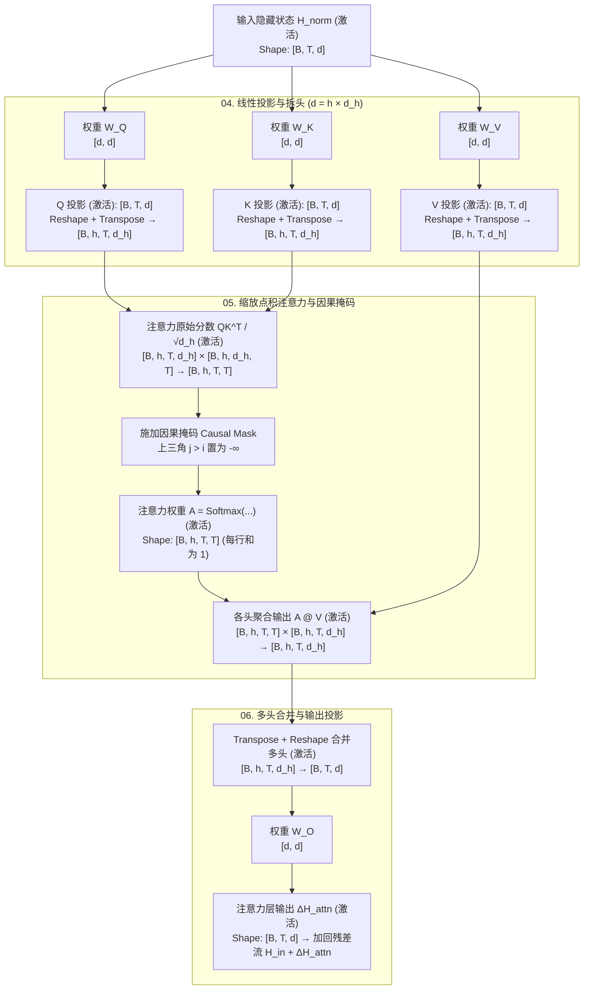

# 第零篇｜一次大语言模型推理的完整旅程：从输入文本到下一个 Token（写作规格书）

> **系列定位**：全套 LLM 底层系列的“总览篇（Episode 0）”。
> **后续分工红线**：
> - **第零篇（本篇）**：走通一次完整的前向计算（Forward Pass），锁定**张量形状、矩阵乘法链路、静态权重 vs 动态激活**，让后续概念各就各位。
> - **第 1 篇**：深入 Tokenizer（UTF-8、BPE 算法、词表构造、特殊控制符）。
> - **第 2 篇**：深入 Transformer 内部机制（RoPE 数学推导、GQA 原理、RMSNorm、SwiGLU、残差流几何学）。

---

## 一、 开篇引言与“为什么用 Rust 解剖 LLM？”

> **完整实证调研库参见**：[`research/findings/dr00-rust-in-frontier-ai.md`](../../research/findings/dr00-rust-in-frontier-ai.md)

在进入公式之前，开篇用简短有力的一节回答读者心中的第一个问题：**讲大模型原理的文章绝大多数用 Python / PyTorch，我们为什么要选 Rust？**

### 1. 工业界真相：Python 是 AI 的方向盘，而 Rust 已成为 AI 的底盘与变速箱
- **你以为在跑 Python，底层其实是 Rust**：
  - **分词（Step 01）**：Hugging Face 的 **`tokenizers`** 与 OpenAI 的 **`tiktoken`**，底层核心 100% 是 Rust 编写并通过 PyO3 暴露给 Python 的；
  - **权重加载（Step 02）**：主流开源模型标配的 **`.safetensors`** 格式，其零拷贝内存映射（`mmap`）和边界校验引擎是纯 Rust 写的；
  - **结构化输出与数据校验（Step 10）**：为了在每生成一个 Token 的间歇（`< 50 µs`）内算出 `128k` 词表的语法合法掩码，微软/Guidance 的 **`llguidance`**、**`outlines-core`** 以及校验 JSON 的 **`pydantic-core`** 全部用 Rust 编写。
- **前沿实验室与 AI 应用的系统层正在全面向 Rust 收敛**：
  - **OpenAI**：支撑超 10 亿用户的核心存储平台 **`Habitat`** 从 Python 重写为 Rust；官方终端编程 Agent **Codex CLI (`openai/codex`)** 核心全面重写为 **`codex-rs`**（零 Node 依赖、单二进制、原生接入 macOS `seatbelt` / Linux `Landlock` 沙箱），并成为 Rust 基金会白金赞助商。
  - **xAI (Grok) & DeepSeek**：xAI 开源的终端 Agent 与运行时工作区 **`grok-build`** 及万卡集群训练编排组件大量采用 Rust；DeepSeek 开源的 **`3FS`（Fire-Flyer File System）** 高性能分布式文件系统中，直接管理物理磁盘块与 `io_uring` 异步 I/O 的核心 **Chunk Engine** 用 Rust 编写以保障内存安全。
  - **NVIDIA & 推理网关**：英伟达开源的数据中心分布式推理调度框架 **NVIDIA Dynamo**、SGLang 的前缀树 KV Cache 路由器 **`sgl-router`**、Hugging Face **TGI** 网关，以及纯 Rust 推理框架 **`candle`** / **`mistral.rs`** 全是 Rust。
  - **AI 原生 IDE 与检索底座**：**Zed** 从零用 Rust 打造了 120 FPS 的 GPU 加速编辑器与 **GPUI**；支撑 **Cursor** 万亿级代码库语义检索的向量数据库 **`Turbopuffer`**、多模态训练数据湖 **`LanceDB`** 与 **`Qdrant`** 全部构建于 Rust 之上。

### 2. 教学与白盒追踪视角：撕掉胶水层，拒绝“隐式魔法”
- Python / PyTorch 为训练便利设计了大量隐式广播（Implicit Broadcasting）、动态图包装和黑盒算子，初学者常写出 `out = model(input_ids)` 却不知道中间发生了 300 次怎样的矩阵变形。
- 既然从分词（`tokenizers`）到加载权重（`safetensors`）本来就是 Rust 在干活，我们直接撕掉中间那层 Python 胶水，用 200 行干净的 Rust（`candle-core` + `safetensors`）做白盒追踪：
  1. **静态权重与动态激活的生命周期泾渭分明**：磁盘上的 `safetensors` 通过 `mmap` 映射为不可变的只读张量视图，而前向计算的每一步激活都显式分配与释放。
  2. **每一次维度变换都无法偷懒**：从 `[B, T, d]` 拆头到 `[B, h, T, d_h]`、转置后内存是否连续（`.contiguous()`）、二维权重如何广播乘上三维输入，在 Rust 类型系统和显式 API 下无所遁形。

---

## 二、 核心符号与两类矩阵约定（贯穿全文的坐标系）

在进入任何公式前，先向读者立下两条铁律：

### 1. 维度符号表
| 符号 | 含义 | 教学玩具手算值 | 真实模型案例（以 SmolLM2-135M 为例） | 真实模型案例（以 Qwen2.5-0.5B 为例） |
|---|---|---|---|---|
| $B$ | 批大小（Batch Size，同时处理的独立序列数） | $1$ | $1$ | $1$ |
| $T$ | 当前输入序列长度（Sequence Length / Tokens） | $3$ | $5$（Prefill）$\to 1$（Decode） | $5$（Prefill）$\to 1$（Decode） |
| $d$ | 隐藏层维度（Hidden Size / Model Dimension） | $4$ | $576$ | $896$ |
| $h$（或 $h_q$） | 注意力查询头数（Num Query Heads） | $2$ | $9$ | $14$ |
| $h_{kv}$ | 注意力键值头数（Num KV Heads，标准 MHA 中 $h_{kv}=h$） | $2$ | $3$（GQA，每 3 个 Q 共享 1 组 KV） | $2$（GQA，每 7 个 Q 共享 1 组 KV） |
| $d_h$ | 单个注意力头的维度（Head Dimension，满足 $d = h \cdot d_h$） | $2$ | $64$（$9 \times 64 = 576$） | $64$（$14 \times 64 = 896$） |
| $d_{ff}$ | MLP 中间升维维度（Intermediate Size） | $8$ | $1536$ | $4864$ |
| $V$ | 词表大小（Vocabulary Size） | $6$ | $49152$ | $151936$ |
| $L$ | Transformer 层数（Num Hidden Layers） | $2$ | $30$ | $24$ |

### 2. 两类张量的严格区分
Throughout the entire journey, every tensor falls into one of two categories:
- **参数矩阵（Parameter Matrices / Weights，记作 $\mathbf{W}$）**：
  - 在训练阶段习得并固化在磁盘权重文件（如 `model.safetensors`）中；在普通推理过程中**只读、不更新**。
  - **关键识别特征**：它们的形状由模型超参数 $(V, d, h, d_h, d_{ff})$ 决定，**绝不包含批大小 $B$ 和序列长度 $T$**。不管你输入 3 个词还是 3000 个词，参数矩阵的形状纹丝不动。
- **中间激活（Intermediate Activations，记作 $\mathbf{X}, \mathbf{H}, \mathbf{Q}, \mathbf{K}, \mathbf{V}, \mathbf{P}, \text{logits}$）**：
  - 随着本次用户的具体输入动态算出来、用完即弃（KV Cache 除外）的临时张量。
  - **关键识别特征**：它们的形状**必定带有 $B$ 和 $T$**，数值随本次输入文本改变。

---

## 三、 11 阶段正文展开主线（全景路标）

正文严格沿着一次真实前向传播的 11 个站点顺序推进：

| 阶段 | 主要形状变化 | 参与的静态参数矩阵 | 产生的动态中间激活 | 这一节回答什么核心问题 |
|---|---|---|---|---|
| **01. 输入组织与分词** | 文本 $\to [B, T]$ (整数 ID) | 词表映射规则（`tokenizer.json`） | `input_ids`: $[B, T]$ | 聊天消息如何加上角色模板并变成模型实际读取的整数序列？（点到为止，BPE 细节留第 1 篇） |
| **02. Embedding 查表** | $[B, T] \to [B, T, d]$ | $\mathbf{W}_E \in \mathbb{R}^{V \times d}$ | $\mathbf{H}^{(0)} \in \mathbb{R}^{[B, T, d]}$ | 离散的 Token ID 如何通过按行查表变成连续向量？为什么查表等价于 One-Hot 乘矩阵？ |
| **03. 位置处理** | 保持 $[B, T, d]$ 或在 $[B, h, T, d_h]$ 上变换 | 经典：$\mathbf{W}_{\text{pos}} \in \mathbb{R}^{T_{\max} \times d}$ 现代：预计算 $\cos/\sin$ 频率表 | 注入位置后的状态或旋转后的 $\mathbf{Q}, \mathbf{K}$ | 矩阵乘法本身对顺序不敏感，模型如何区分“猫追狗”和“狗追猫”？（说明经典加性位置编码与现代 RoPE 注入时机差异） |
| **04. 注意力投影与拆头** | $[B, T, d] \to [B, h, T, d_h]$ | $\mathbf{W}_Q, \mathbf{W}_K, \mathbf{W}_V \in \mathbb{R}^{d \times d}$（GQA 下 $\mathbf{W}_K, \mathbf{W}_V$ 为 $d \times (h_{kv}d_h)$） | $\mathbf{Q}, \mathbf{K}, \mathbf{V} \in \mathbb{R}^{[B, h, T, d_h]}$ | 同一份隐藏状态如何通过三个独立权重矩阵投影出“找什么（Q）”、“有什么标签（K）”、“实际内容是什么（V）”并拆成多个子空间？ |
| **05. 注意力分数与因果掩码** | $\mathbf{Q}\mathbf{K}^\top \to [B, h, T, T]$ 乘 $\mathbf{V} \to [B, h, T, d_h]$ | 无可训练权重（仅有固定常数 $1/\sqrt{d_h}$ 与上三角 $-\infty$ 掩码） | 注意力分数 $\mathbf{S}: [B,h,T,T]$ 注意力权重 $\mathbf{A}: [B,h,T,T]$ 单头输出 $\mathbf{O}_h: [B,h,T,d_h]$ | 第 $t$ 个位置如何只看 $\le t$ 的历史位置、不偷看未来？矩阵维度 $T \times T$ 是怎么消掉中间的 $d_h$ 又乘回 $d_h$ 的？ |
| **06. 多头合并与输出投影** | $[B, h, T, d_h] \to [B, T, d] \to [B, T, d]$ | $\mathbf{W}_O \in \mathbb{R}^{d \times d}$ | $\mathbf{O}_{\text{concat}}: [B, T, d]$ $\Delta \mathbf{H}_{\text{attn}}: [B, T, d]$ | 各自独立计算的 $h$ 个注意力头如何拼回完整宽度，并通过 $\mathbf{W}_O$ 融合后加回残差流？ |
| **07. 归一化、残差与 MLP** | $[B, T, d] \to [B, T, d_{ff}] \to [B, T, d]$ | Norm 缩放向量 $\boldsymbol{\gamma} \in \mathbb{R}^{d}$ MLP 权重 $\mathbf{W}_{\text{up}} \in \mathbb{R}^{d \times d_{ff}}, \mathbf{W}_{\text{down}} \in \mathbb{R}^{d_{ff} \times d}$（或 SwiGLU 三矩阵） | 归一化状态、升维激活 $\mathbf{M} \in \mathbb{R}^{[B, T, d_{ff}]}$、本层最终输出 $\mathbf{H}^{(1)} \in \mathbb{R}^{[B, T, d]}$ | 为什么进出这一步形状还是 $[B, T, d]$？Attention 负责“跨位置搬运信息”，MLP 负责“每个位置内部非线性加工”。 |
| **08. 重复 Transformer 层** | $\mathbf{H}^{(0)} \to \mathbf{H}^{(1)} \to \dots \to \mathbf{H}^{(L)}$，始终 $[B, T, d]$ | 第 $0$ 到 $L-1$ 层各自独立的权重矩阵集合 | 每一层刷新后的残差流状态 $\mathbf{H}^{(\ell)}: [B, T, d]$ | 为什么 30 层 Transformer 可以像乐高一样直接串联？正因为每层严格遵守 $[B, T, d] \to [B, T, d]$ 的接口契约。 |
| **09. 输出投影（LM Head）** | $[B, T, d] \to [B, T, V]$ | $\mathbf{W}_{\text{head}} \in \mathbb{R}^{d \times V}$（常与 $\mathbf{W}_E^\top$ 共享） | $\text{logits}_{\text{all}} \in \mathbb{R}^{[B, T, V]}$ | 隐藏向量如何变回词表里成千上万个候选 Token 的未归一化打分（Logits）？ |
| **10. 选择下一个 Token** | $[B, T, V] \xrightarrow{\text{取 } t=T-1} [B, V] \to [B, 1]$ | 无参数矩阵 | $\text{logits}_{\text{last}}: [B, V]$ 概率分布 $\mathbf{p}: [B, V]$ `next_token_id`: $[B, 1]$ | 既然算出了全部 $T$ 个位置的分数，为什么预测下一个词只取最后一个位置 $[-1]$ 的切片？ |
| **11. 自回归继续生成与 KV Cache** | 输入 $[B, T+1]$（无缓存）vs 输入 $[B, 1]$ + 缓存 $[B, h_{kv}, T, d_h]$ | 同一套全模型权重再次复用 | 新增 1 步的 $\mathbf{q}, \mathbf{k}, \mathbf{v}$，注意力矩阵变为 $[B, h, 1, T+1]$ | 为什么大模型是一个词一个词蹦出来的？Prefill 与 Decode 有何区别？KV Cache 到底存了哪两个张量？ |

---

## 四、 注意力机制专属维度流图（Mermaid 设计稿）

文章中在讲第 04～06 阶段时，插入这张显式标出所有维度变换与权重/激活区分的流程图：

---

## 五、 配套示例 1：玩具维度手算（纸笔可完全复现的精确数值设计）

为了让读者真正用纸笔跟算一次，我们专门设计一套**全部由小整数与 $0.5$ 构成、矩阵乘法心算即可完成**的极简玩具参数：

- **超参数设定**：
  - 批大小 $B = 1$（为书写清爽，手算展示时先写出省略 $B$ 的二维切片，同时在旁边标注带 $B$ 的三维形状 $[1, \dots]$）
  - 输入序列长度 $T = 3$，假设输入 3 个 Token：`["我", "爱", "Rust"]`，对应 Token ID 为 `[1, 3, 4]`
  - 词表大小 $V = 6$（ID `0..5`）
  - 隐藏维度 $d = 4$，注意力头数 $h = 2$，每头维度 $d_h = 2$（满足 $d = h \cdot d_h = 2 \times 2 = 4$）
- **手算演练步骤设计**：
  1. **给定 $\mathbf{W}_E \in \mathbb{R}^{6 \times 4}$**，直接抽出第 `1, 3, 4` 行，拼成 $\mathbf{X} \in \mathbb{R}^{1 \times 3 \times 4}$：
     $$
     \mathbf{X}_{[3 \times 4]} = \begin{bmatrix}
     1 & 0 & 1 & 0 \\
     0 & 2 & 0 & 1 \\
     1 & 1 & 0 & 2
     \end{bmatrix}
     $$
  2. **给定极简整数投影矩阵 $\mathbf{W}_Q, \mathbf{W}_K, \mathbf{W}_V \in \mathbb{R}^{4 \times 4}$**，算出 $\mathbf{Q}, \mathbf{K}, \mathbf{V} \in \mathbb{R}^{1 \times 3 \times 4}$，并按列劈成两半（Head 0 取前 2 列，Head 1 取后 2 列），得到 $\mathbf{Q}^{(0)}, \mathbf{K}^{(0)}, \mathbf{V}^{(0)} \in \mathbb{R}^{3 \times 2}$。
  3. **手算 Head 0 的 $\mathbf{Q}^{(0)} (\mathbf{K}^{(0)})^\top$**（$[3, 2] \times [2, 3] = [3, 3]$），除以 $\sqrt{2}$（或为方便手算设定缩放后数值），然后把右上角 3 个未来位置 $(0,1), (0,2), (1,2)$ 盖成 $-\infty$：
     $$
     \mathbf{S}_{\text{masked}}^{(0)} = \begin{bmatrix}
     s_{00} & -\infty & -\infty \\
     s_{10} & s_{11} & -\infty \\
     s_{20} & s_{21} & s_{22}
     \end{bmatrix}
     $$
  4. **展示每一行做 Softmax 后的必然规律**：
     - 第 0 行（Token `"我"`）：只能看自己，注意力权重必然是 $[1, 0, 0]$！它的输出就是 $1.0 \times \mathbf{v}_0$。
     - 第 1 行（Token `"爱"`）：只能看位置 0 和 1，权重如 $[0.4, 0.6, 0]$，输出是 $0.4\mathbf{v}_0 + 0.6\mathbf{v}_1$。
     - 第 2 行（Token `"Rust"`）：能看位置 0、1、2，权重如 $[0.2, 0.3, 0.5]$，输出是三者的加权平均。
  5. **用 Rust `--mode toy` 一键验算**：读者在终端运行 `cargo run -- --mode toy`，打印出的矩阵每一格数字与手算分毫不差。

---

## 六、 配套示例 2：具体开源模型的 Rust 形状追踪与架构差异说明

在手算建立直觉后，立刻切换到真实开源模型（由 DR-01 最终拍板，推荐 `SmolLM2-135M-Instruct` 或 `Qwen2.5-0.5B-Instruct`），用一张对照表讲清楚**为什么真实模型的形状与教学玩具略有不同，但主干完全一致**：

1. **GQA（分组查询注意力）对 $\mathbf{K}, \mathbf{V}$ 形状的压缩**：
   - 教学模型：$\mathbf{Q}, \mathbf{K}, \mathbf{V}$ 都是 $[B, h, T, d_h]$。
   - 真实模型（如 $h_q=9, h_{kv}=3$）：$\mathbf{Q}$ 是 $[1, 9, T, 64]$，而 $\mathbf{K}, \mathbf{V}$ 刚投影出来时只有 $[1, 3, T, 64]$；在算 $\mathbf{Q}\mathbf{K}^\top$ 前，每组 $\mathbf{K}, \mathbf{V}$ 广播复用 3 次对齐到 $[1, 9, T, 64]$。
2. **RoPE（旋转位置编码）的注入位置**：
   - 不在 Embedding 后加，而是在第 04 步拆出 $\mathbf{Q}, \mathbf{K}: [B, h, T, d_h]$ 后，原地对每对维度做复数旋转，**输入输出形状完全不变**。
3. **Pre-RMSNorm 与 SwiGLU 门控 MLP**：
   - 进 Attention 和进 MLP 之前先做 RMSNorm（形状不变：$[B, T, d] \to [B, T, d]$）。
   - MLP 内部由两条并联升维支路（`gate_proj` 与 `up_proj`：$[B, T, d] \to [B, T, d_{ff}]$）逐元素相乘后，经 `down_proj` 降回 $[B, T, d]$。

---

## 七、 Prefill vs Decode 与 KV Cache 直觉建立

在文章倒数第二节，用 Rust 探针连续跑两步（Step 0 Prefill 输入 5 个 Token，Step 1 Decode 输入刚生成的第 6 个 Token），直观对比形状：

| 对比维度 | Step 0：Prefill（预填充阶段） | Step 1：Decode（自回归解码阶段，开启 KV Cache） |
|---|---|---|
| **本次输入 Token 数** | $T = 5$（整句 Prompt 一次性喂入） | $T_{\text{cur}} = 1$（只喂入刚生成的最新 1 个 Token） |
| **隐藏状态 $\mathbf{H}$ 形状** | $[1, 5, d]$ | $[1, 1, d]$ |
| **本次新算出的 $\mathbf{Q}_{\text{new}}$** | $[1, h_q, 5, d_h]$ | $[1, h_q, 1, d_h]$ |
| **本次新算出的 $\mathbf{K}_{\text{new}}, \mathbf{V}_{\text{new}}$** | $[1, h_{kv}, 5, d_h]$（存入 KV Cache） | $[1, h_{kv}, 1, d_h]$（追加到 KV Cache 尾部） |
| **KV Cache 拼接后总形状** | $[1, h_{kv}, 5, d_h]$ | $[1, h_{kv}, 6, d_h]$（历史 5 个 + 新增 1 个） |
| **注意力分数 $\mathbf{Q}\mathbf{K}^\top$ 形状** | **$[1, h_q, 5, 5]$（二维方阵，带上三角掩码）** | **$[1, h_q, 1, 6]$（单行向量，看全部 6 个位置，无需掩码）** |

> **一句话点透 KV Cache**：因为因果掩码的存在，前 5 个 Token 的 $\mathbf{K}$ 和 $\mathbf{V}$ 在第 6 个 Token 到来时**一个数字都不会变**；为了算第 6 个位置的注意力，我们只需要第 6 个位置的 $\mathbf{q}_6$ 去和全部 6 个位置的 $\mathbf{K}_{1..6}, \mathbf{V}_{1..6}$ 做点积。所以把算过的每一层 $\mathbf{K}, \mathbf{V}$ 存下来，后续每一步就只需输入 $[B, 1]$！
